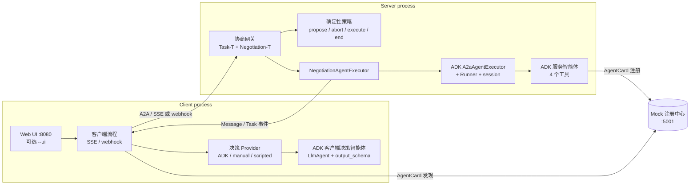

# RAN 节能样例（A2A + A2A-T + ADK）

一个可运行的智能体协作参考实现：客户端智能体与 RAN（Radio Access Network，无线接入网）域服务端智能体通过 A2A-T 的 `Negotiation-T` 达成节能任务，再通过标准 A2A Task 和 Google ADK（Agent Development Kit）执行任务。

本样例面向两类读者：**客户端智能体**开发团队与**服务端智能体**开发团队。当组件只属于一侧时，本文直接写明责任方，不使用未区分的“你”。

**术语表**

| 术语 | 含义 |
| --- | --- |
| A2A | Agent2Agent 协议：在智能体之间传输消息与 Task。 |
| A2A-T | 本样例使用的 A2A-T SDK 扩展：`Task-T`（结构化任务提示词）与 `Negotiation-T`（任务创建前的协商消息）。 |
| ADK | Google Agent Development Kit：本样例用它构建两侧的 `LlmAgent`、工具、`Runner` 与会话。 |
| RAN | Radio Access Network，无线接入网：本样例中的小区及其负载/能耗行为。 |
| SLA | Service Level Agreement，服务等级协议：小区必须保障的吞吐下限。 |
| OSS / BSS | 运营支撑系统 / 业务支撑系统：生产环境的集成目标，不属于本样例。 |
| OCS | Online Charging System，在线计费系统：生产环境的计费集成目标，不属于本样例。 |

## 1. 样例解决什么问题

客户端请求 RAN 节能，例如“在满足分时段保障速率目标的前提下最大化节能”。该请求经常无法按原样执行：

- 缺少必需参数（哪个分时段保障速率目标？）；
- 目标存在歧义（两个吞吐时段重叠）；
- 在当前条件下不可行（长时间停电期间仍要求保障速率）。

服务端不会立即拒绝，而是开启 **Negotiation-T** 会话。双方在**任何 Task 创建之前**交换独立的 A2A `Message`：`Propose`、`Accept`、`Reject`、`Abort`。客户端接受后，协商确定的 `Task-T` 提示词被交给 ADK 服务端智能体，由它创建 Task 并执行四个确定性工具：读取小区画像、评估方案、下发方案、生成报告。

样例演示了：

- 真实 A2A HTTP+JSON 链路上的四类 A2A-T performative；
- 真正的多轮协商（`maxRounds = 3`），包含反提议；
- 客户端 ADK `LlmAgent` 使用工具与结构化 `output_schema`，服务端 ADK `LlmAgent` 使用工具；
- 任务前协商网关与 ADK `A2aAgentExecutor` 之间的显式集成缝；
- 确定性离线运行（脚本化 SDK LLM + ADK fake model）与面向 OpenAI-compatible 端点的在线模式；
- CLI 与轻量 Web UI。

## 2. 架构与目录



所有协商都发生在**Task 创建之前**：`Propose` / `Accept` / `Reject` / `Abort` 都是独立的 `Message`，不是 Task 事件。只有协商被接受后才会创建 Task，并由内层 ADK `A2aAgentExecutor` 推进到 `COMPLETED`。

### 目录说明

| 路径 | 职责 |
| --- | --- |
| [`run_demo.py`](run_demo.py) | 三进程启动器：后台启动注册中心与服务端，前台运行 CLI 客户端（`--ui` 时改为 Web UI），结束后停止子进程。 |
| [`env.example`](env.example) | 统一的、可直接离线运行的配置模板。 |
| [`agents/server_agent/`](agents/server_agent) | 服务端 ADK 智能体：`agent.py` 导出 `root_agent`；`tools.py` 为四个工具；`prompts/service_instruction.md` 为 instruction。 |
| [`agents/client_agent/`](agents/client_agent) | 客户端 ADK 决策智能体：`agent.py` 导出 `root_agent`；`tools.py` 为 SLA 与影响评估工具；`prompts/request_instruction.md` 为 instruction。 |
| [`protocol/negotiation_gate.py`](protocol/negotiation_gate.py) | 服务端唯一协议入口：识别任务前请求、校验 Task-T / Negotiation-T 消息，并转发被接受的请求。 |
| [`protocol/negotiation_policy.py`](protocol/negotiation_policy.py) | 纯确定性服务端策略：`propose`、`abort`、`execute`、`end`，不调用 LLM。 |
| [`protocol/server_executor.py`](protocol/server_executor.py) | 包裹 ADK `A2aAgentExecutor` 的外层 `AgentExecutor`，以及自定义 request converter 与 artifact interceptor。 |
| [`protocol/server_app.py`](protocol/server_app.py) | 服务端装配：AgentCard（声明 `Task-T/v1` 与 `Negotiation-T/v1`）、请求处理器、Starlette 应用、注册中心注册。 |
| [`protocol/client_flow.py`](protocol/client_flow.py) | 客户端协议流程：初始 Task-T、多轮协商、accept 重填、SSE/webhook 终态处理。 |
| [`protocol/client_runtime.py`](protocol/client_runtime.py) | 客户端装配：每次运行的 SDK `.env`、服务发现、SDK 客户端、传输、决策 Provider。 |
| [`protocol/decision_provider.py`](protocol/decision_provider.py) | 决策 Provider 协议及 ADK、manual、scripted 三种实现。 |
| [`protocol/discovery.py`](protocol/discovery.py) | 通过注册中心或 `/.well-known/agent-card.json` 发现 AgentCard。 |
| [`protocol/messages.py`](protocol/messages.py) | A2A-T 元数据助手：扩展 URI、`templateUri`、`negotiationContext`、结束消息、样例专用元数据。 |
| [`protocol/transcript.py`](protocol/transcript.py) | 结构化运行记录，写入 `runs/<timestamp>-<scenario>.json` 与 `.md`。 |
| [`shared/config.py`](shared/config.py) | 读取 `.env` 并构建 ADK 模型（离线 fake model，在线 `LiteLlm`）。 |
| [`shared/agent_card.py`](shared/agent_card.py) | 客户端（服务发现）与服务端（构建 AgentCard）共享的身份常量。 |
| [`shared/sdk_env.py`](shared/sdk_env.py) | 两个运行时共用的每次运行 SDK `.env` 构建器（消除 client↔server 导入）。 |
| [`shared/models.py`](shared/models.py) | `NegotiationDecision`（客户端 `output_schema`）与 Provider 视角的提议视图。 |
| [`shared/scenario.py`](shared/scenario.py) | 五个场景定义：请求、期望 performative/round 序列、终态、离线决策。 |
| [`shared/task_schema.py`](shared/task_schema.py) | 服务端校验与客户端 accept 重填共用的调用方参数 schema。 |
| [`shared/ran_data.py`](shared/ran_data.py) + [`resources/ran_data/cells.json`](resources/ran_data/cells.json) | 进程内 RAN 数据集、方案评估与进程内方案存储。 |
| [`shared/scripted_llm.py`](shared/scripted_llm.py) + [`resources/mock_llm/`](resources/mock_llm) | 通过官方工厂注册的脚本化 SDK `LLMClient`；按 schema 路由的预置响应。 |
| [`shared/adk_fake_model.py`](shared/adk_fake_model.py) | 离线与测试使用的确定性 ADK `BaseLlm`。 |
| [`shared/registry_client.py`](shared/registry_client.py) | 注册中心注册/查询 HTTP 调用。 |
| [`shared/webhook_receiver.py`](shared/webhook_receiver.py) | 内置 webhook 推送接收器，校验 token。 |
| [`shared/sse_event_consumer.py`](shared/sse_event_consumer.py) | 将 A2A 流事件归一化为统一事件结构。 |
| [`registry/`](registry) | Mock 注册中心（AgentCard 注册/查询，端口 5001）。 |
| [`web/`](web) | Starlette Web UI（`app.py`）与单页前端（`static/index.html`）。 |
| [`tests/`](tests) | 单元、集成、传输、Web UI 与五场景离线验收测试；`tests/js/` 为 pytest 驱动的 Node harness。 |

## 3. 快速开始

前置条件：Python 3.12+ 与 [`uv`](https://docs.astral.sh/uv/)。从全新检出开始时，先在仓库根目录安装 A2A-T SDK 及其开发依赖，再把样例依赖安装到同一个 `.venv`：

```bash
# 1. 仓库根目录：把 SDK 与开发依赖安装到 .venv
uv sync --dev

# 2. a2a-t-sample：把样例依赖安装到同一个 .venv
cd a2a-t-sample
uv pip install -r requirements.txt
```

`uv sync` 会精确同步 SDK 环境，因此之后每次执行 `uv sync --dev` 都需要重新执行第 2 步。

运行任何样例命令前先激活该环境（按你的 shell 选择）：

```bash
source ../.venv/Scripts/activate        # Git Bash / Windows（在 a2a-t-sample/ 下）
# source ../.venv/bin/activate          # Linux / macOS
# ../.venv/Scripts/Activate.ps1         # Windows PowerShell
```

下文所有 `python` 都指这个已激活的解释器。

`run_demo.py` 会回退到 `env.example`，因此**离线运行不需要 `.env` 文件，也不需要 API key**。如需自定义，复制模板：

```bash
cp env.example .env              # 共享样例配置
# 或：cp ran-energy-saving/env.example ran-energy-saving/.env
```

### 离线 CLI（无需 key，确定性）

```bash
cd ran-energy-saving
python run_demo.py --scenario information --mode auto --model-mode offline
python run_demo.py --scenario target --mode auto --model-mode offline
```

若跳过激活，请把 `python` 替换为 `../../.venv/Scripts/python.exe`（Windows）或 `../../.venv/bin/python`（Linux/macOS）。

`information` 的预期输出（已节选：工具调用 artifact 的明细行、id 与路径省略）：

```text
[run_demo] starting registry on 5001 ...
[run_demo] starting server on 8000 ...
[run_demo] running client (scenario=information, mode=auto, transport=sse, discovery=registry, language=en-US, model_mode=offline) ...
[client] agent-discovered: url=http://127.0.0.1:8000 discovery=registry
[client] event kind=propose performative=PROPOSE summary=## Information Negotiation Please supplement ...
[client] sse-received events=1
[client] decision-requested round=1
[client] event kind=status performative=status summary=TASK_STATE_SUBMITTED
[client] event kind=status performative=status summary=TASK_STATE_WORKING
[client] event kind=artifact performative=artifact summary=<id>: {"args": {"cell_id": "cell-001", "date": "<date>"}, "id": "<id>", "name": "get_cell_energy_profile"}
...  # 其余 7 条工具调用 artifact；id 与内容省略
[client] event kind=artifact performative=artifact summary=RAN energy-saving task completed.
[client] event kind=status performative=status summary=TASK_STATE_COMPLETED
[client] sse-received events=12
[client] final_state=task_completed task_id=<uuid>
[client] report={"artifact_id": "<uuid>", "name": "energy saving intent report", "text": "RAN energy-saving task completed."}
[client] transcript: .../runs/<timestamp>-information.json
[client] transcript: .../runs/<timestamp>-information.md
[run_demo] stopped 2 background process(es)
```

`target` 的预期输出（两轮；客户端在第 1 轮反提议，在第 2 轮接受；已节选：工具调用
artifact 的明细行、id 与路径省略）：

```text
[run_demo] starting registry on 5001 ...
[run_demo] starting server on 8000 ...
[run_demo] running client (scenario=target, mode=auto, transport=sse, discovery=registry, language=en-US, model_mode=offline) ...
[client] agent-discovered: url=http://127.0.0.1:8000 discovery=registry
[client] event kind=propose performative=PROPOSE summary=## Target Negotiation Target negotiation for the RAN energy saving task: the guaranteed throughput target has two overlapping time segments, {17:30~23:00,20M...
[client] sse-received events=1
[client] decision-requested round=1
[client] event kind=propose performative=PROPOSE summary=## Target Negotiation Revised proposal for round 2: cell cell-001, window 00:00~06:00, target rate 30%. Please accept this revised plan. ## Target Clarificat...
[client] sse-received events=1
[client] decision-requested round=2
[client] event kind=status performative=status summary=TASK_STATE_SUBMITTED
[client] event kind=status performative=status summary=TASK_STATE_WORKING
...  # 8 条工具调用 artifact；id 与内容省略
[client] event kind=artifact performative=artifact summary=RAN energy-saving task completed.
[client] event kind=status performative=status summary=TASK_STATE_COMPLETED
[client] sse-received events=12
[client] final_state=task_completed task_id=<uuid>
[client] report={"artifact_id": "<uuid>", "name": "energy saving intent report", "text": "RAN energy-saving task completed."}
[client] transcript: .../runs/<timestamp>-target.json
[client] transcript: .../runs/<timestamp>-target.md
[run_demo] stopped 2 background process(es)
```

两条 `propose` 分别是服务端第 1 轮提议与第 2 轮修订提议；第二条渲染的是修订后的方案
（小区、时间窗与目标速率），不再是第 1 轮的重复内容。客户端自己的反提议不会出现在它收到的事件日志中；完整双向序列见运行记录（§9）。

### 在线 CLI（OpenAI-compatible 端点）

```bash
python run_demo.py --scenario target --mode auto --model-mode live
```

在线模式下，两个 ADK 智能体使用 `ADK_MODEL_*`，A2A-T SDK 使用 `A2AT_LLM_*`，两者必须指向同一个 OpenAI-compatible 端点；`env.example` 默认使用本地代理 `http://127.0.0.1:31943/v1`。该命令可以端到端运行，但协商序列**依赖模型**：SDK 基于 LLM 的抽取与语义校验决定服务端最终收到什么。离线模式才是测试与 §4 使用的可复现基准；在线运行应视为集成 smoke，而不是验收测试。

**在线模式为尽力而为。** 在 `information` 场景中，服务端语义校验与客户端决策智能体均由模型驱动：使用 flash 模型时，服务端可能接受不完整的提示词（从而不触发协商），或客户端返回无法解析的决策。离线模式是确定性的，也是验收路径。

### Web UI

```bash
python run_demo.py --ui --ui-port 8080 --scenario information --model-mode offline
```

打开 <http://127.0.0.1:8080>。页面可选择场景、`auto`/`manual` 模式与 SSE/webhook；展示实时时间线、最终报告，并提供 JSON/Markdown 运行记录下载。语言与模型模式是进程级、只读的（见 `GET /api/meta`）。

```bash
curl http://127.0.0.1:8080/api/meta
{"language":"en-US","modelMode":"offline","modelLabel":"offline (scripted)","scenarios":["information","target","feasibility","reject","abort"],"modes":["auto","manual"],"transports":["sse","webhook"],"discoveries":["registry","direct"],"defaultScenario":"information","defaultMode":"auto","defaultTransport":"sse","defaultDiscovery":"registry","finishedGraceMs":2000}
```

### Run Explorer（运行探索器）

`--ui` 页面是运行探索器，而不只是结果页：它从浏览器发起运行，展示从下发到报告的完整链路，并包含客户端与服务端两个进程的 LLM 请求/响应。离线模式是确定性基准，在线模式为尽力而为。

```bash
# 离线（无需 key，确定性）
python run_demo.py --ui --scenario information --mode auto --model-mode offline
# 打开 http://127.0.0.1:8080

# 在线（尽力而为；SDK 与 ADK 都使用配置的 OpenAI-compatible 端点）
python run_demo.py --ui --scenario information --mode auto --model-mode live
```

在左侧栏选择场景与 `auto`/`manual` 模式，然后点击 **Start run**。上下文条与 `GET /api/meta` 展示只读的进程级语言与模型模式。

#### 八个阶段

| # | 阶段 | 展示内容 |
| ---: | --- | --- |
| 1 | Dispatch（下发） | 运行被接受、客户端运行时构建、discovery 与 transport 就绪、期望序列。 |
| 2 | Task-T generation（Task-T 生成） | 客户端 SDK 槽位抽取、内容校验、渲染后的 Task-T 提示词。 |
| 3 | Task validation（Task 校验） | 首次 A2A 发送、服务端网关校验、开启协商或直接接受任务。 |
| 4 | Negotiation（协商） | 每轮：服务端 propose、决策请求、决策、响应、服务端校验。 |
| 5 | Resolution（终态） | Accepted/Rejected/Aborted/Ended、重填的 Task-T 与达成参数。 |
| 6 | Execution（执行） | ADK 轮次、工具调用、中间 artifact 与 `WORKING` 状态。 |
| 7 | Report（报告） | 报告 artifact 载荷与 `COMPLETED`。 |
| 8 | Done（结束） | 最终状态、运行记录与摘要。 |

每个事件行带有全局编号、actor（client/server/LLM/tool/human/system）、标题、耗时、token、轮次与状态。LLM 与 tool span 嵌套在触发它的协议步骤下。决策在 provider 返回时立即记录，因此出现在它所导致的任务事件**之前**。协商阶段显示 `R1 ✓ R2 ◐` 轮次标签；Resolution 显示 `Accepted`、`Rejected`、`Aborted` 或 `Ended`。时间线可在 **Story**（阶段卡片）与 **Waterfall**（扁平耗时条）间切换，并支持 All/Protocol/LLM/Tools/Errors、actor、轮次与全文搜索过滤。

#### 检查器（Inspector）

选中一行后打开检查器，包含以下标签页（不适用的标签页会禁用）：

- **Summary**：一句话说明、关键事实、前后因果与关联决策。
- **Protocol**：方向、message/task/context id、模板 URI、协商上下文、Task-T/Negotiation-T 文本与原始 parts。
- **LLM request**：阶段、目的、system instruction、messages、JSON schema、tools 与生成参数。
- **LLM response**：状态、耗时、token、原始与解析结果、function calls、解析错误与重试。
- **Tool call**：工具名、参数、结果、耗时与错误。
- **Raw JSON**：完整 span envelope；复制/下载始终导出完整载荷。

离线 LLM 调用不报告 token 用量，UI 显示 `n/a (scripted)`，而不是虚构的 `0`。

#### Trace、隐私与限制

`run_demo.py --ui` 会生成本次运行的本地 token，并把服务端指向 UI（`A2AT_SAMPLE_TRACE_URL=http://127.0.0.1:<ui_port>`、`A2AT_SAMPLE_TRACE_TOKEN=<random>`）；服务端把 span POST 到 `POST /api/runs/{runId}/trace`，UI 校验 run id 与 token。该端点只应绑定 localhost：span 中可能包含模型提示词、工具参数与结果。

- 未配置 token 时 ingest 路由默认拒绝（失败关闭），不会接受未认证 span；复用的 keep-alive 服务端必须携带相同 token。
- `Authorization`、`api_key`、`X-API-Key` 会被脱敏，API key 永不记录。
- 每条 LLM 请求/响应载荷上限 256 KB：保留头尾并标记 `truncated`。
- `GET /api/runs/{id}/trace.json` 返回完整 span 列表（`spanId` 唯一、`seq` 单调）与运行记录；`transcript.json` / `transcript.md` 也可下载。
- CLI 运行（不带 `--ui`）把服务端 trace 写入 `runs/<runId>/server-trace.jsonl`，并打印 LLM/tool/token 摘要。

#### `--keep-alive` 与 PID 复用

`--keep-alive` 在客户端退出后保留注册中心与服务端；用 `python run_demo.py --stop` 停止。PID 文件（以 `0600` 写入，因为包含本地 trace token）同时记录这些进程的模型模式、语言、trace token 与 trace URL/UI 端口；后续启动只有在这些都和请求一致时才复用。不一致时（例如 `live` keep-alive 服务端之后启动 `offline` UI，或换了 `--ui-port` 但服务端仍向旧端口发 span），启动器会停止已记录的进程、打印原因并重新启动，避免离线 UI 静默发起 live 模型调用，也避免服务端 span 发到错误进程。端口被监听但没有 PID 记录时，说明进程不属于启动器：启动器拒绝复用并要求先释放端口。

#### 限制

- 每个 UI 实例同时只允许一个运行；trace 与运行状态保存在内存中，UI 重启即丢失。
- 重新加载 `#run=<id>` 会重放已记录的流，但无法恢复随进程丢失的运行。
- 在线输出依赖模型的抽取/校验结果；验收请使用离线模式。
- 服务端 trace 投递是尽力而为：服务端按批发送（0.5 秒刷新间隔），UI 在 `finished` 后保留一段
  宽限窗口（`GET /api/meta` 的 `finishedGraceMs`，默认 2 秒）以接收最后一批 span。若仍有批次
  晚到，客户端在 finalize 时合并 `GET /api/runs/{id}/trace.json`；从未到达 UI 的批次不会出现在
  时间线中（transcript 与 trace 文件仍是事实来源）。
- 只有 Provider 返回了用量时才显示 LLM token；在线调用缺失用量显示 `n/a`，离线（scripted）运行
  显示 `n/a (scripted)`。

### 人工决策模式

```bash
python run_demo.py --ui --mode manual --scenario target --ui-port 8080
```

`--mode manual` 必须配合 `--ui`（决策表单位于 Web UI）。服务端每次 `Propose` 后，客户端流程等待通过 `POST /api/runs/{id}/decisions` 提交的决策；默认超时 300 秒，超时后转为 `Abort` 决策。

## 4. 五个场景

所有序列都由服务端发起。`S` = 服务端，`C` = 客户端；括号内为 round。期望序列由 `tests/test_scenarios.py` 与 `tests/test_client_flow.py` 断言。

| 场景 | 触发 | 协商序列 | 最终状态 |
| --- | --- | --- | --- |
| `information` | Task-T 请求缺少分时段保障速率目标（`content.param_missing`）。 | `S:Propose(1)` → `C:Accept(1)` | Task `COMPLETED` + 报告（`task_completed`） |
| `target` | 保障吞吐目标的时间段重叠（`content.value_not_allowed`）。 | `S:Propose(1)` → `C:Propose(1)`（反提议） → `S:Propose(2)`（修订） → `C:Accept(2)` | Task `COMPLETED` + 报告（`task_completed`） |
| `feasibility` | 保障速率与 18 小时停电冲突（`content.rule_violation`）。 | `S:Propose(1)`（替代方案） → `C:Accept(1)` | Task `COMPLETED` + 报告（`task_completed`） |
| `reject` | 客户端无法提供缺失的保障速率目标。 | `S:Propose(1)` → `C:Reject(1)` → `S:Message("协商已结束")` | 无 Task（`no_task_negotiation_ended`） |
| `abort` | 客户端反复反提议策略始终无法接受的方案。 | `S:Propose(1)` → `C:Propose(1)` → `S:Propose(2)` → `C:Propose(2)` → `S:Propose(3)` → `C:Propose(3)` → `S:Abort(3)` | 无 Task（`no_task_negotiation_aborted`） |

说明：

- `target` 中客户端反提议保持第 1 轮；只有服务端修订方案进入第 2 轮，客户端 `Accept` 也保持第 2 轮。
- `reject` 与 `abort` 都不创建 Task。`reject` 以一条不含 Negotiation-T 元数据的普通 A2A `Message` 结束；`abort` 使用通用 abort 模板，在 `round = maxRounds = 3` 发出。
- 首个 Task-T 校验错误码到协商类型的映射（`content.param_missing` → information、`content.value_not_allowed` → target、`content.rule_violation` → feasibility）是**样例约定**，不是 A2A-T 契约。实现位于 [`protocol/negotiation_policy.py`](protocol/negotiation_policy.py) 的 `NEGOTIATION_KIND_BY_ERROR_CODE`。

## 5. ADK 智能体开发

### 服务端智能体

[`agents/server_agent/agent.py`](agents/server_agent/agent.py) 导出 `root_agent`，可被 `adk run` / `adk web` 直接加载：

```python
root_agent = LlmAgent(
    name="ran_energy_service_agent",
    model=build_adk_model(),           # 离线 fake model，在线 LiteLlm
    instruction=SERVICE_INSTRUCTION,
    tools=[
        get_cell_energy_profile,
        evaluate_energy_saving_plan,
        apply_energy_saving_plan,
        generate_energy_saving_report,
    ],
)
```

| 工具 | 输入 | 作用 |
| --- | --- | --- |
| `get_cell_energy_profile` | `cell_id`、`date` | 返回 24 小时负载/能耗曲线、容量/SLA、可用节能窗口。 |
| `evaluate_energy_saving_plan` | `cell_id`、`window`、`target_rate` | 校验窗口、节能率上限与 SLA；估算节能与 KPI 影响。 |
| `apply_energy_saving_plan` | `cell_id`、`window`、`target_rate` | 重新评估并写入进程内方案存储。 |
| `generate_energy_saving_report` | `plan_id` | 根据已存方案生成结构化最终报告。 |

工具都是基于 [`shared/ran_data.py`](shared/ran_data.py) 的确定性函数。可预期的失败（未知小区、参数格式错误、方案不可行）返回结构化的 `{"ok": false, "error_code": ...}` 字典而不是抛异常，便于模型解释并调整。instruction（`prompts/service_instruction.md`）要求先读数据、再评估、再下发、最后报告，不得跳过评估。

ADK 运行时：[`protocol/server_executor.py`](protocol/server_executor.py) 使用 `InMemorySessionService` 构建 `Runner`，`session_id = context.context_id`，并通过 `force_new_version=True` 将智能体包进 ADK 的 `A2aAgentExecutor`。

### 客户端决策智能体

[`agents/client_agent/agent.py`](agents/client_agent/agent.py)：

```python
root_agent = LlmAgent(
    name="ran_energy_request_agent",
    model=build_adk_model(),
    instruction=REQUEST_INSTRUCTION,
    tools=[get_sla_policy, evaluate_proposal_impact],
    output_schema=NegotiationDecision,
)
```

`get_sla_policy(cell_id)` 返回小区的 SLA 下限、最大节能率与可用窗口。`evaluate_proposal_impact(proposal)` 从提议文本中解析小区 id、窗口与节能率，返回确定性可行性与影响视图。`output_schema=NegotiationDecision` 让 ADK 解析模型的结构化答案；客户端流程从不解析自由文本。

[`protocol/decision_provider.py`](protocol/decision_provider.py) 通过 `InMemoryRunner` 运行智能体，每个协商 id 保留一个 ADK 会话（后续轮次可见之前的提议），仅在离线模式下回退到安全的 `accept` 决策。

### Executor 与 interceptor 集成

`NegotiationAgentExecutor` 先运行网关。短路结果只入队一条独立消息（协商 `Propose`/`Abort`，或普通结束消息），不创建 Task；否则委托给内层 ADK executor。两个集成缝被显式配置：

- **`request_converter`** —— ADK 默认转换器只读请求级 metadata，而 A2A-T 载荷位于 `context.message.metadata`。自定义转换器从那里读取 Task-T 提示词，用协商后的提示词替换短文本标签，并把协商上下文镜像到 ADK 会话状态中供审计。
- **`ExecuteInterceptor.after_event` / `after_agent`** —— interceptor 在报告 artifact 上打上 Task-T 扩展 URI 与模板 URI，在终态 status 上附加协商上下文，并释放按会话缓存的上下文。

### 客户方需要替换什么

四个工具与两份 instruction 是业务层。实现自有 RAN 服务的客户方应把工具实现替换为对自身 OSS/BSS/网管系统的调用，并重写 instruction；ADK 装配、网关、策略状态机与 executor 集成缝保持不变。

## 6. A2A-T 协商集成

### 消息结构

每条协商消息都携带：

- `A2A-Extensions: Task-T/v1,Negotiation-T/v1`；
- Negotiation-T 扩展 URI 下的渲染文本；
- `templateUri` —— 文本渲染自的模板；
- `negotiationContext = {id, round, maxRounds, performative}`。

`protocol/messages.py` 是唯一构建/读取这些键的地方。协商会话 id 被强制设为 A2A `contextId`（样例约定）。

### 网关

[`protocol/negotiation_gate.py`](protocol/negotiation_gate.py) 是服务端唯一协议入口，只处理**任务前**请求（`context.current_task is None`；`context.task_id` 不是可靠信号，因为 `RequestContext` 构造时会生成一个）：

1. 初始 Task-T 请求通过 `validate_task_prompt_and_data_filling(prompt, TASK_PARAM_SCHEMA, TASK_TEMPLATE_URI)` 校验。
2. 校验失败且首个错误码可映射到协商类型时，生成初始 `Propose`；不可映射时返回带结构化错误的终态 `REJECTED` Task。
3. `Accept` 通过 `validate_accept_prompt_and_data_filling` 校验；随后再次校验协商确定的 Task-T 提示词并交给 ADK executor。
4. `Reject` 或 `Abort` 是终态：网关回一条普通消息，不创建 Task。
5. 客户端反提议通过 `validate_propose_prompt_and_data_filling` 校验，再由策略引擎应答。

所有 SDK 调用都是同步的，因此网关用 `asyncio.to_thread` 执行，避免阻塞服务端事件循环。

### 策略引擎

[`protocol/negotiation_policy.py`](protocol/negotiation_policy.py) 是纯函数：输入状态，输出 `PolicyDecision`。它不调用 LLM，也不发送任何消息。

| 输入 | 决策 |
| --- | --- |
| 初始校验失败 | `propose`（第 1 轮）；若已到轮次上限则 `abort`。 |
| 客户端 `Accept` | `execute`。 |
| 客户端 `Reject` / `Abort` | `end`。 |
| 客户端在 `maxRounds` 之前反提议 | 在下一轮 `propose`：反提议方案可行则接受，否则修订。 |
| 客户端在 `maxRounds` 反提议 | `abort`，保持当前 round。 |

服务端从不发出 `Accept`：它通过发布一个客户端可接受的最终 `Propose` 来表达同意。若没有 `sampleProposal`（见下文），策略按预设修订序列推进。

### 决策 Provider

| Provider | 使用方 | 行为 |
| --- | --- | --- |
| `AdkDecisionProvider` | 默认 `--mode auto` | 运行客户端 ADK 智能体，返回结构化 `NegotiationDecision`。 |
| `ManualDecisionProvider` | `--ui --mode manual` | 等待 Web UI 决策；300 秒超时后转为 `Abort`。 |
| `ScriptedDecisionProvider` | 测试（`MODE_SCRIPTED`；`run_demo.py` 不暴露） | 按顺序回放场景决策。离线 `auto` 模式则让 ADK 智能体配合 fake model 留在决策回路中。 |

所有 Provider 都实现 `respond(propose, session) -> NegotiationDecision`。Provider 只决定**意图**；流程层负责生成协议内容，且从不改变 round。

### 四类 performative 与轮次归属

| Performative | 生成方法 | 含义 |
| --- | --- | --- |
| `Propose` | `generate_negotiation_propose_prompt_from_text` | 缺失信息、歧义、替代方案或修订方案。 |
| `Accept` | `generate_negotiation_accept_prompt_from_text` | 客户端接受；流程层用 `generate_task_prompt_from_data_with_schema` 重填 Task-T 提示词。 |
| `Reject` | `generate_negotiation_reject_prompt_from_text` | 客户端拒绝；终态。 |
| `Abort` | `generate_negotiation_abort_prompt_from_text` | 服务端（到达 `maxRounds`）或客户端结束会话；终态。 |

轮次规则：

- **服务端**发起协商，并且是唯一推进 round 的一侧（首个 `Propose` 为 `round = 1`，每次修订为 `round + 1`）。
- **客户端**始终使用 `session.with_performative(...)` 保持入站 round，从不调用 `next_round()`。
- `maxRounds = 3`。第 3 轮的反提议之后无法再跟服务端确认，因此服务端在第 3 轮直接 `abort`，不会越过轮次上限。

协商内容**只使用 `fromText`**。（Negotiation-T 的 `fromData` 不在本样例范围内；Task-T 的 accept 重填使用独立的 `fromDataWithSchema` API。）

### `sampleProposal`：仅样例约定

客户端反提议可以携带：

```json
"metadata": {"sampleProposal": {"cellId": "cell-001", "window": "00:00~06:00", "targetRate": "30"}}
```

`sampleProposal` **不是 A2A-T 协议字段**。它让确定性策略可以用 `shared.ran_data.evaluate_plan` 评估反提议，从而保证离线演示可复现。若缺失，协议仍然工作：策略按预设修订序列推进。该键定义在 [`protocol/messages.py`](protocol/messages.py)，解析在 [`protocol/negotiation_policy.py`](protocol/negotiation_policy.py)。

## 7. 替换清单

`KEEP` 表示可直接复用的协议/管道代码；`REPLACE` 表示包含样例业务内容或仅演示用的机制。

### 客户端

| 文件 / 函数 | 结论 | 原因 |
| --- | --- | --- |
| `protocol/client_flow.py`（`run_client_flow`） | KEEP | 协议正确性：消息序列、元数据、传输、终态处理。 |
| `protocol/decision_provider.py`（`NegotiationDecisionProvider`、`AdkDecisionProvider`） | KEEP | ADK 集成与决策契约。 |
| `agents/client_agent/agent.py`（`build_client_agent`） | KEEP | ADK 装配；仅当你的 agent 图不同才替换。 |
| `agents/client_agent/prompts/request_instruction.md` | **REPLACE** | 客户端策略与措辞。 |
| `agents/client_agent/tools.py`（`get_sla_policy`、`evaluate_proposal_impact`） | **REPLACE** | 改为读取你的 SLA/目录系统，而不是进程内数据集。 |
| `shared/scenario.py`（脚本化决策、用户请求） | **REPLACE** | 演示输入；仅离线演示/测试保留。 |
| `protocol/client_runtime.py` | KEEP | 装配；通过配置调整 SDK 端点。 |
| `shared/scripted_llm.py`、`shared/adk_fake_model.py`、`resources/mock_llm/` | KEEP（仅离线/测试） | 确定性测试；禁止用于生产。 |
| `web/app.py`、`web/static/index.html` | KEEP 或 REPLACE | 开发者 UI；可替换为自有界面。 |
| `shared/models.py`（`NegotiationDecision`） | KEEP | 只有决策需要更多载荷时才扩展字段。 |

### 服务端

| 文件 / 函数 | 结论 | 原因 |
| --- | --- | --- |
| `protocol/negotiation_gate.py`（`NegotiationGate`） | KEEP | 协议入口与校验/短路逻辑。 |
| `protocol/server_executor.py`（`NegotiationAgentExecutor`、converter、interceptor） | KEEP | ADK 集成缝。 |
| `protocol/server_app.py`（`build_agent_card`、`build_server_runtime`） | KEEP | 装配；替换卡片的元数据/Provider URL。 |
| `protocol/negotiation_policy.py`（`decide` 及规则助手） | 替换规则，保留结构 | 状态机可复用；业务规则与提议文本属于样例。 |
| `agents/server_agent/agent.py`（`build_server_agent`） | KEEP | ADK 装配。 |
| `agents/server_agent/prompts/service_instruction.md` | **REPLACE** | 你的服务流程与措辞。 |
| `agents/server_agent/tools.py`（四个工具） | **REPLACE** | 接入真实 RAN/OSS/BSS/网管操作。 |
| `shared/ran_data.py`、`resources/ran_data/cells.json` | **REPLACE** | 进程内演示数据与方案存储。 |

### 双侧

| 文件 / 函数 | 结论 | 原因 |
| --- | --- | --- |
| `protocol/messages.py` | KEEP | A2A-T 元数据组装/解析。 |
| `protocol/discovery.py` | KEEP | 注册中心/直连发现。 |
| `shared/task_schema.py` + `TASK_TEMPLATE_URI` | 模板不同则 **REPLACE** | 调用方 schema 与模板是双方约定的契约。 |
| `shared/config.py`、`env.example`、`.env` | **替换取值** | 端点、端口、语言、发现方式、传输。 |
| `registry/` | **REPLACE** | 这是 mock 注册中心；使用部署环境注册中心或绕过发现。 |
| `shared/webhook_receiver.py` + `A2AT_SAMPLE_WEBHOOK_TOKEN` | 替换鉴权，保留接收器 | 静态演示 token 不是生产鉴权。 |
| `protocol/transcript.py` | KEEP | 运行记录；可按需调整输出目录。 |
| `run_demo.py` | KEEP（仅开发） | 三进程启动器，不是部署工具。 |
| `tests/` | KEEP / 调整 | 用你的验收用例替换场景断言。 |

## 8. 配置参考

所有样例键由 [`shared/config.py`](shared/config.py)、`run_demo.py` 或 A2A-T SDK 读取。`run_demo.py` 只把 `A2AT_SAMPLE_UI_PORT` 作为 `--ui-port` 的默认值；显式传入 `--ui-port` 会覆盖它。完整模板：[`env.example`](env.example)（以及 [`../env.example`](../env.example)）。

| 键 | 取值 | 作用 |
| --- | --- | --- |
| `A2AT_SAMPLE_MODEL_MODE` | `offline`（默认）、`live` | `offline` = 脚本化 SDK Provider + 确定性 ADK fake model；`live` = 两侧都使用 OpenAI-compatible 端点。 |
| `A2AT_LANGUAGE` | `en-US`、`zh-CN`（未设置时默认 `zh-CN`；`run_demo.py` 默认 `en-US`） | 进程级语言，作用于模板、预置响应、注册中心/服务端/客户端。不能按运行切换；Web UI 只展示当前值。 |
| `A2AT_SAMPLE_HOST` / `A2AT_SAMPLE_PORT` | 默认 `127.0.0.1` / `8000` | 服务端绑定与 AgentCard 对外接口。 |
| `REGISTRY_CENTER_HOST` / `REGISTRY_CENTER_PORT` | 默认 `127.0.0.1` / `5001` | Mock 注册中心绑定与查询 URL。 |
| `A2AT_SAMPLE_DISCOVERY` | `registry`（默认）、`direct` | 服务发现方式。 |
| `A2AT_SAMPLE_DIRECT_SERVER_URL` | 默认 `http://127.0.0.1:8000` | `direct` 发现读取的基础 URL。 |
| `A2AT_SAMPLE_TRANSPORT` | `sse`（默认）、`webhook` | 客户端事件传输。 |
| `A2AT_SAMPLE_WEBHOOK_PORT` | 默认 `9000`（`0` = 临时端口） | 内置 webhook 接收器端口。 |
| `A2AT_SAMPLE_WEBHOOK_TOKEN` | 默认 `demo-webhook-token` | 与 `X-A2A-Notification-Token` 比对的静态推送 token。 |
| `A2AT_SAMPLE_WEBHOOK_IDLE_TIMEOUT` | 默认 `30` | 无推送多少秒后结束 webhook 阶段。 |
| `A2AT_SAMPLE_UI_PORT` | 默认 `8080` | Web UI 的默认绑定端口；`run_demo.py` 将其作为 `--ui-port` 的默认值读取。 |
| `A2AT_SAMPLE_TRACE_URL` | 默认未设置；`--ui` 设为 `http://127.0.0.1:<ui_port>` | 服务端 trace 端点（Web UI）。仅用于本地演示；服务端把 span POST 到这里。 |
| `A2AT_SAMPLE_TRACE_TOKEN` | 默认未设置；`--ui` 生成随机 token | 服务端出示、UI 校验的本地 token；未设置时 ingest 路由关闭（失败关闭）。 |
| `A2AT_SAMPLE_TRACE_DIR` | 默认未设置；CLI 设为 `<sample>/runs` | CLI 服务端 trace 目录（`<dir>/<runId>/server-trace.jsonl`）。 |
| `ADK_MODEL_PROVIDER` | `litellm` | ADK 模型 Provider（本样例只实现 LiteLlm）。 |
| `ADK_MODEL_NAME` | 默认 `openai/mass/volcengine/deepseek-v4.1-flash` | LiteLlm 模型 id（需要 provider 前缀）。 |
| `ADK_MODEL_API_BASE` | 默认 `http://127.0.0.1:31943/v1` | OpenAI-compatible 端点。 |
| `ADK_MODEL_API_KEY` | 默认 `not-needed` | 端点 key。 |
| `A2AT_LLM_PROVIDER` | 在线为 `openai_traced`；离线被覆盖为 `scripted_traced` | SDK Provider（`openai` / `scripted` 的 traced 包装；trace 捕获不改变行为）。 |
| `A2AT_LLM_MODEL` | 默认 `mass/volcengine/deepseek-v4.1-flash` | SDK 模型 id（不带 LiteLlm 前缀）。 |
| `A2AT_LLM_API_KEY` | 默认 `not-needed`；离线被覆盖 | SDK 端点 key。 |
| `A2AT_LLM_BASE_URL` | 默认 `http://127.0.0.1:31943/v1` | SDK 端点基础 URL。 |
| `A2AT_LLM_MAX_TOKENS`、`A2AT_LLM_TEMPERATURE`、`A2AT_LLM_TIMEOUT_SECONDS` | SDK 默认值 | 结构化调用限制。 |
| `A2AT_LLM_DETAIL_LOG_ENABLED` | `false`（默认） | 打印完整 LLM 载荷（调试；可能暴露敏感内容）。 |
| `A2AT_SAMPLE_DEBUG` | `false`（默认） | 额外样例调试日志。 |

**离线模式。** 在构造 `A2ATClient` / `A2ATServer` 之前，运行时注册 traced 包装（离线 `scripted_traced`、在线 `openai_traced`），并生成临时 SDK `.env`，写入 `A2AT_LLM_PROVIDER=scripted_traced`、`A2AT_LLM_MODEL=scripted`、`A2AT_LLM_API_KEY=not-needed`。源 `.env` 不会被修改。ADK 侧使用 `shared/adk_fake_model.py`。日志与 Web UI 标注为 `offline (scripted)`。

**在线模式。** SDK 与 ADK 都使用配置端点。Windows 下保持 `PYTHONUTF8=1`（`run_demo.py` 会为子进程设置）。在线输出依赖模型的抽取与语义校验，见 §3。

**端口。** 默认服务端 `8000`、注册中心 `5001`、webhook `9000`、Web UI `8080`。`run_demo.py` 会把这些值写入交给三个进程的每次运行 `.env`。

## 9. 测试与验证

在 `a2a-t-sample/ran-energy-saving` 下运行（已安装样例依赖）：

```bash
PYTHONPATH=. python -m pytest tests -q
python -m ruff check shared agents protocol web tests run_demo.py
```

（`python` 必须是 §3 中激活的环境；若未激活，Windows 使用 `../../.venv/Scripts/python.exe`，Linux/macOS 使用 `../../.venv/bin/python`。）

测试套件完全离线且确定性（331 个测试）。覆盖范围：

| 测试模块 | 覆盖内容 |
| --- | --- |
| `test_policy.py` | 所有策略决策与轮次规则，包括 `maxRounds` 时的 abort 与错误码映射。 |
| `test_negotiation_gate.py` | 消息识别、Task-T/Negotiation-T 校验调用、轮次推进、终态处理，以及真实离线服务端。 |
| `test_client_flow.py` | 五场景流程、accept/counter/reject/abort 消息构造、`sampleProposal` 约定、两种传输。 |
| `test_decision_provider.py` | ADK、manual、scripted 三种 Provider 的契约，包括 manual 超时。 |
| `test_scenarios.py` | 端到端验收：真实服务端 + 真实客户端 + ADK fake model，断言精确 performative/round 序列与终态。 |
| `test_transports.py` | SSE 与 webhook 产生相同 performative 序列。 |
| `test_web_ui.py` | `/api/meta`、运行生命周期、SSE 事件、人工决策、下载、错误状态码，以及真实离线信息运行（8 阶段、seq 单调、决策先于任务事件、客户端/服务端 LLM/tool span、`trace.json`）与真实人工决策流程。 |
| `test_web_static.py` | 静态契约：资源与模块图、禁止 `innerHTML`、检查器标签页、CSS token；`node --check` 全部 JS，并运行仓库内 `tests/js` store 与真实帧 harness（无 Node 时跳过）。 |
| `test_server_executor.py` | request converter、artifact interceptor、executor 委托、AgentCard 扩展、注册载荷。 |
| `test_server_tools.py`、`test_ran_data.py` | 四个工具与进程内数据集。 |
| `test_scripted_llm.py`、`test_adk_fake_model.py` | schema 路由与确定性 ADK 模型。 |
| `test_config.py`、`test_scenario.py`、`test_transcript.py`、`test_client_runtime.py` | 配置、场景定义、运行记录、运行时装配（含客户端导入不构建服务端模型）。 |
| `test_run_demo.py` | 启动器默认值与 PID 复用：元数据匹配则复用，模型模式/语言/token 不一致则重启，外来监听则拒绝。 |

JS harness 位于 [`tests/js`](tests/js)：`store.test.mjs` 重放合成帧，`frames.test.mjs` 重放离线集成运行的真实 SSE 帧。两者都由 `pytest` 驱动，未安装 `node` 时干净跳过。

### 五场景离线 smoke

```bash
for s in information target feasibility reject abort; do
  python run_demo.py --scenario "$s" --mode auto --model-mode offline
done
```

预期 `[client] final_state`：

| 场景 | `final_state` |
| --- | --- |
| `information` | `task_completed` |
| `target` | `task_completed` |
| `feasibility` | `task_completed` |
| `reject` | `no_task_negotiation_ended` |
| `abort` | `no_task_negotiation_aborted` |

### 传输与 UI smoke

```bash
python run_demo.py --scenario information --mode auto --model-mode offline --transport webhook
python run_demo.py --scenario target --mode auto --model-mode offline --transport webhook
```

两者都到达 `task_completed`；客户端日志出现 `[client] webhook-mode: push_url=http://127.0.0.1:9000/webhook`。

```bash
python run_demo.py --ui --ui-port 8080 --scenario information --model-mode offline
curl http://127.0.0.1:8080/api/meta
```

`/api/meta` 返回 §3 所示的语言、模型模式、场景、模式、传输与默认值，即视为 UI smoke 通过。

### 在线 smoke

```bash
python run_demo.py --scenario target --mode auto --model-mode live
```

需要可访问的 OpenAI-compatible 端点。该命令仅手工执行，不进入自动套件，因为输出依赖模型。使用本样例开发期间的本地代理时，运行可以端到端完成，但 SDK 的语义校验拒绝了 target 请求（`task_rejected`），没有进入设计的协商序列；离线模式才是权威、可复现的演示。

每次运行写入 `runs/<timestamp>-<scenario>.json` 与 `.md`（已 gitignore）。Markdown 文件包含双向时间线与决策表。

## 10. 生产化注意事项

本样例刻意保持原型性质。生产化之前：

- **持久化。** 方案保存在进程内存储（`shared/ran_data._PLANS`），Task 使用 `InMemoryTaskStore`，push 配置使用 `InMemoryPushNotificationConfigStore`，ADK 会话使用 `InMemorySessionService`。四者都需要替换为持久化实现；多实例部署还要求持久化 ADK 会话服务。
- **注册中心。** `registry/` 是 mock。使用部署环境的真实注册中心，或配置 `direct` 发现并固定 AgentCard 端点。
- **Webhook 安全。** `A2AT_SAMPLE_WEBHOOK_TOKEN` 是静态演示 token。生产应使用按客户端的密钥、轮换、重放防护与 TLS；把接收器视为对外暴露的 HTTP 端点。
- **鉴权与 TLS。** 本样例的 A2A 服务端与注册中心没有鉴权。应在网关或 A2A 层终止 TLS 并增加认证/授权。
- **模型治理。** 在线模式会把提示词与抽取参数发送到配置的模型端点。应落实数据分级、脱敏、限流与供应商协议。非调试场景保持 `A2AT_LLM_DETAIL_LOG_ENABLED=false`。
- **协议正确性由确定性代码掌握。** round、performative、终态与 Task 生命周期必须留在确定性代码中；LLM 只负责意图、文本与工具调用。
- **离线机制仅供测试。** `shared/scripted_llm.py`、`shared/adk_fake_model.py`、`resources/mock_llm/` 与 `shared/scenario.py` 用于可复现的演示与测试，不要作为生产路径发布。
- **单运行 Web UI。** Web UI 每个应用实例只允许一个并发运行，是开发者工具，不是多租户控制台。
- **SDK 范围。** 本样例不修改 `src/a2a_t/`。SDK 缺陷应作为独立 SDK 变更处理，不要在样例内打补丁。
