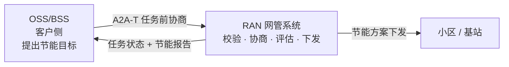
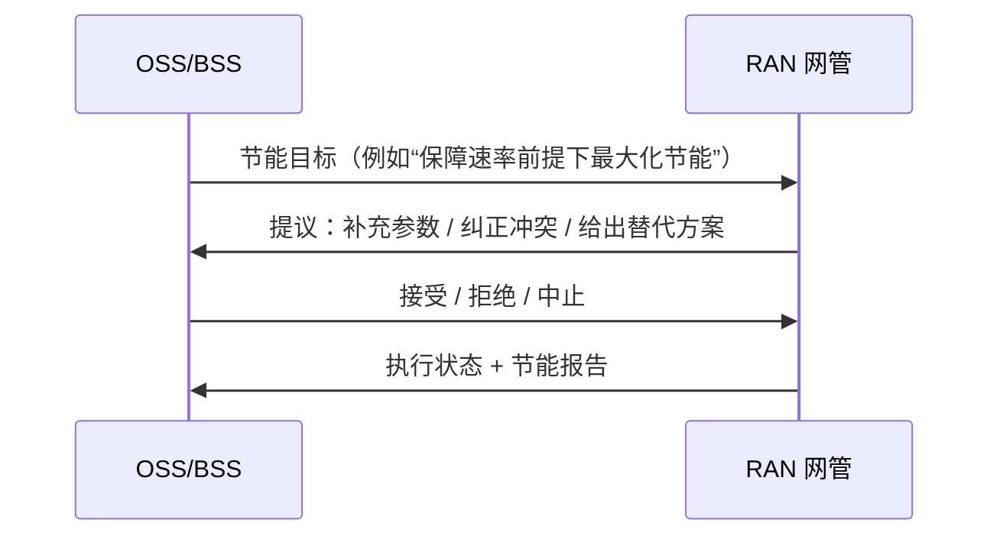
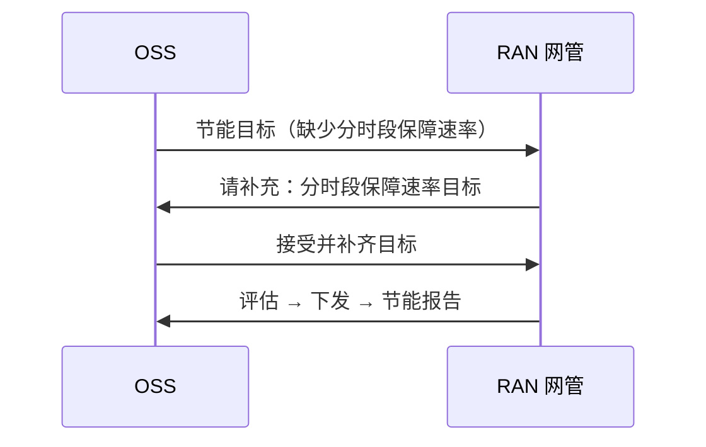
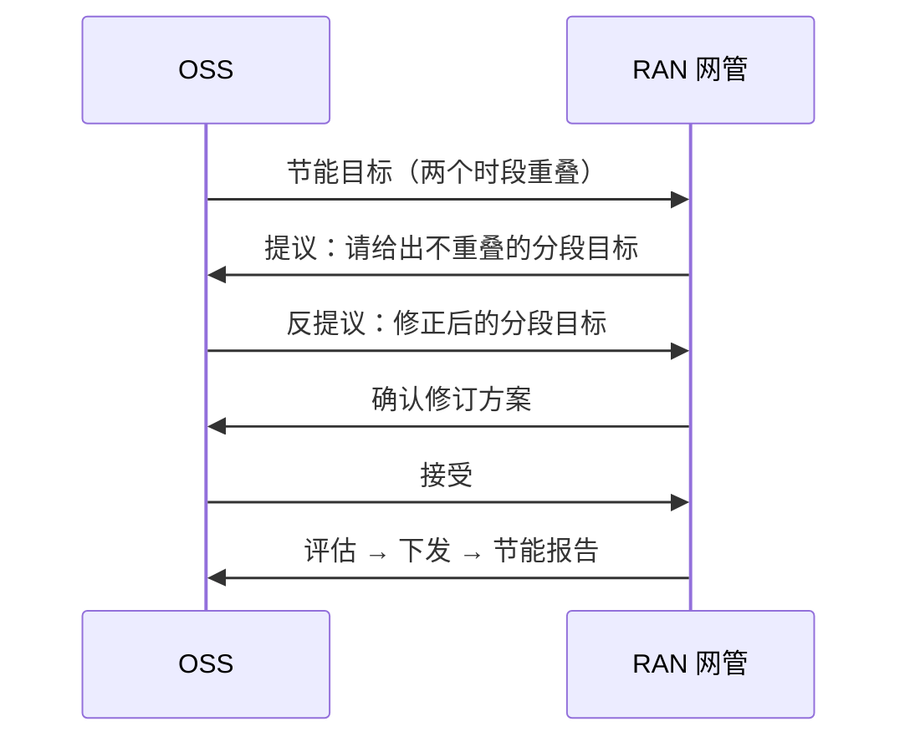
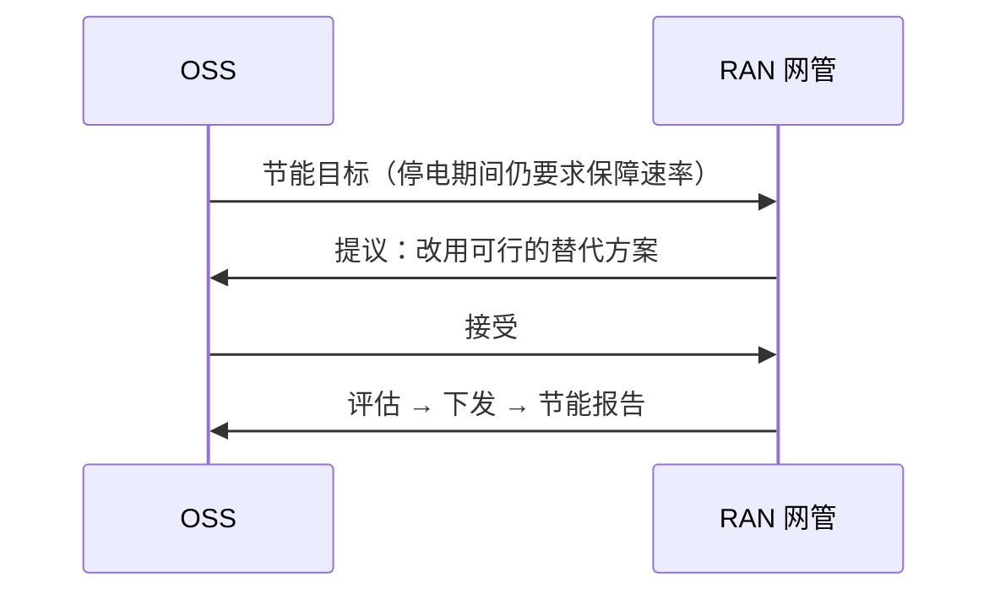

# RAN 节能：OSS 与 RAN 网管的智能协商（A2A-T 客户方案）

> **一句话：** OSS 提出节能目标，RAN 网管先协商补齐或纠偏，再评估、下发并出报告——全程自动、可追溯。



## 1. 系统间交互

OSS 与 RAN 网管之间只做两件事：**先把目标谈清楚，再把方案执行掉**。

| 系统 | 角色 | 在本方案中负责 |
| --- | --- | --- |
| OSS/BSS | 客户侧 | 提出节能目标，做接受 / 拒绝 / 反提议决策 |
| RAN 网管（NMS） | 执行侧 | 校验目标、发起协商、评估并下发方案、生成报告 |



协商可能进行 2–3 轮，但**任务只在双方达成一致后才创建**，因此不会出现“按错误目标下发”的情况。

典型问题正好对应三类协商：

- 目标缺参数；
- 时段重叠；
- 条件不可行（例如停电期间仍要求保障速率）。

## 2. 典型场景

### 2.1 目标缺参数：网管问，OSS 补



**结果：** 任务完成，无需人工工单。

### 2.2 时段冲突：先纠偏再执行



**结果：** 冲突在任务创建前纠正，避免错误下发。

### 2.3 条件不可行：网管给替代方案



**结果：** 不下发不可行方案，直接给出可执行替代。

其余两种终止情形，客户只需要知道结论：

| 场景 | 结论 |
| --- | --- |
| OSS 无法提供必需参数 | 协商结束，不创建任务 |
| 多轮反提议仍不收敛 | 达到轮次上限后主动中止，不创建任务 |

## 3. 客户价值

| 痛点 | 没有任务前协商 | 本方案 |
| --- | --- | --- |
| 参数缺失 | 任务失败或人工追问 | 网管问、OSS 补，自动完成 |
| 目标冲突 | 可能按错误目标下发 | 任务创建前纠正 |
| 条件不可行 | 下发失败、回滚 | 先给替代方案，接受才执行 |
| 审计 | 邮件、工单 | 每次提议、决策、下发都有记录 |

## 4. 演示

```bash
# 命令行（离线、确定性，无需 key）
python run_demo.py --scenario information --mode auto --model-mode offline
# Web UI（演示视图）
python run_demo.py --ui --scenario information --model-mode offline
# Web UI：工程师确认 OSS Agent 的决策
python run_demo.py --ui --mode confirm --scenario information --model-mode offline
# Web UI：方案下发前由工程师审批
python run_demo.py --ui --mode confirm --approval-gate --scenario information --model-mode offline
# 可选：把 OSS 侧作为 A2A 后端暴露
python run_demo.py --ui --gateway --ui-port 8080 --gateway-port 8001 --model-mode offline
# 在局域网共享 Web UI：显式选择免 token（仅限可信网络）
python run_demo.py --ui --ui-host 0.0.0.0 --allow-insecure-bind --model-mode offline
# 或者保留 token，分享带 token 的链接；页面会把它存进同源 cookie
A2AT_SAMPLE_AUTH_TOKEN=<token> python run_demo.py --ui --ui-host 0.0.0.0 --model-mode offline
# 同事打开 http://<你的局域网 IP>:8080/?token=<token>
```

`--ui-host 0.0.0.0` 只暴露 Web UI；注册中心与网管服务仍在回环地址。未配置
`A2AT_SAMPLE_AUTH_TOKEN` 时，启动器默认拒绝非回环绑定；只有显式加 `--allow-insecure-bind`
才允许。该模式下能访问端口的人都能发起运行，请只在可信网络使用。配置了 token 时，分享
`/?token=…` 链接即可：页面会把 token 写入同源 `a2at_ui_token` cookie，并从地址栏移除，因此
`fetch` 与 SSE 流都能通过认证（浏览器无法给 `EventSource` 设置 `Authorization` 头）。

使用 `--gateway` 时，OSS 侧本身就是一个 A2A Agent：Gemini Enterprise 之类的外部调用方发送一次请求后，
会在最终节能报告之前收到协商与执行里程碑的进度通知——可以走流式连接，也可以注册 webhook。

Web UI 默认打开演示视图：左侧是 16:9 的舞台，依次是网络工程师、OSS Agent、RAN 网管、小区，
中间是 A2A-T 通道。先选五个演示场景之一（或修改请求）再发起，舞台会按人的节奏跟随真实运行：请求、
结构化 Task-T、任务前协商、网管评估、变更审批、节能报告。右侧保留证据层：OSS Agent 理解到的任务
（含 24 小时保障速率图）、每一轮提议与决策的完整内容、以及合并后的会话轨迹；选中的一轮可以在业务
措辞和它携带的 A2A-T 报文之间切换。

有两个人工决策点。`--mode confirm` 下，OSS Agent 先给出建议，页面请工程师确认或改判后再发出；
`--approval-gate` 下，网管在真正下发前暂停，页面请工程师批准变更；驳回则不下发、不出报告。
变更闸门使用真实的 A2A `INPUT_REQUIRED` 任务状态，因此这次暂停在协议上也可见。

播放控制（自动 / 单步、速度、暂停、上一步 / 下一步、循环）只影响演示节奏，后端运行是真实的。
传输、模型与语言在进程启动时确定，页面上只保留场景切换和请求编辑。

需要协议级视图（阶段、LLM 与工具调用、原始报文、历史记录）时，在同一条命令后加 `--ui-mode explorer`。
安装、环境变量与完整参数见[技术指南](TECHNICAL-zh.md)。

## 5. 集成边界

| OSS 侧 | 网管侧 |
| --- | --- |
| 接入 A2A-T 客户端，由 SDK 提供协议能力 | 保留现有网管的评估、下发与报告能力 |
| 提供决策智能体：接受 / 拒绝 / 反提议 | 把样例工具替换为真实网管接口 |
| 保留自有策略、审批与审计 | 保留协商策略与任务存储 |

参考实现中，OSS 侧使用 ADK 决策智能体，网管侧使用 LangGraph 执行；它们只是选型，不影响上述系统间交互。

## 6. 关键特性

| 特性 | 说明 |
| --- | --- |
| 可审计 | 每次提议、决策、下发与报告都有记录 |
| 模型无关 | 离线可复现；在线模型只影响决策与规划 |
| 可替换 | 工具与策略可替换为真实网管实现 |

## 7. 技术资料

协议细节、实现结构、配置、测试与生产化注意事项见[技术指南](TECHNICAL-zh.md)。
