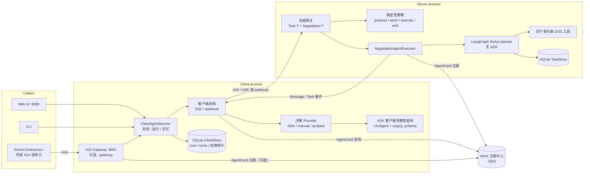
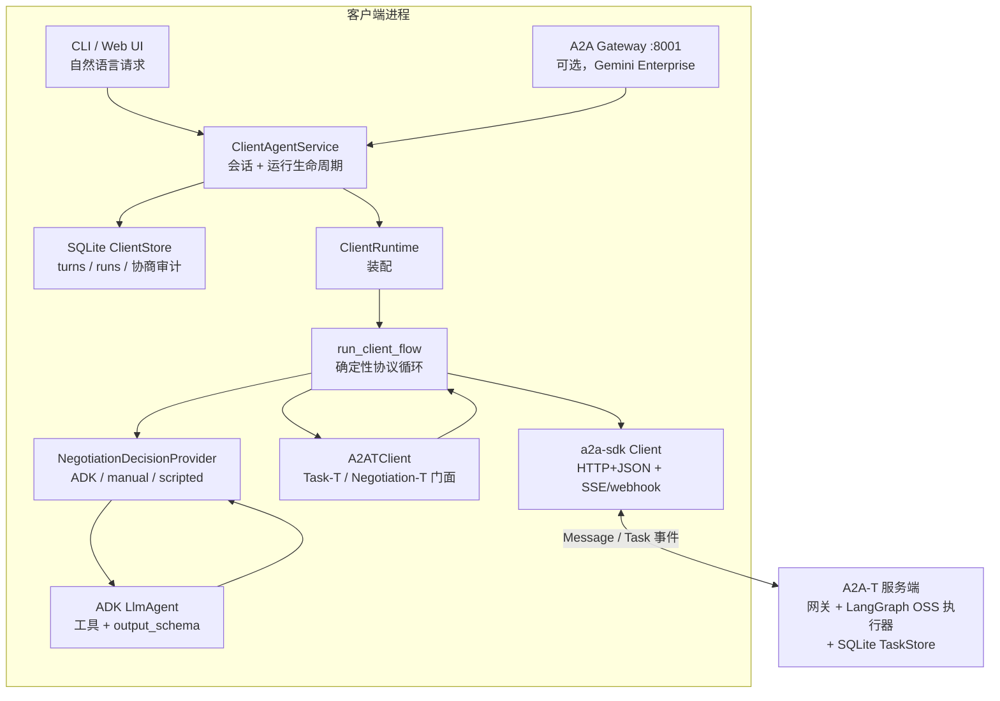
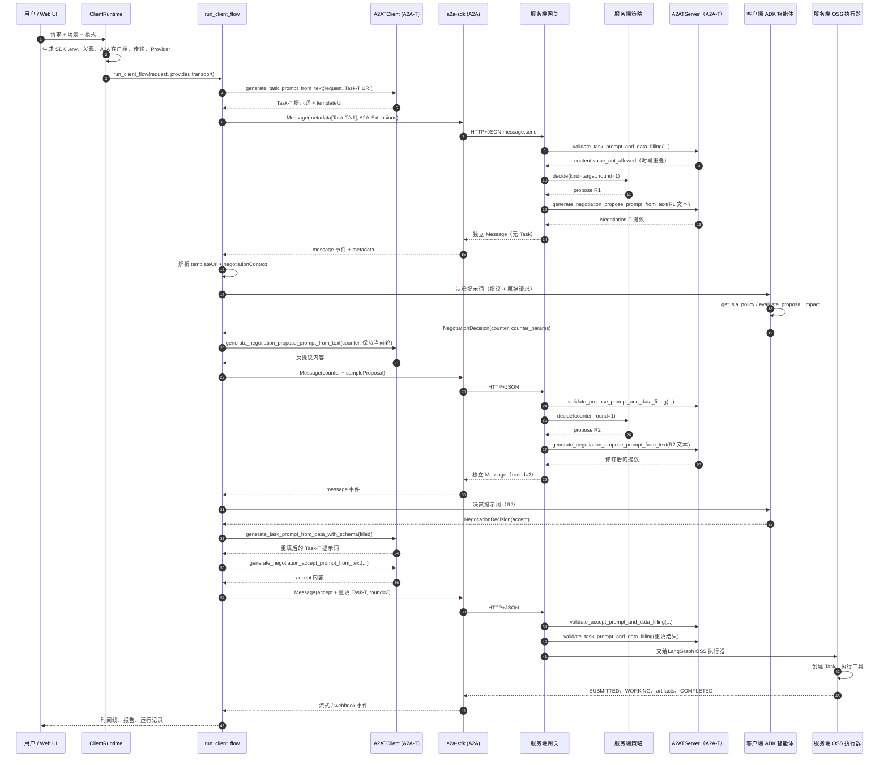
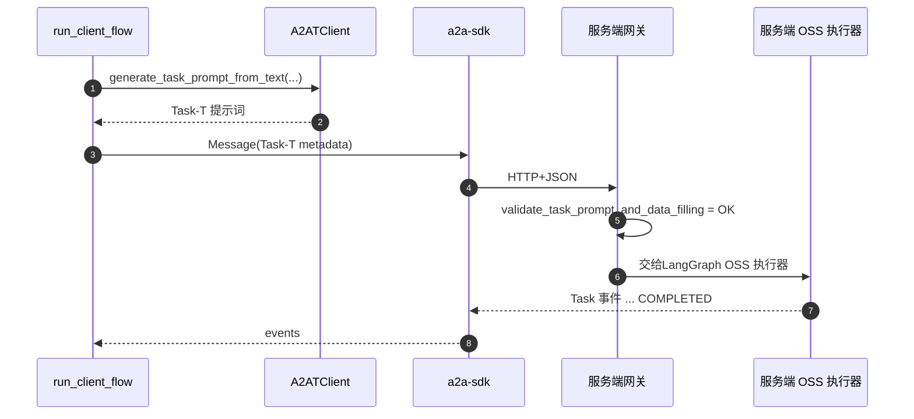
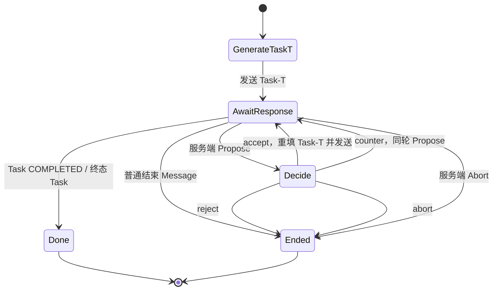
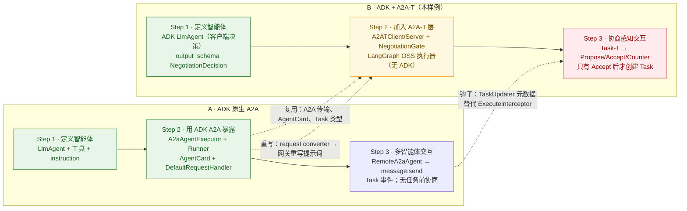
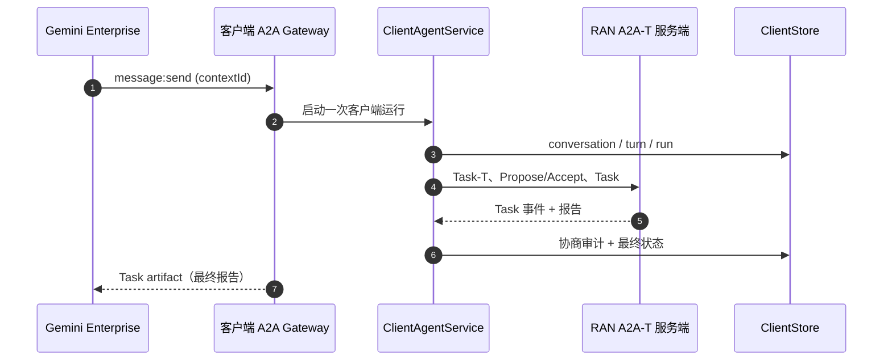
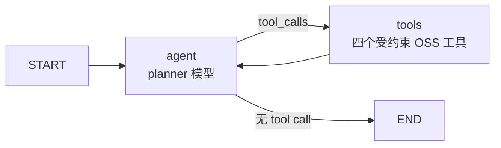

# RAN 节能样例（A2A + A2A-T + ADK 客户端）

一个可运行的智能体协作参考实现：客户端智能体与 RAN（Radio Access Network，无线接入网）域服务端智能体通过 A2A-T 的 `Negotiation-T` 达成节能任务，再通过标准 A2A Task 执行任务。Google ADK（Agent Development Kit）**只用于客户端决策智能体**；服务端是普通 A2A/A2A-T 服务，使用 LangGraph ReAct 执行器编排确定性 OSS 工具。

本样例面向两类读者：**客户端智能体**开发团队与**服务端智能体**开发团队。首要目的是**客户端层集成**：展示一个智能体如何把 A2A 传输、A2A-T 语义与 ADK 推理组合起来，同时不让模型掌握协议正确性。§2.1 就是这份集成指南；其余部分是参考实现。当组件只属于一侧时，本文直接写明责任方，不使用未区分的“你”。

**术语表**

| 术语 | 含义 |
| --- | --- |
| A2A | Agent2Agent 协议：在智能体之间传输消息与 Task。 |
| A2A-T | 本样例使用的 A2A-T SDK 扩展：`Task-T`（结构化任务提示词）与 `Negotiation-T`（任务创建前的协商消息）。 |
| ADK | Google Agent Development Kit：本样例用它构建客户端 `LlmAgent`、工具、`Runner` 与会话；服务端不使用 ADK。 |
| RAN | Radio Access Network，无线接入网：本样例中的小区及其负载/能耗行为。 |
| SLA | Service Level Agreement，服务等级协议：小区必须保障的吞吐下限。 |
| OSS / BSS | 运营支撑系统 / 业务支撑系统：服务端域角色，也是生产环境的集成目标。本样例实现了 OSS 任务执行器及其持久化 Task 存储。 |
| OCS | Online Charging System，在线计费系统：生产环境的计费集成目标，不属于本样例。 |

## 1. 样例解决什么问题

客户端请求 RAN 节能，例如“在满足分时段保障速率目标的前提下最大化节能”。该请求经常无法按原样执行：

- 缺少必需参数（哪个分时段保障速率目标？）；
- 目标存在歧义（两个吞吐时段重叠）；
- 在当前条件下不可行（长时间停电期间仍要求保障速率）。

服务端不会立即拒绝，而是开启 **Negotiation-T** 会话。双方在**任何 Task 创建之前**交换独立的 A2A `Message`：`Propose`、`Accept`、`Reject`、`Abort`。客户端接受后，协商确定的 `Task-T` 提示词被交给 **LangGraph ReAct planner**，由它创建 Task、选择并执行四个受约束的 OSS 工具（读取小区画像、评估方案、下发方案、生成报告），并把每次 Task 状态变化持久化到 SQLite。

样例演示了：

- 真实 A2A HTTP+JSON 链路上的四类 A2A-T performative；
- 真正的多轮协商（`maxRounds = 3`），包含反提议；
- 客户端 ADK `LlmAgent` 使用工具与结构化 `output_schema`；服务端不使用 ADK，而是用 LangGraph ReAct planner 编排确定性 OSS 工具；
- 任务前协商网关与 Task 执行器之间的显式集成缝；
- 确定性离线运行（脚本化 SDK LLM + 客户端 ADK fake model + 脚本化 LangGraph planner）与面向 OpenAI-compatible 端点的在线模式；
- 两套 SQLite 存储：服务端 A2A `TaskStore` 与客户端会话/运行/协商审计库，以及 Web UI 的两个表格；
- 可选入站 A2A gateway，使客户端智能体也能作为 Gemini Enterprise 的后端智能体；
- CLI 与轻量 Web UI。

## 2. 架构与目录



所有协商都发生在**Task 创建之前**：`Propose` / `Accept` / `Reject` / `Abort` 都是独立的 `Message`，不是 Task 事件。只有协商被接受后才会创建 Task，并由 LangGraph 执行器推进到 `COMPLETED`；服务端不使用 ADK 智能体，但其 planner 在 live 模式下由 LLM 驱动。

### 2.1 客户端层集成：A2A、A2A-T 与 ADK

本样例的首要目的是**客户端层集成**，而不是 RAN 业务逻辑。一个客户端智能体需要组合三层，它们解决的是不同问题：

| 层 | 职责 | 拥有 | 不负责 |
| --- | --- | --- | --- |
| **A2A**（`a2a-sdk`） | 传输与生命周期：发现 AgentCard、发送 `Message`、流式接收事件或 webhook 推送、表达 `Task` 及其状态。 | HTTP+JSON、SSE/webhook、`contextId`、`Message`、`Task`、`TaskState`。 | 不理解 Task-T / Negotiation-T 的含义。 |
| **A2A-T**（`a2a_t`） | A2A 之上的语义层：抽取并校验 Task-T 参数、渲染 Task-T 提示词、生成并校验 Negotiation-T performative、携带 `templateUri` 与 `negotiationContext`。 | `A2ATClient` / `A2ATServer` 门面、模板、结构化校验、扩展元数据。 | 不建立 HTTP 连接，也不运行智能体。 |
| **ADK**（`google-adk`，仅客户端） | 推理与工具：决定如何应答提议、调用客户端工具、产出结构化 `NegotiationDecision`。 | `LlmAgent`、工具、`output_schema`、`Runner`、会话。 | 从不把协议内容放到线上，从不决定 round 或 performative，也从不解析原始 A2A-T 元数据；服务端不使用 ADK，服务端执行 planner 是 LangGraph。 |
| **确定性客户端流程**（本样例） | 编排与协议正确性：调用正确的 A2A-T API、发送正确的 A2A 消息、保持 round/performative 一致、处理终态。 | `protocol/client_flow.py`。 | 不做业务决策；业务决策来自 Provider。 |
| **客户端应用服务 + 存储**（本样例） | 会话身份、运行生命周期、每会话并发约束、最近轮次记忆与审计。 | `protocol/client_service.py`、`protocol/client_store.py`。 | 不直接说 A2A，也不做决策。 |
| **A2A Gateway**（可选，本样例） | 客户端智能体的入站 A2A 接口，供 Gemini Enterprise 或其他调用方使用。 | `protocol/client_gateway.py`。 | 不替代出站 A2A-T 流程；每条入站消息启动一次客户端运行。 |

一句话心智模型：

> **A2A 负责把消息送到对端。A2A-T 赋予消息语义。ADK 给出决策。流程保证协议正确。**

#### 客户端组件模型



`ClientAgentService` 负责会话身份、持久化、记忆与每会话并发约束。`ClientRuntime` 只负责单次运行的装配：生成每次运行的 A2A-T SDK `.env`、注册 traced/scripted Provider、创建 `A2ATClient`、发现服务端 AgentCard、创建 a2a-sdk 客户端、选择传输与决策 Provider。真正的集成发生在 `run_client_flow`。

#### 端到端时序：target 场景（反提议后接受）

这是最完整的路径：初始 Task-T 未通过校验，服务端开启 target 协商，客户端反提议，服务端修订，客户端接受。



关键结构点：**第 1、2 轮的提议都是独立 `Message`，不是 Task 事件。** 只有网关校验了 `Accept` 和重填后的 Task-T 之后，A2A `Task` 才出现。

#### 直接路径：Task-T 校验通过，不进入协商

如果初始 Task-T 完整且有效，网关不会开启协商，同一请求直接进入LangGraph OSS 执行器。这就是 Run Explorer 中 Phase 04/05 为空的场景。



#### 终态路径：reject 与 abort

`Reject` 与 `Abort` 同样是独立的 `Negotiation-T` 消息。服务端尽力校验终态消息后，返回一条普通 A2A `Message`（不含 Negotiation-T 元数据），并且**不创建 Task**。客户端流程以 `no_task_negotiation_ended`（客户端 reject）或 `no_task_negotiation_aborted`（服务端在 `maxRounds` abort）结束。



#### A2A-T SDK 在哪些环节被调用

所有 A2A-T 调用都是同步的，只返回生成内容或校验结果，**不负责发送**。流程再把内容包进 A2A `Message`，由 a2a-sdk 传输发送。

| 时机 | 调用 | 侧 | 结果 |
| --- | --- | --- | --- |
| 初始 Task-T | `A2ATClient.generate_task_prompt_from_text(request, TASK_TEMPLATE_URI)` | 客户端 | 渲染后的 Task-T 提示词；槽位抽取与内容校验在此发生。 |
| 初始校验 | `A2ATServer.validate_task_prompt_and_data_filling(prompt, TASK_PARAM_SCHEMA, TASK_TEMPLATE_URI)` | 服务端 | 填充参数或结构化 `SlotValidationError`。 |
| 服务端首次提议 | `A2ATServer.generate_negotiation_propose_prompt_from_text(text, context, template_uri)` | 服务端 | `Propose` 的 `MetadataContent`。 |
| 客户端决策消息 | `A2ATClient.generate_negotiation_{accept,propose,reject,abort}_prompt_from_text(...)` | 客户端 | 所选 performative 的 `MetadataContent`。 |
| 反提议校验 | `A2ATServer.validate_propose_prompt_and_data_filling(...)` | 服务端 | 校验后的反提议或结构化错误。 |
| Accept 校验 | `A2ATServer.validate_accept_prompt_and_data_filling(...)` | 服务端 | 校验后的 accept。 |
| Task-T 重填 | `A2ATClient.generate_task_prompt_from_data_with_schema(filled, TASK_PARAM_SCHEMA, TASK_TEMPLATE_URI)` | 客户端 | 随 `Accept` 发送的最终 Task-T 提示词。 |
| 最终 Task-T 校验 | `A2ATServer.validate_task_prompt_and_data_filling(...)` | 服务端 | 网关放行；此时才创建 Task。 |

`MetadataContent.build_metadata_content()` 产出线上元数据（`Task-T/v1` 或 `Negotiation-T/v1` 的值、`templateUri`，协商消息还包含 `negotiationContext`）。[`protocol/messages.py`](protocol/messages.py) 定义 A2A-T 元数据的键与助手，[`protocol/client_flow.py`](protocol/client_flow.py) 组装出站元数据映射并发送。

#### ADK 如何接入客户端

ADK 智能体刻意**不在线上路径中**：

1. `run_client_flow` 把入站 `Propose` 解析为 `NegotiationProposeView` 与 `NegotiationContext`。
2. `AdkDecisionProvider.respond(propose, session)` 构造决策提示词，包含提议、协商类型/轮次和原始用户请求。
3. Provider 通过 `InMemoryRunner` 运行 `agents.client_agent.agent.build_client_agent`，每个协商 id 保留一个 ADK 会话，使后续轮次能看到之前的提议。
4. 智能体可调用 `get_sla_policy` 与 `evaluate_proposal_impact`；`output_schema=NegotiationDecision` 让 ADK 返回类型化决策。
5. 流程把 `action` 转换为恰好一个 A2A-T performative。**模型从不设置 `round`、`performative`、`templateUri` 或消息元数据。**

替换业务逻辑时应保留的正是这个集成缝：替换工具与 instruction，保留 `NegotiationDecision` 与 `AdkDecisionProvider`，让流程继续保持确定性。

#### 新客户端集成步骤

1. 通过**文件式** `.env` 配置 A2A-T SDK；生成每次运行的临时文件，不要修改源文件。SDK 从该文件读取 `A2AT_LLM_*`，而不是进程环境变量。
2. 发现服务端 AgentCard，确认它声明了 `Task-T/v1` 与 `Negotiation-T/v1`。
3. 创建 a2a-sdk 客户端：SSE 使用流式；webhook 关闭流式并配置 push notification。
4. 把初始 Task-T 作为 A2A `Message` 发送：`parts` 放短文本标签，`metadata` 的 Task-T 扩展 URI 下放提示词，同时带 `templateUri`，并设置 `A2A-Extensions`。
5. 把所有携带 `negotiationContext` 的独立 `Message` 当作协商步骤，而不是 Task 事件；按 `templateUri` 分派，不要解析自由文本。
6. 向决策 Provider 索取意图，再用 `session.with_performative(...)` 调用对应的 A2A-T 生成器。客户端绝不调用 `next_round()`；轮次由服务端掌握。
7. 在 `accept` 时用 `generate_task_prompt_from_data_with_schema` 重填 Task-T，并在同一条消息里同时发送重填后的 Task-T 与 Negotiation-T accept。
8. 只有 accept 之后才消费 Task 事件；在 `COMPLETED`、终态拒绝/失败或普通结束消息处停止。

规范实现见 [`protocol/client_runtime.py`](protocol/client_runtime.py)（装配）与 [`protocol/client_flow.py`](protocol/client_flow.py)（协议循环）。§7 的替换清单标明了哪些文件可直接复用、哪些属于样例业务内容。

### 2.2 ADK 原生 A2A 与 ADK + A2A-T 对比

左侧是 ADK 开发者使用 ADK 内置 A2A 能力时的基线；右侧是本样例：相同的 ADK 开发步骤，加上 A2A-T 语义层与 LangGraph 服务端。



**图例：** 绿色 = 复用 ADK/A2A；黄色 = 注入钩子；红色 = 新增或重写。

| 集成点 | ADK 原生 A2A | ADK + A2A-T（本样例） | 结论 |
| --- | --- | --- | --- |
| 传输、AgentCard、`Task`/事件类型 | `a2a-sdk` | `a2a-sdk` | 复用 |
| 客户端推理 | `RemoteA2aAgent` 或 ADK agent | ADK `LlmAgent` + `Runner` + `output_schema`，只负责决策 | 复用 |
| 初始请求转换 | `A2ARequestToAgentRunRequestConverter` | `NegotiationGate` 读取消息元数据并重写 Task-T 提示词 | 重写 |
| 任务前协议 | 无 | 网关 + `NegotiationAgentExecutor` 独立消息 | 重写 |
| 服务端执行 | ADK agent + 工具 + 会话 | `LangGraphTaskExecutor` + LangGraph ReAct planner + 四个受约束工具 | 重写 |
| Artifact/状态元数据 | `ExecuteInterceptor.after_event` / `after_agent` | `TaskUpdater.add_artifact(metadata=...)` / `update_status(metadata=...)` | 钩子 |
| 记忆/连续性 | ADK `SessionService`（按 `contextId`） | 客户端 SQLite 库（`conversations`/`turns`）+ `contextId`/`taskId`；服务端 SQLite `TaskStore` | 重写 |
| 可观测性 | ADK `TracePlugin` | 客户端 ADK 追踪 + 服务端 LangGraph planner/工具 span | 客户端复用，服务端重写 |
| 入站接口 | ADK A2A server endpoint | 可选独立 A2A Gateway（`ClientGatewayExecutor`） | 重写 |

关键边界：A2A 的传输、AgentCard 与 Task 类型原样复用；A2A-T 增加任务前协议与结构化提示词；服务端执行器是 LangGraph ReAct graph，而不是 ADK agent；客户端 ADK agent 只产出 `NegotiationDecision`，从不写协议元数据或 round。

### 2.3 两套系统、两个数据库与入站 Gateway

客户端与 RAN 服务端是两套系统，各自保存状态：

| 归属 | 存储 | 表 / 内容 | 写入方 |
| --- | --- | --- | --- |
| 客户端 | `runs/client-state.sqlite3`（`A2AT_SAMPLE_CLIENT_DB`） | `conversations`、`turns`、`runs`、`negotiation_events`、`task_snapshots` | `ClientAgentService` |
| 服务端 | `runs/task-status.sqlite3`（`A2AT_SAMPLE_TASK_DB`） | A2A `Task` blob + 摘要列 | `SqliteTaskStore` |

客户端库是可查询的审计/索引层；完整 transcript 与 trace span 仍保存在 `runs/<runId>/` 文件中。它提供：

- **会话身份**：客户端 `conversation_id`，以及调用方传入的可选 `external_id`（例如 Gemini Enterprise 的会话 id）；
- **轮次记忆**：最近 `A2AT_SAMPLE_CLIENT_MEMORY_TURNS` 轮会注入下一次决策提示词与 Task-T 生成；
- **运行生命周期**：`running` / `finished` / `failed` / `interrupted`；同一会话最多一个活跃运行，不同会话可并发；
- **协商审计**：每条入站 `Propose` 与出站决策，包含 round、performative、内容与理由；
- **Task 快照**：客户端观测到的最后一次 A2A Task 状态；
- **重启处理**：所属进程已消失的 `running` 运行标记为 `interrupted`；仍存活的第二个进程（gateway + Web UI）不受影响。

可选的**入站 A2A Gateway**（`run_demo.py --gateway`，端口 8001）把客户端智能体变成 Gemini Enterprise 或其他 A2A 调用方的后端智能体：



一条入站消息对应一次客户端运行；入站 `contextId` 作为客户端 `conversation_id`。协商过程保留在客户端库与 Web UI；Gateway 返回最终报告 artifact。Gateway 路径禁用人工决策。

### 目录说明

| 路径 | 职责 |
| --- | --- |
| [`run_demo.py`](run_demo.py) | 多进程启动器：后台启动注册中心、服务端（以及 `--gateway` 时的入站 A2A Gateway），前台运行 CLI 客户端（`--ui` 时改为 Web UI），结束后停止子进程。 |
| [`env.example`](env.example) | 统一的、可直接离线运行的配置模板。 |
| [`agents/server_agent/`](agents/server_agent) | 服务端 LangGraph 执行：`planner.py`（脚本化/在线模型 + 提示词）、`langgraph_tools.py`（受约束工具 + `PlanGuard`）、`graph.py`（ReAct 状态图）、`tools.py`（纯 OSS 工具）；不使用 ADK。 |
| [`agents/client_agent/`](agents/client_agent) | 客户端 ADK 决策智能体：`agent.py` 导出 `root_agent`；`tools.py` 为 SLA 与影响评估工具；`prompts/request_instruction.md` 为 instruction。 |
| [`protocol/negotiation_gate.py`](protocol/negotiation_gate.py) | 服务端唯一协议入口：识别任务前请求、校验 Task-T / Negotiation-T 消息，并转发被接受的请求。 |
| [`protocol/negotiation_policy.py`](protocol/negotiation_policy.py) | 纯确定性服务端策略：`propose`、`abort`、`execute`、`end`，不调用 LLM。 |
| [`protocol/server_executor.py`](protocol/server_executor.py) | 外层协商执行器与 `LangGraphTaskExecutor`：运行 ReAct planner 并发布 A2A Task 生命周期；不使用 ADK。 |
| [`protocol/sqlite_task_store.py`](protocol/sqlite_task_store.py) | SQLite `TaskStore`，持久化 A2A Task 状态并为 UI 提供任务摘要。 |
| [`protocol/server_app.py`](protocol/server_app.py) | 服务端装配：AgentCard（声明 `Task-T/v1` 与 `Negotiation-T/v1`）、请求处理器、Starlette 应用、注册中心注册。 |
| [`protocol/client_flow.py`](protocol/client_flow.py) | 客户端协议流程：初始 Task-T、多轮协商、accept 重填、SSE/webhook 终态处理。 |
| [`protocol/client_runtime.py`](protocol/client_runtime.py) | 客户端单次运行装配：每次运行的 SDK `.env`、服务发现、SDK 客户端、传输、决策 Provider。 |
| [`protocol/client_service.py`](protocol/client_service.py) | 客户端应用服务：会话、运行生命周期、记忆注入、每会话并发约束、持久化钩子。 |
| [`protocol/client_store.py`](protocol/client_store.py) | 客户端 SQLite 库：会话、轮次、运行、协商审计、Task 快照。 |
| [`protocol/client_gateway.py`](protocol/client_gateway.py) | 可选入站 A2A Gateway：一条入站消息 -> 一次客户端运行 -> 最终报告 artifact。 |
| [`protocol/decision_provider.py`](protocol/decision_provider.py) | 决策 Provider 协议及 ADK、manual、scripted 三种实现。 |
| [`protocol/discovery.py`](protocol/discovery.py) | 通过注册中心或 `/.well-known/agent-card.json` 发现 AgentCard。 |
| [`protocol/messages.py`](protocol/messages.py) | A2A-T 元数据助手：扩展 URI、`templateUri`、`negotiationContext`、结束消息、样例专用元数据。 |
| [`protocol/transcript.py`](protocol/transcript.py) | 结构化运行记录，写入 `runs/<timestamp>-<scenario>.json` 与 `.md`。 |
| [`shared/config.py`](shared/config.py) | 读取 `.env`、解析两套数据库路径、Gateway 与 planner 配置，并构建客户端 ADK 模型（离线 fake model，在线 `LiteLlm`）。 |
| [`shared/agent_card.py`](shared/agent_card.py) | 客户端（服务发现）与服务端（构建 AgentCard）共享的身份常量。 |
| [`shared/sdk_env.py`](shared/sdk_env.py) | 两个运行时共用的每次运行 SDK `.env` 构建器（消除 client↔server 导入）。 |
| [`shared/models.py`](shared/models.py) | `NegotiationDecision`（客户端 `output_schema`）与 Provider 视角的提议视图。 |
| [`shared/scenario.py`](shared/scenario.py) | 五个场景定义：请求、期望 performative/round 序列、终态、离线决策。 |
| [`shared/task_schema.py`](shared/task_schema.py) | 服务端校验与客户端 accept 重填共用的调用方参数 schema。 |
| [`shared/ran_data.py`](shared/ran_data.py) + [`resources/ran_data/cells.json`](resources/ran_data/cells.json) | 进程内 RAN 数据集、方案评估与进程内方案存储。 |
| [`shared/scripted_llm.py`](shared/scripted_llm.py) + [`resources/mock_llm/`](resources/mock_llm) | 通过官方工厂注册的脚本化 SDK `LLMClient`；按 schema 路由的预置响应。 |
| [`shared/adk_fake_model.py`](shared/adk_fake_model.py) | 离线与测试使用的确定性客户端 ADK `BaseLlm`。 |
| [`shared/registry_client.py`](shared/registry_client.py) | 注册中心注册/查询 HTTP 调用。 |
| [`shared/webhook_receiver.py`](shared/webhook_receiver.py) | 内置 webhook 推送接收器，校验 token。 |
| [`shared/sse_event_consumer.py`](shared/sse_event_consumer.py) | 将 A2A 流事件归一化为统一事件结构。 |
| [`registry/`](registry) | Mock 注册中心（AgentCard 注册/查询，端口 5001）。 |
| [`web/`](web) | Starlette Web UI（`app.py`）与单页前端（`static/index.html`）。 |
| [`tests/`](tests) | 单元、集成、传输、Web UI 与五场景离线验收测试；`tests/js/` 为 pytest 驱动的 Node harness。 |

## 3. 快速开始

前置条件：Python 3.12+ 与 [`uv`](https://docs.astral.sh/uv/)。从全新检出开始时，先在仓库根目录安装 A2A-T SDK 及其开发依赖，再把样例依赖安装到同一个 `.venv`：

```bash
# 1. 仓库根目录：把 SDK 与开发依赖安装到 .venv
uv sync --dev

# 2. a2a-t-sample：把样例依赖安装到同一个 .venv
cd a2a-t-sample
uv pip install -r requirements.txt
```

`uv sync` 会精确同步 SDK 环境，因此之后每次执行 `uv sync --dev` 都需要重新执行第 2 步。

运行任何样例命令前先激活该环境（按你的 shell 选择）：

```bash
source ../.venv/Scripts/activate        # Git Bash / Windows（在 a2a-t-sample/ 下）
# source ../.venv/bin/activate          # Linux / macOS
# ../.venv/Scripts/Activate.ps1         # Windows PowerShell
```

下文所有 `python` 都指这个已激活的解释器。

`run_demo.py` 会回退到 `env.example`，因此**离线运行不需要 `.env` 文件，也不需要 API key**。如需自定义，复制模板：

```bash
cp env.example .env              # 共享样例配置
# 或：cp ran-energy-saving/env.example ran-energy-saving/.env
```

### 离线 CLI（无需 key，确定性）

```bash
cd ran-energy-saving
python run_demo.py --scenario information --mode auto --model-mode offline
python run_demo.py --scenario target --mode auto --model-mode offline
```

若跳过激活，请把 `python` 替换为 `../../.venv/Scripts/python.exe`（Windows）或 `../../.venv/bin/python`（Linux/macOS）。

`information` 的预期输出（已节选：工具调用 artifact 的明细行、id 与路径省略）：

```text
[run_demo] starting registry on 5001 ...
[run_demo] starting server on 8000 ...
[run_demo] running client (scenario=information, mode=auto, transport=sse, discovery=registry, language=en-US, model_mode=offline) ...
[client] agent-discovered: url=http://127.0.0.1:8000 discovery=registry
[client] event kind=propose performative=PROPOSE summary=## Information Negotiation Please supplement ...
[client] sse-received events=1
[client] decision-requested round=1
[client] event kind=status performative=status summary=TASK_STATE_SUBMITTED
[client] event kind=status performative=status summary=TASK_STATE_WORKING
[client] event kind=artifact performative=artifact summary={"ok": true, "cell_id": "cell-001", ...}
...  # 其余 2 条工具结果，然后是报告 artifact
[client] event kind=artifact performative=artifact summary=energy saving intent report: {"ok": true, "summary": "..."}
[client] event kind=status performative=status summary=RAN energy-saving task completed.
[client] event kind=status performative=status summary=TASK_STATE_COMPLETED
[client] sse-received events=<n>
[client] final_state=task_completed task_id=<uuid>
[client] report={"ok": true, "summary": "Plan plan-cell-001-001 applied ...", ...}
[client] transcript: .../runs/<timestamp>-information.json
[client] transcript: .../runs/<timestamp>-information.md
[run_demo] stopped 2 background process(es)
```

`target` 的预期输出（两轮；客户端在第 1 轮反提议，在第 2 轮接受；已节选：工具调用
artifact 的明细行、id 与路径省略）：

```text
[run_demo] starting registry on 5001 ...
[run_demo] starting server on 8000 ...
[run_demo] running client (scenario=target, mode=auto, transport=sse, discovery=registry, language=en-US, model_mode=offline) ...
[client] agent-discovered: url=http://127.0.0.1:8000 discovery=registry
[client] event kind=propose performative=PROPOSE summary=## Target Negotiation Target negotiation for the RAN energy saving task: the guaranteed throughput target has two overlapping time segments, {17:30~23:00,20M...
[client] sse-received events=1
[client] decision-requested round=1
[client] event kind=propose performative=PROPOSE summary=## Target Negotiation Revised proposal for round 2: cell cell-001, window 00:00~06:00, target rate 30%. Please accept this revised plan. ## Target Clarificat...
[client] sse-received events=1
[client] decision-requested round=2
[client] event kind=status performative=status summary=TASK_STATE_SUBMITTED
[client] event kind=status performative=status summary=TASK_STATE_WORKING
...  # 3 条工具结果 + 报告 artifact
[client] event kind=artifact performative=artifact summary=energy saving intent report: {"ok": true, "summary": "..."}
[client] event kind=status performative=status summary=RAN energy-saving task completed.
[client] event kind=status performative=status summary=TASK_STATE_COMPLETED
[client] sse-received events=<n>
[client] final_state=task_completed task_id=<uuid>
[client] report={"ok": true, "summary": "Plan plan-cell-001-001 applied ...", ...}
[client] transcript: .../runs/<timestamp>-target.json
[client] transcript: .../runs/<timestamp>-target.md
[run_demo] stopped 2 background process(es)
```

两条 `propose` 分别是服务端第 1 轮提议与第 2 轮修订提议；第二条渲染的是修订后的方案
（小区、时间窗与目标速率），不再是第 1 轮的重复内容。客户端自己的反提议不会出现在它收到的事件日志中；完整双向序列见运行记录（§9）。

### 在线 CLI（OpenAI-compatible 端点）

```bash
python run_demo.py --scenario target --mode auto --model-mode live
```

在线模式下，**客户端** ADK 决策智能体使用 `ADK_MODEL_*`，两侧 A2A-T SDK 使用 `A2AT_LLM_*`，服务端 LangGraph planner 使用 `A2AT_SAMPLE_PLANNER_*`（未设置时默认沿用 ADK 端点/模型）。它们必须指向同一个 OpenAI-compatible 端点；`env.example` 默认使用本地代理 `http://127.0.0.1:31943/v1`。该命令可以端到端运行，但协商序列与 planner 的工具选择**依赖模型**：SDK 基于 LLM 的抽取与语义校验决定服务端最终收到什么，planner 决定 OSS 方案；工具本身仍是确定性且受顺序约束的。离线模式才是测试与 §4 使用的可复现基准；在线运行应视为集成 smoke，而不是验收测试。

**在线模式为尽力而为，但有确定性护栏。** SDK 语义结论与客户端决策智能体由模型驱动，但样例在接受 Task-T 前会重新检查调用方 schema 的必填字段，以及设计中的冲突条件（目标时段重叠、背景停电期间仍要求保障速率）。客户端 accept 路径只回答被请求的信息项，并把目标规整到模板允许的三段式上限。如果决策模型返回散文而不是要求的 JSON（部分 OpenAI-compatible 网关会丢弃响应格式约束），Provider 会从代码围栏或正文中提取 JSON 对象；仍失败时在同一 ADK 会话里追加一次纠正性追问，然后才报错。SDK 的结构化调用（参数提取、校验）采用同样的容忍策略：带围栏或被散文包裹的 JSON 对象会被接受，确实非法的 JSON 仍然失败。离线模式仍是验收路径。

### Web UI

```bash
python run_demo.py --ui --ui-port 8080 --scenario information --model-mode offline
# 局域网访问（仅限可信网络；演示 UI 没有认证）：
python run_demo.py --ui --ui-host 0.0.0.0 --ui-port 8080
```

打开 <http://127.0.0.1:8080>。页面可选择场景、`auto`/`manual` 模式与 SSE/webhook；展示实时时间线、最终报告，并提供 JSON/Markdown 运行记录下载。语言与模型模式是进程级、只读的（见 `GET /api/meta`）。

运行设置中新增可编辑的 **Original user request** 输入框：默认填入所选场景的预置请求，启动 run 时作为 `userRequest` 发给 `POST /api/runs`，客户端用它生成 Task-T，而不是使用预置请求。留空时回退到场景默认请求；**Reset to scenario default** 可恢复预置文本。这是用五个预设之外的请求演示协商的最快方式。

```bash
curl http://127.0.0.1:8080/api/meta
# `scenarioRequests` 提供每个场景可编辑的默认请求文本。
```

### Run Explorer（运行探索器）

`--ui` 页面是运行探索器，而不只是结果页：它从浏览器发起运行，展示从下发到报告的完整链路，并包含客户端与服务端两个进程的 LLM 请求/响应。离线模式是确定性基准，在线模式为尽力而为。

```bash
# 离线（无需 key，确定性）
python run_demo.py --ui --scenario information --mode auto --model-mode offline
# 打开 http://127.0.0.1:8080

# 在线（尽力而为；两侧 SDK 与客户端 ADK 使用配置的 OpenAI-compatible 端点）
python run_demo.py --ui --scenario information --mode auto --model-mode live
```

在左侧栏选择场景与 `auto`/`manual` 模式，然后点击 **Start run**。上下文条与 `GET /api/meta` 展示只读的进程级语言与模型模式。

#### 历史记录

两个数据库都可以在页面上查看。时间线下方的 **历史记录** 面板默认折叠，含三个标签页，不会再把运行观察器挤出首屏：

| 标签页 | 数据源 | 列 |
| --- | --- | --- |
| **OSS 任务** | `GET /api/tasks` → `runs/task-status.sqlite3` | task id、状态、context、更新时间、报告摘要、run id |
| **客户端运行** | `GET /api/client/runs` → `runs/client-state.sqlite3` | run id、会话、场景、状态、终态、开始时间、请求摘要 |
| **会话** | `GET /api/client/conversations` | 会话、轮次数、运行数、更新时间 |

OSS 任务页在启动/结束以及运行期间刷新，因此 `WORKING` 行会在运行结束前出现。**查看** 会加载 `GET /api/client/runs/{id}`（轮次、协商审计、运行记录链接）或 `GET /api/client/conversations/{id}`（轮次与运行列表）。所有表格对页面只读，服务端或客户端服务是唯一写入方。

#### 界面语言

界面内置英文与中文（`zh-CN`）两套文案，位于 `web/static/js/i18n/`，无需构建，也不发起网络请求。页头菜单可选择 **自动**、**English** 或 **中文**，选择会写入 `localStorage`；`?lang=en` / `?lang=zh-CN` 可对单次加载临时覆盖。**自动** 跟随 `A2AT_LANGUAGE`，因此中文进程会同时得到中文界面与中文场景文本。当界面语言与进程语言不一致时，上下文条会显示一条轻提示，例如 `界面 中文 · 数据 en-US`。协议标识符（`Task-T`、`Negotiation-T`、`PROPOSE`、工具名、JSON 载荷值）保持英文，以便与规范及 trace 对照。

#### 入站 A2A Gateway

客户端智能体也可以作为后端 A2A 智能体：

```bash
python run_demo.py --ui --gateway --ui-port 8080 --gateway-port 8001 --model-mode offline
```

Gateway 在 `http://127.0.0.1:8001/.well-known/agent-card.json` 提供 AgentCard，并接受 `POST /message:send`（A2A HTTP+JSON，`A2A-Version: 1.0`）。一条入站消息启动一次客户端运行，并把最终报告作为 Task artifact 返回。加 `--gateway-register` 可把 Gateway 卡片注册到 mock 注册中心。Web UI 与 Gateway 共享客户端库但是不同进程；由于重启清理会检查 owner PID，仍在运行的 Gateway 运行不会被误标为 `interrupted`。

```bash
curl -X POST http://127.0.0.1:8001/message:send \
  -H 'Content-Type: application/json' -H 'A2A-Version: 1.0' \
  -d '{"message":{"messageId":"m1","role":"ROLE_USER","contextId":"conv-1",
       "parts":[{"text":"在满足吞吐目标的前提下最大化节能。"}]}}'
```

#### 八个阶段

| # | 阶段 | 展示内容 |
| ---: | --- | --- |
| 1 | Dispatch（下发） | 运行被接受、客户端运行时构建、discovery 与 transport 就绪、期望序列。 |
| 2 | Task-T generation（Task-T 生成） | 客户端 SDK 槽位抽取、内容校验、渲染后的 Task-T 提示词。 |
| 3 | Task validation（Task 校验） | 首次 A2A 发送、服务端网关校验、开启协商或直接接受任务。 |
| 4 | Negotiation（协商） | 每轮：服务端 propose、决策请求、决策、响应、服务端校验。 |
| 5 | Resolution（终态） | Accepted/Rejected/Aborted/Ended、重填的 Task-T 与达成参数。 |
| 6 | Execution（执行） | ADK 轮次、工具调用、中间 artifact 与 `WORKING` 状态。 |
| 7 | Report（报告） | 报告 artifact 载荷与 `COMPLETED`。 |
| 8 | Done（结束） | 最终状态、运行记录与摘要。 |

每个事件行带有全局编号、actor（client/server/LLM/tool/human/system）、标题、耗时、token、轮次与状态。LLM 与 tool span 嵌套在触发它的协议步骤下。决策在 provider 返回时立即记录，因此出现在它所导致的任务事件**之前**。协商阶段显示 `R1 ✓ R2 ◐` 轮次标签；Resolution 显示 `Accepted`、`Rejected`、`Aborted` 或 `Ended`。时间线可在 **Story**（阶段卡片）与 **Waterfall**（扁平耗时条）间切换，并支持 All/Protocol/LLM/Tools/Errors、actor、轮次与全文搜索过滤。

#### 检查器（Inspector）

选中一行后打开检查器，包含以下标签页（不适用的标签页会禁用）：

- **Summary**：一句话说明、关键事实、前后因果与关联决策。
- **Protocol**：方向、message/task/context id、模板 URI、协商上下文、Task-T/Negotiation-T 文本与原始 parts。
- **LLM request**：阶段、目的、system instruction、messages、JSON schema、tools 与生成参数。
- **LLM response**：状态、耗时、token、原始与解析结果、function calls、解析错误与重试。
- **Tool call**：工具名、参数、结果、耗时与错误。
- **Raw JSON**：完整 span envelope；复制/下载始终导出完整载荷。

离线 LLM 调用不报告 token 用量，UI 显示 `n/a (scripted)`，而不是虚构的 `0`。

#### Trace、隐私与限制

`run_demo.py --ui` 会生成本次运行的本地 token，并把服务端指向 UI（`A2AT_SAMPLE_TRACE_URL=http://127.0.0.1:<ui_port>`、`A2AT_SAMPLE_TRACE_TOKEN=<random>`）；服务端把 span POST 到 `POST /api/runs/{runId}/trace`，UI 校验 run id 与 token。该端点只应绑定 localhost：span 中可能包含模型提示词、工具参数与结果。

- 未配置 token 时 ingest 路由默认拒绝（失败关闭），不会接受未认证 span；复用的 keep-alive 服务端必须携带相同 token。
- `Authorization`、`api_key`、`X-API-Key` 会被脱敏，API key 永不记录。
- 每条 LLM 请求/响应载荷上限 256 KB：保留头尾并标记 `truncated`。
- `GET /api/runs/{id}/trace.json` 返回完整 span 列表（`spanId` 唯一、`seq` 单调）与运行记录；`transcript.json` / `transcript.md` 也可下载。
- CLI 运行（不带 `--ui`）把服务端 trace 写入 `runs/<runId>/server-trace.jsonl`，并打印 LLM/tool/token 摘要。

#### `--keep-alive` 与 PID 复用

`--keep-alive` 在客户端退出后保留注册中心与服务端；用 `python run_demo.py --stop` 停止。PID 文件（以 `0600` 写入，因为包含本地 trace token）同时记录这些进程的模型模式、语言、trace token 与 trace URL/UI 端口；后续启动只有在这些都和请求一致时才复用。不一致时（例如 `live` keep-alive 服务端之后启动 `offline` UI，或换了 `--ui-port` 但服务端仍向旧端口发 span），启动器会停止已记录的进程、打印原因并重新启动，避免离线 UI 静默发起 live 模型调用，也避免服务端 span 发到错误进程。端口被监听但没有 PID 记录时，说明进程不属于启动器：启动器拒绝复用并要求先释放端口。

#### 限制

- 每个 UI 实例同时只允许一个运行；trace 与运行状态保存在内存中，UI 重启即丢失。
- 重新加载 `#run=<id>` 会重放已记录的流，但无法恢复随进程丢失的运行。
- 在线输出依赖模型的抽取/校验结果；验收请使用离线模式。
- 服务端 trace 投递是尽力而为：服务端按批发送（0.5 秒刷新间隔），UI 在 `finished` 后保留一段
  宽限窗口（`GET /api/meta` 的 `finishedGraceMs`，默认 2 秒）以接收最后一批 span。若仍有批次
  晚到，客户端在 finalize 时合并 `GET /api/runs/{id}/trace.json`；从未到达 UI 的批次不会出现在
  时间线中（transcript 与 trace 文件仍是事实来源）。
- 只有 Provider 返回了用量时才显示 LLM token；在线调用缺失用量显示 `n/a`，离线（scripted）运行
  显示 `n/a (scripted)`。

### 人工决策模式

```bash
python run_demo.py --ui --mode manual --scenario target --ui-port 8080
```

`--mode manual` 必须配合 `--ui`（决策表单位于 Web UI）。服务端每次 `Propose` 后，客户端流程等待通过 `POST /api/runs/{id}/decisions` 提交的决策；默认超时 300 秒，超时后转为 `Abort` 决策。

## 4. 五个场景

所有序列都由服务端发起。`S` = 服务端，`C` = 客户端；括号内为 round。期望序列由 `tests/test_scenarios.py` 与 `tests/test_client_flow.py` 断言。

| 场景 | 触发 | 协商序列 | 最终状态 |
| --- | --- | --- | --- |
| `information` | Task-T 请求缺少分时段保障速率目标（`content.param_missing`）。 | `S:Propose(1)` → `C:Accept(1)` | Task `COMPLETED` + 报告（`task_completed`） |
| `target` | 保障吞吐目标的时间段重叠（`content.value_not_allowed`）。 | `S:Propose(1)` → `C:Propose(1)`（反提议） → `S:Propose(2)`（修订） → `C:Accept(2)` | Task `COMPLETED` + 报告（`task_completed`） |
| `feasibility` | 保障速率与 18 小时停电冲突（`content.rule_violation`）。 | `S:Propose(1)`（替代方案） → `C:Accept(1)` | Task `COMPLETED` + 报告（`task_completed`） |
| `reject` | 客户端无法提供缺失的保障速率目标。 | `S:Propose(1)` → `C:Reject(1)` → `S:Message("协商已结束")` | 无 Task（`no_task_negotiation_ended`） |
| `abort` | 客户端反复反提议策略始终无法接受的方案。 | `S:Propose(1)` → `C:Propose(1)` → `S:Propose(2)` → `C:Propose(2)` → `S:Propose(3)` → `C:Propose(3)` → `S:Abort(3)` | 无 Task（`no_task_negotiation_aborted`） |

说明：

- `target` 中客户端反提议保持第 1 轮；只有服务端修订方案进入第 2 轮，客户端 `Accept` 也保持第 2 轮。
- `reject` 与 `abort` 都不创建 Task。`reject` 以一条不含 Negotiation-T 元数据的普通 A2A `Message` 结束；`abort` 使用通用 abort 模板，在 `round = maxRounds = 3` 发出。
- 首个 Task-T 校验错误码到协商类型的映射（`content.param_missing` → information、`content.value_not_allowed` → target、`content.rule_violation` → feasibility）是**样例约定**，不是 A2A-T 契约。实现位于 [`protocol/negotiation_policy.py`](protocol/negotiation_policy.py) 的 `NEGOTIATION_KIND_BY_ERROR_CODE`。

## 5. 客户端 ADK 智能体与 LangGraph 服务端执行器

### 服务端：LangGraph ReAct 执行器（无 ADK）

服务端没有 `LlmAgent`、没有 ADK `Runner`，也没有 ADK 会话。网关批准 Task-T 后，[`protocol/server_executor.py`](protocol/server_executor.py) 运行一张小型 LangGraph ReAct 图：



- **agent**：用系统提示词调用 planner 模型；提示词携带已接受的 Task-T、数据集目录与工具规则。模型选择下一个工具及其参数。
- **tools**：执行请求的工具；每个工具返回结构化 JSON，并更新本次运行的 `PlanGuard`。
- 离线模型是 `ScriptedChatModel`（按顺序发出四个样例调用），在线模型是 `ChatOpenAI`；两者走同一张图。不引入持久 checkpointer；A2A `TaskStore` 是 Task 级事实源。
- `A2AT_SAMPLE_PLANNER_MAX_STEPS` 是图递归上限；超限时 Task 以明确错误进入 `FAILED`。

**工具强制业务顺序**，因此模型无法在未评估时下发方案，也无法在没有 plan id 时生成报告：

| 工具 | 输入 | 前置条件 | 作用 |
| --- | --- | --- | --- |
| `get_cell_energy_profile` | `cell_id`、`date` | 无 | 返回 24 小时负载/能耗曲线、容量/SLA、可用节能窗口。 |
| `evaluate_energy_saving_plan` | `cell_id`、`window`、`target_rate` | 已读取同一小区画像 | 校验窗口、节能率上限与 SLA；估算节能与 KPI 影响。 |
| `apply_energy_saving_plan` | `cell_id`、`window`、`target_rate` | 同一方案已评估成功 | 重新评估并写入进程内方案存储。 |
| `generate_energy_saving_report` | `plan_id` | 已成功 apply 该方案 | 根据已存方案生成结构化最终报告。 |

前置条件失败返回 `{"ok": false, "error_code": "tool_order_violation", ...}`，planner 可在步数预算内自我纠正。可预期的业务失败（未知小区、参数格式错误、方案不可行）返回其他结构化 `error_code`。如果 planner 始终无法生成成功报告，Task 进入 `FAILED`，不会发布空报告。

执行器用 `TaskUpdater` 发布标准 A2A Task 生命周期：

1. 入队 `Task(SUBMITTED)` 与请求历史；
2. `start_work()` → `WORKING`；
3. 每个非报告工具调用一个 `tool result` artifact，并发出一个 `tool` trace span；
4. 每个 planner turn 一个 `llm` trace span，挂在执行 span 下；
5. 报告 artifact 带 `Task-T/v1`、`templateUri`、协商上下文与 run id 元数据；
6. 以最终文本进入 `COMPLETED`。

当设置 `A2AT_SAMPLE_TASK_DB` 时，每次 Task 状态变化都由 [`protocol/sqlite_task_store.py`](protocol/sqlite_task_store.py) 持久化。Web UI 以只读方式打开同一文件来渲染任务表格。

### 客户端 ADK 决策智能体

[`agents/client_agent/agent.py`](agents/client_agent/agent.py)：

```python
root_agent = LlmAgent(
    name="ran_energy_request_agent",
    model=build_adk_model(),
    instruction=REQUEST_INSTRUCTION,
    tools=[get_sla_policy, evaluate_proposal_impact],
    output_schema=NegotiationDecision,
)
```

`get_sla_policy(cell_id)` 返回小区的 SLA 下限、最大节能率与可用窗口。`evaluate_proposal_impact(proposal)` 从提议文本中解析小区 id、窗口与节能率，返回确定性可行性与影响视图。`output_schema=NegotiationDecision` 让 ADK 解析模型的结构化答案；客户端流程从不解析自由文本。

[`protocol/decision_provider.py`](protocol/decision_provider.py) 通过 `InMemoryRunner` 运行智能体，每个协商 id 保留一个 ADK 会话（后续轮次可见之前的提议），仅在离线模式下回退到安全的 `accept` 决策。`ClientAgentService` 会把最近若干轮会话（默认 6 轮）注入每次决策提示词与 Task-T 生成，因此“同样方案给 cell-002”这类后续请求仍保留前文语境。

当提议包含具体小区、时间窗或速率时，决策智能体会调用 `get_sla_policy` / `evaluate_proposal_impact`。在 `information` 场景中，提示词会要求它在决策前对两个样例小区调用 `get_sla_policy`，因此那里也会出现工具行。`target` 仍是最直观的多轮示例。如果根本没有开启协商，客户端决策智能体不会被调用，自然也没有工具调用。

### 执行器与持久化集成

`NegotiationAgentExecutor` 先运行网关。短路结果只入队一条独立消息（协商 `Propose`/`Abort`，或普通结束消息），不创建 Task；否则委托给 `LangGraphTaskExecutor`。旧 ADK `request_converter` 与 `ExecuteInterceptor` 注入的 A2A-T 元数据，现在由 LangGraph 执行器直接写入：

- 网关把 `context.message` 重写为达成一致的 Task-T 提示词；
- planner 提示词携带已接受的 Task-T 与已接受的协商上下文；
- 执行器在报告 artifact 与终态 status 上写入 `Task-T/v1`、`templateUri`、`negotiationContext` 与样例 run id；
- `TaskUpdater` 发出标准 A2A 状态/artifact 事件，SQLite `TaskStore` 持久化每次状态变化。

### 客户方需要替换什么

四个工具、`PlanGuard` 与 planner 提示词是服务端业务层。实现自有 RAN 服务的客户方应把工具实现替换为对自身 OSS/BSS/网管系统的调用，用自有策略替换样例提示词/planner 模型，并保留图外壳、A2A 执行器生命周期与 TaskStore。客户端替换两个 ADK 工具、instruction 与会话/轮次 schema。A2A-T 网关、策略状态机、确定性流程、客户端服务、Gateway 与 TaskStore 结构保持不变。

## 6. A2A-T 协商集成

### 消息结构

每条协商消息都携带：

- `A2A-Extensions: Task-T/v1,Negotiation-T/v1`；
- Negotiation-T 扩展 URI 下的渲染文本；
- `templateUri` —— 文本渲染自的模板；
- `negotiationContext = {id, round, maxRounds, performative}`。

`protocol/messages.py` 是唯一构建/读取这些键的地方。协商会话 id 被强制设为 A2A `contextId`（样例约定）。

### 网关

[`protocol/negotiation_gate.py`](protocol/negotiation_gate.py) 是服务端唯一协议入口，只处理**任务前**请求（`context.current_task is None`；`context.task_id` 不是可靠信号，因为 `RequestContext` 构造时会生成一个）：

1. 初始 Task-T 请求通过 `validate_task_prompt_and_data_filling(prompt, TASK_PARAM_SCHEMA, TASK_TEMPLATE_URI)` 校验。
2. 校验失败且首个错误码可映射到协商类型时，生成初始 `Propose`；不可映射时返回带结构化错误的终态 `REJECTED` Task。
3. `Accept` 通过 `validate_accept_prompt_and_data_filling` 校验；随后再次校验协商确定的 Task-T 提示词并交给 LangGraph 执行器。
4. `Reject` 或 `Abort` 是终态：网关回一条普通消息，不创建 Task。
5. 客户端反提议通过 `validate_propose_prompt_and_data_filling` 校验，再由策略引擎应答。

所有 SDK 调用都是同步的，因此网关用 `asyncio.to_thread` 执行，避免阻塞服务端事件循环。

### 策略引擎

[`protocol/negotiation_policy.py`](protocol/negotiation_policy.py) 是纯函数：输入状态，输出 `PolicyDecision`。它不调用 LLM，也不发送任何消息。

| 输入 | 决策 |
| --- | --- |
| 初始校验失败 | `propose`（第 1 轮）；若已到轮次上限则 `abort`。 |
| 客户端 `Accept` | `execute`。 |
| 客户端 `Reject` / `Abort` | `end`。 |
| 客户端在 `maxRounds` 之前反提议 | 在下一轮 `propose`：反提议方案可行则接受，否则修订。 |
| 客户端在 `maxRounds` 反提议 | `abort`，保持当前 round。 |

服务端从不发出 `Accept`：它通过发布一个客户端可接受的最终 `Propose` 来表达同意。若没有 `sampleProposal`（见下文），策略按预设修订序列推进。

### 决策 Provider

| Provider | 使用方 | 行为 |
| --- | --- | --- |
| `AdkDecisionProvider` | 默认 `--mode auto` | 运行客户端 ADK 智能体，返回结构化 `NegotiationDecision`。 |
| `ManualDecisionProvider` | `--ui --mode manual` | 等待 Web UI 决策；300 秒超时后转为 `Abort`。 |
| `ScriptedDecisionProvider` | 测试（`MODE_SCRIPTED`；`run_demo.py` 不暴露） | 按顺序回放场景决策。离线 `auto` 模式则让 ADK 智能体配合 fake model 留在决策回路中。 |

所有 Provider 都实现 `respond(propose, session) -> NegotiationDecision`。Provider 只决定**意图**；流程层负责生成协议内容，且从不改变 round。

### 四类 performative 与轮次归属

| Performative | 生成方法 | 含义 |
| --- | --- | --- |
| `Propose` | `generate_negotiation_propose_prompt_from_text` | 缺失信息、歧义、替代方案或修订方案。 |
| `Accept` | `generate_negotiation_accept_prompt_from_text` | 客户端接受；流程层用 `generate_task_prompt_from_data_with_schema` 重填 Task-T 提示词。 |
| `Reject` | `generate_negotiation_reject_prompt_from_text` | 客户端拒绝；终态。 |
| `Abort` | `generate_negotiation_abort_prompt_from_text` | 服务端（到达 `maxRounds`）或客户端结束会话；终态。 |

轮次规则：

- **服务端**发起协商，并且是唯一推进 round 的一侧（首个 `Propose` 为 `round = 1`，每次修订为 `round + 1`）。
- **客户端**始终使用 `session.with_performative(...)` 保持入站 round，从不调用 `next_round()`。
- `maxRounds = 3`。第 3 轮的反提议之后无法再跟服务端确认，因此服务端在第 3 轮直接 `abort`，不会越过轮次上限。

协商内容**只使用 `fromText`**。（Negotiation-T 的 `fromData` 不在本样例范围内；Task-T 的 accept 重填使用独立的 `fromDataWithSchema` API。）

### `sampleProposal`：仅样例约定

客户端反提议可以携带：

```json
"metadata": {"sampleProposal": {"cellId": "cell-001", "window": "00:00~06:00", "targetRate": "30"}}
```

`sampleProposal` **不是 A2A-T 协议字段**。它让确定性策略可以用 `shared.ran_data.evaluate_plan` 评估反提议，从而保证离线演示可复现。若缺失，协议仍然工作：策略按预设修订序列推进。该键定义在 [`protocol/messages.py`](protocol/messages.py)，解析在 [`protocol/negotiation_policy.py`](protocol/negotiation_policy.py)。

## 7. 替换清单

`KEEP` 表示可直接复用的协议/管道代码；`REPLACE` 表示包含样例业务内容或仅演示用的机制。

### 客户端

| 文件 / 函数 | 结论 | 原因 |
| --- | --- | --- |
| `protocol/client_flow.py`（`run_client_flow`） | KEEP | 协议正确性：消息序列、元数据、传输、终态处理。 |
| `protocol/decision_provider.py`（`NegotiationDecisionProvider`、`AdkDecisionProvider`） | KEEP | ADK 集成与决策契约。 |
| `agents/client_agent/agent.py`（`build_client_agent`） | KEEP | ADK 装配；仅当你的 agent 图不同才替换。 |
| `agents/client_agent/prompts/request_instruction.md` | **REPLACE** | 客户端策略与措辞。 |
| `agents/client_agent/tools.py`（`get_sla_policy`、`evaluate_proposal_impact`） | **REPLACE** | 改为读取你的 SLA/目录系统，而不是进程内数据集。 |
| `shared/scenario.py`（脚本化决策、用户请求） | **REPLACE** | 演示输入；仅离线演示/测试保留。 |
| `protocol/client_runtime.py` | KEEP | 单次运行装配；通过配置调整 SDK 端点。 |
| `protocol/client_service.py` | KEEP | 会话身份、运行生命周期、记忆与每会话并发约束。 |
| `protocol/client_store.py` | KEEP | 最小持久化客户端库；生产环境可替换为自有数据库。 |
| `protocol/client_gateway.py` | KEEP（调整 AgentCard/身份） | 可选入站 A2A 接口；替换演示卡片、鉴权与注册。 |
| `shared/scripted_llm.py`、`shared/adk_fake_model.py`、`resources/mock_llm/` | KEEP（仅离线/测试） | 确定性测试；禁止用于生产。 |
| `web/app.py`、`web/static/index.html` | KEEP 或 REPLACE | 开发者 UI；可替换为自有界面。 |
| `shared/models.py`（`NegotiationDecision`） | KEEP | 只有决策需要更多载荷时才扩展字段。 |

### 服务端

| 文件 / 函数 | 结论 | 原因 |
| --- | --- | --- |
| `protocol/negotiation_gate.py`（`NegotiationGate`） | KEEP | 协议入口与校验/短路逻辑。 |
| `protocol/server_executor.py`（`NegotiationAgentExecutor`、`LangGraphTaskExecutor`） | KEEP 外壳 | A2A 生命周期、图循环与网关接线可复用；planner 提示词/模型与工具属于业务逻辑。 |
| `agents/server_agent/planner.py` | **REPLACE** 提示词/模型策略 | 保留 `ScriptedChatModel` 供离线测试；把在线模型指向你的端点与提示词。 |
| `agents/server_agent/langgraph_tools.py`（`PlanGuard`、工具包装） | **REPLACE** 顺序规则 | 保留包装结构；调整业务前置条件。 |
| `protocol/sqlite_task_store.py`（`SqliteTaskStore`） | KEEP | 最小持久化 A2A TaskStore；生产环境可替换为自有数据库。 |
| `protocol/server_app.py`（`build_agent_card`、`build_server_runtime`） | KEEP | 装配；替换卡片元数据/Provider URL 与 TaskStore。 |
| `protocol/negotiation_policy.py`（`decide` 及规则助手） | 替换规则，保留结构 | 状态机可复用；业务规则与提议文本属于样例。 |
| `agents/server_agent/tools.py`（四个工具） | **REPLACE** | 接入真实 RAN/OSS/BSS/网管操作。 |
| `shared/ran_data.py`、`resources/ran_data/cells.json` | **REPLACE** | 进程内演示数据与方案存储。 |

### 双侧

| 文件 / 函数 | 结论 | 原因 |
| --- | --- | --- |
| `protocol/messages.py` | KEEP | A2A-T 元数据组装/解析。 |
| `protocol/discovery.py` | KEEP | 注册中心/直连发现。 |
| `shared/task_schema.py` + `TASK_TEMPLATE_URI` | 模板不同则 **REPLACE** | 调用方 schema 与模板是双方约定的契约。 |
| `shared/config.py`、`env.example`、`.env` | **替换取值** | 端点、端口、语言、发现方式、传输。 |
| `registry/` | **REPLACE** | 这是 mock 注册中心；使用部署环境注册中心或绕过发现。 |
| `shared/webhook_receiver.py` + `A2AT_SAMPLE_WEBHOOK_TOKEN` | 替换鉴权，保留接收器 | 静态演示 token 不是生产鉴权。 |
| `protocol/transcript.py` | KEEP | 运行记录；可按需调整输出目录。 |
| `run_demo.py` | KEEP（仅开发） | 多进程启动器，不是部署工具。 |
| `tests/` | KEEP / 调整 | 用你的验收用例替换场景断言。 |

## 8. 配置参考

所有样例键由 [`shared/config.py`](shared/config.py)、`run_demo.py` 或 A2A-T SDK 读取。`run_demo.py` 只把 `A2AT_SAMPLE_UI_PORT` 作为 `--ui-port` 的默认值；显式传入 `--ui-port` 会覆盖它。完整模板：[`env.example`](env.example)（以及 [`../env.example`](../env.example)）。

| 键 | 取值 | 作用 |
| --- | --- | --- |
| `A2AT_SAMPLE_MODEL_MODE` | `offline`（默认）、`live` | `offline` = 脚本化 SDK Provider + 确定性客户端 ADK fake model + 脚本化 LangGraph planner；`live` = 两侧 SDK、客户端 ADK 与服务端 LangGraph planner 使用 OpenAI-compatible 端点。 |
| `A2AT_LANGUAGE` | `en-US`、`zh-CN`（未设置时默认 `zh-CN`；`run_demo.py` 默认 `en-US`） | 进程级语言，作用于模板、预置响应、注册中心/服务端/客户端。不能按运行切换；Web UI 只展示当前值。 |
| `A2AT_SAMPLE_HOST` / `A2AT_SAMPLE_PORT` | 默认 `127.0.0.1` / `8000` | 服务端绑定与 AgentCard 对外接口。 |
| `REGISTRY_CENTER_HOST` / `REGISTRY_CENTER_PORT` | 默认 `127.0.0.1` / `5001` | Mock 注册中心绑定与查询 URL。 |
| `A2AT_SAMPLE_DISCOVERY` | `registry`（默认）、`direct` | 服务发现方式。 |
| `A2AT_SAMPLE_DIRECT_SERVER_URL` | 默认 `http://127.0.0.1:8000` | `direct` 发现读取的基础 URL。 |
| `A2AT_SAMPLE_TRANSPORT` | `sse`（默认）、`webhook` | 客户端事件传输。 |
| `A2AT_SAMPLE_WEBHOOK_PORT` | 默认 `9000`（`0` = 临时端口） | 内置 webhook 接收器端口。 |
| `A2AT_SAMPLE_WEBHOOK_TOKEN` | 默认 `demo-webhook-token` | 与 `X-A2A-Notification-Token` 比对的静态推送 token。 |
| `A2AT_SAMPLE_WEBHOOK_IDLE_TIMEOUT` | 默认 `300`（与 HTTP 预算一致） | 无推送多少秒后结束 webhook 阶段；阶段不能早于客户端预算结束。 |
| `A2AT_SAMPLE_HTTP_TIMEOUT_SECONDS` | 默认 `300`（> 0） | 单次 A2A 请求的客户端 HTTP 预算：`httpx` 客户端超时与每次发送的 `ClientCallContext.timeout`。 |
| `A2AT_SAMPLE_LLM_TIMEOUT_SECONDS` | 默认 `120`（> 0） | 在线单次 LLM 调用预算（SDK 结构化调用或 ADK `LiteLlm` turn），写入每次运行的 SDK `.env`。 |
| `A2AT_SAMPLE_LLM_MAX_ATTEMPTS` | 默认 `1`（`1`..`10`） | 在线 SDK 每个可重试步骤的协议级尝试次数，写入每次运行的 SDK `.env`；OpenAI 传输层重试另行关闭。 |
| `A2AT_SAMPLE_UI_HOST` | 默认 `127.0.0.1` | Web UI 的默认绑定主机；`run_demo.py` 将其作为 `--ui-host` 的默认值读取。设为 `0.0.0.0` 可监听所有网卡（仅限可信网络）。 |
| `A2AT_SAMPLE_UI_PORT` | 默认 `8080` | Web UI 的默认绑定端口；`run_demo.py` 将其作为 `--ui-port` 的默认值读取。 |
| `A2AT_SAMPLE_TRACE_URL` | 默认未设置；`--ui` 设为 `http://127.0.0.1:<ui_port>` | 服务端 trace 端点（Web UI）。仅用于本地演示；服务端把 span POST 到这里。 |
| `A2AT_SAMPLE_TRACE_TOKEN` | 默认未设置；`--ui` 生成随机 token | 服务端出示、UI 校验的本地 token；未设置时 ingest 路由关闭（失败关闭）。 |
| `A2AT_SAMPLE_TRACE_DIR` | 默认未设置；CLI 设为 `<sample>/runs` | CLI 服务端 trace 目录（`<dir>/<runId>/server-trace.jsonl`）。 |
| `A2AT_SAMPLE_TASK_DB` | 未设置 = 内存；`run_demo.py` 写入 `<sample>/runs/task-status.sqlite3` | 服务端持久化 A2A Task 存储的绝对 SQLite 路径，也由 `GET /api/tasks` 读取。 |
| `A2AT_SAMPLE_CLIENT_DB` | 未设置 = 内存；`run_demo.py` 写入 `<sample>/runs/client-state.sqlite3` | 客户端会话/运行/协商存储的绝对 SQLite 路径。 |
| `A2AT_SAMPLE_CLIENT_MEMORY_TURNS` | 默认 `6`（>= 0） | 注入下一次决策提示词与 Task-T 生成的最近会话轮数。 |
| `A2AT_SAMPLE_GATEWAY_HOST` / `A2AT_SAMPLE_GATEWAY_PORT` | 默认 `127.0.0.1` / `8001` | 可选入站 A2A Gateway 的绑定与 AgentCard 对外接口。 |
| `A2AT_SAMPLE_GATEWAY_REGISTER` | `0`（默认）、`1` | 是否把 Gateway AgentCard 注册到注册中心。 |
| `A2AT_SAMPLE_GATEWAY_SCENARIO` | 默认 `information` | 入站 Gateway 请求使用的场景。 |
| `A2AT_SAMPLE_PLANNER_MODEL` | 默认：ADK 模型去掉 `openai/` 前缀 | 服务端 planner 的 LangChain 模型 id。 |
| `A2AT_SAMPLE_PLANNER_API_BASE` / `A2AT_SAMPLE_PLANNER_API_KEY` | 默认：ADK 端点/key | 服务端 planner 端点。 |
| `A2AT_SAMPLE_PLANNER_TIMEOUT_SECONDS` | 默认 `120`（> 0） | 服务端 planner 单次调用预算。 |
| `A2AT_SAMPLE_PLANNER_MAX_STEPS` | 默认 `12`（> 0） | 单个已接受 Task 的 LangGraph 递归上限。 |
| `ADK_MODEL_PROVIDER` | `litellm` | 客户端 ADK 模型 Provider（本样例只实现 LiteLlm）。 |
| `ADK_MODEL_NAME` | 默认 `openai/mass/volcengine/deepseek-v4.1-flash` | LiteLlm 模型 id（需要 provider 前缀）。 |
| `ADK_MODEL_API_BASE` | 默认 `http://127.0.0.1:31943/v1` | OpenAI-compatible 端点。 |
| `ADK_MODEL_API_KEY` | 默认 `not-needed` | 端点 key。 |
| `A2AT_LLM_PROVIDER` | 在线为 `openai_traced`；离线被覆盖为 `scripted_traced` | SDK Provider（`openai` / `scripted` 的 traced 包装；trace 捕获不改变行为）。 |
| `A2AT_LLM_MODEL` | 默认 `mass/volcengine/deepseek-v4.1-flash` | SDK 模型 id（不带 LiteLlm 前缀）。 |
| `A2AT_LLM_API_KEY` | 默认 `not-needed`；离线被覆盖 | SDK 端点 key。 |
| `A2AT_LLM_BASE_URL` | 默认 `http://127.0.0.1:31943/v1` | SDK 端点基础 URL。 |
| `A2AT_LLM_MAX_TOKENS`、`A2AT_LLM_TEMPERATURE`、`A2AT_LLM_TIMEOUT_SECONDS` | SDK 默认值（`A2AT_LLM_TIMEOUT_SECONDS` 会按运行被覆盖） | 结构化调用限制。每次运行的 SDK `.env` 始终使用 `A2AT_SAMPLE_LLM_TIMEOUT_SECONDS` / `A2AT_SAMPLE_LLM_MAX_ATTEMPTS`。 |
| `A2AT_LLM_DETAIL_LOG_ENABLED` | `false`（默认） | 打印完整 LLM 载荷（调试；可能暴露敏感内容）。 |
| `A2AT_SAMPLE_DEBUG` | `false`（默认） | 额外样例调试日志。 |

**离线模式。** 在构造 `A2ATClient` / `A2ATServer` 之前，运行时注册 traced 包装（离线 `scripted_traced`、在线 `openai_traced`），并生成临时 SDK `.env`，写入 `A2AT_LLM_PROVIDER=scripted_traced`、`A2AT_LLM_MODEL=scripted`、`A2AT_LLM_API_KEY=not-needed`。源 `.env` 不会被修改。客户端 ADK agent 使用 `shared/adk_fake_model.py`；服务端 planner 使用 `ScriptedChatModel`，按顺序发出四个样例工具调用。日志与 Web UI 标注为 `offline (scripted)`。

**在线模式。** 两侧 SDK、客户端 ADK agent 与服务端 LangGraph planner 使用配置端点。工具保持确定性并受顺序约束；只有 planner 的工具选择与参数由模型驱动。Windows 下保持 `PYTHONUTF8=1`（`run_demo.py` 会为子进程设置）。在线输出依赖模型的抽取、语义校验与规划，见 §3。

**超时预算。** 客户端每次 A2A 请求都通过 `ClientCallContext.timeout` 携带 `A2AT_SAMPLE_HTTP_TIMEOUT_SECONDS`（默认 300s），`httpx` 客户端使用同一预算。在线模式下服务端网关在发出任何事件前会执行多次 LLM 调用，因此客户端预算必须长于该最坏情况；原先固定的 60s 会让客户端在服务端仍在工作时提前放弃（`A2AClientTimeoutError`）。在线 LLM 调用拥有 **120s 单次调用预算**（SDK 结构化调用与客户端 ADK `LiteLlm` turn 共用；更慢的端点可继续调高）。每次运行的 SDK `.env` 写入 `A2AT_LLM_TIMEOUT_SECONDS=120` 与 `A2AT_LLM_MAX_ATTEMPTS=1`。traced Provider 关闭了 OpenAI SDK 自身的传输层重试，LiteLLM 也以 `num_retries=0` 构建，因此一次调用不会悄悄变成三次尝试；卡住的调用会在配置预算内失败，网关随后返回结构化的协议错误消息供客户端展示。离线模式不受影响（脚本化 Provider 不发起网络调用）。webhook 空闲兜底遵循同一原则，默认等于 300s 的 HTTP 预算，客户端仍在等待时不会提前结束阶段。

已有的 `.env` 若设置了 `A2AT_SAMPLE_WEBHOOK_IDLE_TIMEOUT=30` 或 `A2AT_LLM_TIMEOUT_SECONDS=60`，应更新或删除：新的样例键为 `A2AT_SAMPLE_HTTP_TIMEOUT_SECONDS=300`、`A2AT_SAMPLE_LLM_TIMEOUT_SECONDS=120`、`A2AT_SAMPLE_LLM_MAX_ATTEMPTS=1`。

**端口。** 默认服务端 `8000`、注册中心 `5001`、webhook `9000`、Web UI `8080`、可选 A2A Gateway `8001`（均绑定 `127.0.0.1`）。`run_demo.py` 会把这些值写入交给子进程的每次运行 `.env`。Web UI 默认只监听回环地址；`--ui-host 0.0.0.0`（或 `A2AT_SAMPLE_UI_HOST=0.0.0.0`）可监听所有网卡。服务端向 UI 发送 trace 时仍使用 `127.0.0.1`，在 UI 与服务端同机运行时这是正确的。演示 UI 与 Gateway 没有认证，请只在可信网络中暴露。

## 9. 测试与验证

在 `a2a-t-sample/ran-energy-saving` 下运行（已安装样例依赖）：

```bash
PYTHONPATH=. python -m pytest tests -q
python -m ruff check shared agents protocol web tests run_demo.py
```

（`python` 必须是 §3 中激活的环境；若未激活，Windows 使用 `../../.venv/Scripts/python.exe`，Linux/macOS 使用 `../../.venv/bin/python`。）

测试套件完全离线且确定性（419 个测试）。覆盖范围：

| 测试模块 | 覆盖内容 |
| --- | --- |
| `test_policy.py` | 所有策略决策与轮次规则，包括 `maxRounds` 时的 abort 与错误码映射。 |
| `test_negotiation_gate.py` | 消息识别、Task-T/Negotiation-T 校验调用、轮次推进、终态处理，以及真实离线服务端。 |
| `test_client_flow.py` | 五场景流程、accept/counter/reject/abort 消息构造、`sampleProposal` 约定、两种传输。 |
| `test_decision_provider.py` | ADK、manual、scripted 三种 Provider 的契约，包括 manual 超时。 |
| `test_scenarios.py` | 端到端验收：真实服务端 + 真实客户端 + 客户端 ADK fake model，断言精确 performative/round 序列与终态。 |
| `test_transports.py` | SSE 与 webhook 产生相同 performative 序列。 |
| `test_web_ui.py` | `/api/meta`、`/api/tasks`、`/api/client/runs`、`/api/client/conversations`、运行生命周期、SSE 事件、人工决策、下载、错误状态码，以及真实离线信息运行（8 阶段、seq 单调、决策先于任务事件、客户端 LLM span、服务端 planner/tool span、`trace.json`）与真实人工决策流程。 |
| `test_web_static.py` | 静态契约：资源与模块图、禁止 `innerHTML`、检查器标签页与 CSS token、`main.js` 用到的每个元素 id 都存在于页面；`node --check` 全部 JS，并运行仓库内 `tests/js` 的 store、i18n 与真实帧 harness（无 Node 时跳过）。 |
| `test_server_executor.py` | LangGraph Task 生命周期、报告元数据、planner 失败路径、网关委托、AgentCard 扩展、注册载荷。 |
| `test_server_planner.py` | 脚本化 planner 序列、工具顺序约束、离线/在线模型选择、提示词内容。 |
| `test_client_store.py` | 会话/轮次序列、运行幂等、协商审计、Task 快照、过期运行清理、只读助手。 |
| `test_client_service.py` | 运行持久化、会话记忆、每会话单活跃运行、失败/中断处理。 |
| `test_client_gateway.py` | 入站 A2A 消息 -> 一次运行 -> 报告 artifact、冲突处理、取消、Gateway 卡片。 |
| `test_sqlite_task_store.py` | Task save/get/delete、列表过滤/分页、摘要/run id、并发保存、缺失 DB 的只读行为。 |
| `test_server_tools.py`、`test_ran_data.py` | 四个工具与进程内数据集。 |
| `test_scripted_llm.py`、`test_adk_fake_model.py` | schema 路由与确定性客户端 ADK 模型。 |
| `test_config.py`、`test_scenario.py`、`test_transcript.py`、`test_client_runtime.py` | 配置（含两套数据库、Gateway 与 planner 键）、场景定义、运行记录、运行时装配，以及服务端导入不加载 ADK。 |
| `test_run_demo.py` | 启动器默认值与 PID 复用：元数据匹配则复用，模型模式/语言/token 不一致则重启，外来监听则拒绝。 |

JS harness 位于 [`tests/js`](tests/js)：`store.test.mjs` 重放合成帧，`frames.test.mjs` 重放离线集成运行的真实 SSE 帧。两者都由 `pytest` 驱动，未安装 `node` 时干净跳过。

### 五场景离线 smoke

```bash
for s in information target feasibility reject abort; do
  python run_demo.py --scenario "$s" --mode auto --model-mode offline
done
```

预期 `[client] final_state`：

| 场景 | `final_state` |
| --- | --- |
| `information` | `task_completed` |
| `target` | `task_completed` |
| `feasibility` | `task_completed` |
| `reject` | `no_task_negotiation_ended` |
| `abort` | `no_task_negotiation_aborted` |

### 传输与 UI smoke

```bash
python run_demo.py --scenario information --mode auto --model-mode offline --transport webhook
python run_demo.py --scenario target --mode auto --model-mode offline --transport webhook
```

两者都到达 `task_completed`；客户端日志出现 `[client] webhook-mode: push_url=http://127.0.0.1:9000/webhook`。

```bash
python run_demo.py --ui --ui-port 8080 --scenario information --model-mode offline
curl http://127.0.0.1:8080/api/meta
```

`/api/meta` 返回 §3 所示的语言、模型模式、场景、模式、传输与默认值，且 `/api/client/runs` 返回带轮次的运行，即视为 UI smoke 通过。

### Gateway smoke

```bash
python run_demo.py --ui --gateway --ui-port 8080 --gateway-port 8001 --model-mode offline
curl -X POST http://127.0.0.1:8001/message:send \
  -H 'Content-Type: application/json' -H 'A2A-Version: 1.0' \
  -d '{"message":{"messageId":"m1","role":"ROLE_USER","contextId":"conv-gw",
       "parts":[{"text":"在满足吞吐目标的前提下最大化节能。"}]}}'
curl 'http://127.0.0.1:8080/api/client/runs?limit=5'
```

Gateway 返回 `TASK_STATE_COMPLETED` 的 Task 与 `energy saving intent report` artifact；`/api/client/runs` 显示对应的客户端运行与会话。该序列已在离线模式下端到端验证。

### 在线 smoke

```bash
python run_demo.py --scenario target --mode auto --model-mode live
```

需要可访问的 OpenAI-compatible 端点。该命令仅手工执行，不进入自动套件，因为输出依赖模型。客户端协商由模型驱动，服务端 planner 选择 OSS 工具调用；工具及其顺序约束是确定性的。离线模式仍是权威、可复现的演示。

每次运行写入 `runs/<timestamp>-<scenario>.json` 与 `.md`（已 gitignore）。Markdown 文件包含双向时间线与决策表。

## 10. 生产化注意事项

本样例刻意保持原型性质。生产化之前：

- **持久化。** 本样例有两个 SQLite 存储：服务端 Task（`protocol/sqlite_task_store.py`）与客户端会话/运行/协商（`protocol/client_store.py`）。生产应使用自有数据库与迁移。方案仍保存在进程内存储（`shared/ran_data._PLANS`），push 配置使用 `InMemoryPushNotificationConfigStore`，客户端 ADK 决策智能体使用 `InMemorySessionService`，LangGraph 执行器不引入持久 checkpointer。重启安全与多实例部署需要替换方案/会话存储，并在需要断点恢复时增加持久 graph checkpointer；服务端没有 ADK 会话。
- **注册中心。** `registry/` 是 mock。使用部署环境的真实注册中心，或配置 `direct` 发现并固定 AgentCard 端点。
- **Webhook 安全。** `A2AT_SAMPLE_WEBHOOK_TOKEN` 是静态演示 token。生产应使用按客户端的密钥、轮换、重放防护与 TLS；把接收器视为对外暴露的 HTTP 端点。
- **鉴权与 TLS。** 本样例的 A2A 服务端、入站 Gateway 与注册中心没有鉴权。应在网关或 A2A 层终止 TLS 并增加认证/授权；`A2A-Version: 1.0` 与 AgentCard 不是安全控制。
- **模型治理。** 在线模式会把提示词与抽取参数发送到配置的模型端点，服务端 LangGraph planner 还会发送已接受的 Task-T 与工具结果。应落实数据分级、脱敏、限流与供应商协议。非调试场景保持 `A2AT_LLM_DETAIL_LOG_ENABLED=false`。
- **协议正确性由确定性代码掌握。** round、performative、终态与 Task 生命周期必须留在确定性代码中；LLM 只负责意图、文本与工具调用。
- **离线机制仅供测试。** `shared/scripted_llm.py`、`shared/adk_fake_model.py`、`resources/mock_llm/` 与 `shared/scenario.py` 用于可复现的演示与测试，不要作为生产路径发布。
- **运行并发。** 客户端服务允许每个会话一个活跃运行，不同会话可并发；Web UI 仍是开发者工具，不是多租户控制台。多进程部署还需要进程外的共享并发/锁机制。
- **SDK 范围。** 本样例不修改 `src/a2a_t/`。SDK 缺陷应作为独立 SDK 变更处理，不要在样例内打补丁。
- **Gemini Enterprise。** Gemini Enterprise 通过 Google Cloud Agent Registry 消费 A2A AgentCard；卡片声明服务 URL 与接口，而对话连续性仍由智能体自己负责（`contextId`/`taskId` + 持久化会话存储）。本样例的可选 Gateway 就是这个入站接口，客户端 `conversations`/`turns` 库就是记忆缝。参考官方注册指南：<https://docs.cloud.google.com/gemini/enterprise/docs/register-and-manage-an-adk-agent>。
