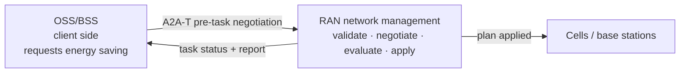
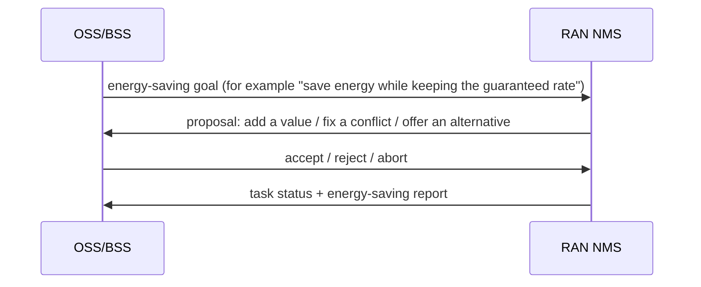
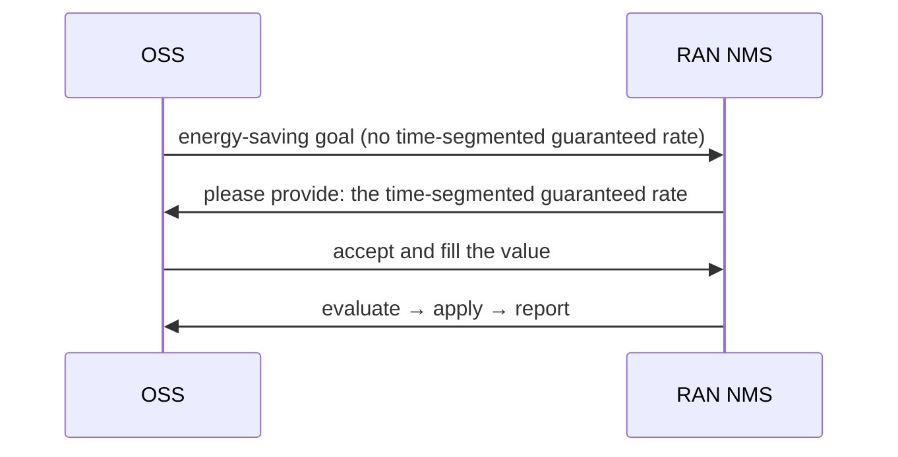
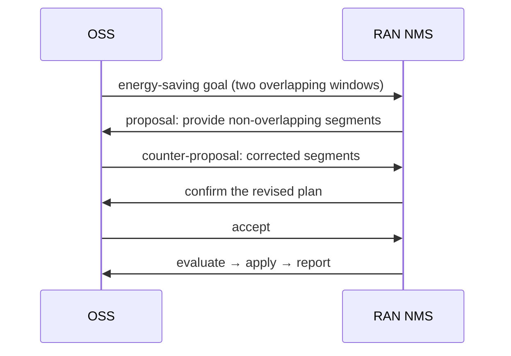
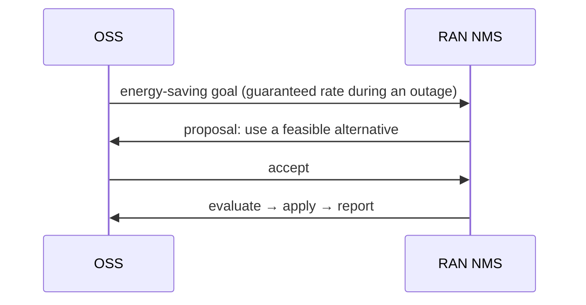

# RAN energy saving: OSS and RAN NMS negotiate, then execute (A2A-T solution)

> **In one sentence:** the OSS asks for an energy-saving goal; the RAN network management system
> negotiates to fill or correct it, then evaluates, applies and reports — automatically, with a
> full audit trail.



## 1. System-to-system interaction

The OSS and the RAN NMS do two things: **agree on the goal, then execute the plan**.

| System | Role | Responsibility |
| --- | --- | --- |
| OSS/BSS | client side | requests the energy-saving goal and decides accept / reject / counter |
| RAN NMS | execution side | validates the goal, negotiates, evaluates and applies the plan, writes the report |



Negotiation may take two or three rounds, but **the task is created only after both sides agree**,
so a wrong goal is never applied.

Typical problems map to three kinds of negotiation:

- missing parameters;
- overlapping time segments;
- infeasible conditions (for example a guaranteed rate during an outage).

## 2. Typical scenarios

### 2.1 Missing value: the NMS asks, the OSS fills it



**Outcome:** the task completes; no manual ticket is needed.

### 2.2 Overlapping segments: correct before executing



**Outcome:** the conflict is fixed before any task exists, so nothing wrong is applied.

### 2.3 Infeasible condition: the NMS proposes an alternative



**Outcome:** the infeasible plan is never applied; the alternative is executable.

The other two outcomes are simple conclusions:

| Scenario | Outcome |
| --- | --- |
| the OSS cannot provide a required value | negotiation ends; no task is created |
| counter-proposals never converge | the NMS aborts at the round limit; no task is created |

## 3. Customer value

| Pain | Without pre-task negotiation | With this solution |
| --- | --- | --- |
| Missing parameters | the task fails, or someone asks by ticket | the NMS asks; the OSS fills the value automatically |
| Conflicting targets | a wrong plan may be applied | the conflict is fixed before the task exists |
| Infeasible conditions | the apply fails and has to be rolled back | an alternative is proposed; nothing runs until accepted |
| Audit | emails and tickets | every proposal, decision and apply is recorded |

## 4. Demo

```bash
# CLI (offline, deterministic, no key): planned outage, no negotiation
python run_demo.py --scenario outage --mode auto --model-mode offline
# Web UI (presentation view; opens on the complete use case 1)
python run_demo.py --ui --model-mode offline
# Web UI with approval 1 (intent) and approval 2 (MML in MIE)
python run_demo.py --ui --mode confirm --approval-gate --scenario target --model-mode offline
# Optional: expose the OSS side as an A2A backend
python run_demo.py --ui --gateway --ui-port 8080 --gateway-port 8001 --model-mode offline
# Share the Web UI on the LAN: explicit tokenless opt-in (trusted network only)
python run_demo.py --ui --ui-host 0.0.0.0 --allow-insecure-bind --model-mode offline
# Or keep a token and share a link; the page stores it in a same-origin cookie
A2AT_SAMPLE_AUTH_TOKEN=<token> python run_demo.py --ui --ui-host 0.0.0.0 --model-mode offline
# colleagues open http://<your-lan-ip>:8080/?token=<token>
```

`--ui-host 0.0.0.0` exposes only the Web UI; the registry and the NMS server stay on loopback.
Without `A2AT_SAMPLE_AUTH_TOKEN` the launcher refuses a non-loopback bind unless
`--allow-insecure-bind` is passed explicitly; in that mode anyone who can reach the port can start
runs, so use it only on a trusted network. With a token, share the `/?token=…` link: the page copies
the token into a same-origin `a2at_ui_token` cookie and removes it from the address bar, so both
`fetch` and the SSE stream authenticate (a browser cannot set an `Authorization` header on an
`EventSource`).

With `--gateway`, the OSS side is itself an A2A agent: an external caller such as Gemini Enterprise
sends one request and receives progress notifications (negotiation and execution milestones) before
the final energy-saving report, either on a stream or through a registered webhook.

The Web UI opens on the presentation view: a 16:9 stage with the engineer, the OSS Agent, the RAN
Agent, the MIE and the radio sites, plus the A2A-T channel between them. Seven examples cover use
case 1 (night-time energy saving, with and without negotiation) and use case 2 (planned power
outage). The stage follows the live run at a human pace through nine steps: request, structured
Task-T, approval 1 (intent), Task-T sent, negotiation when needed, strategy and task start, data
collection (days 2 to 8, compressed), approval 2 (MML in MIE) and apply and report. The right column
keeps the evidence: what the OSS Agent understood (with the 24-hour throughput chart), every
proposal and decision turn with its full message, and the merged session trace.

Approval 1 is real: in `--mode confirm`, the Task-T is held before it leaves the OSS Agent until the
engineer confirms the structured intent. Approval 2 is the MIE MML review: with `--approval-gate`,
the RAN Agent publishes the real A2A `INPUT_REQUIRED` state before applying a plan; the page asks the
engineer to export, check and acknowledge the MML suggestion in MIE. A rejection applies nothing and
ends the run without a report. The data-collection phase is driven by two real `WORKING` status
updates from the RAN Agent; the page compresses the days into a few seconds and never invents
measurements.

The playback controls (auto / step by step, speed, pause, previous / next, loop) only pace the
presentation; the backend run is real. Transport, model and language are fixed when the process
starts, so the page itself offers only the scenario switcher and the request text.

For the protocol-level view (phases, LLM and tool calls, raw payloads, run history), start the same
command with `--ui-mode explorer`. Installation, environment variables and the full command
reference are in the [technical guide](TECHNICAL.md).

## 5. Integration boundary

| OSS side | NMS side |
| --- | --- |
| Integrate the A2A-T client; the SDK carries the protocol | Keep the existing NMS evaluation, apply and reporting capability |
| Provide a decision agent: accept / reject / counter | Replace the sample tools with real NMS interfaces |
| Keep your own policy, approval and audit | Keep the negotiation policy and task store |

In the reference implementation the OSS side uses an ADK decision agent and the NMS side uses
LangGraph; those are implementation choices and do not change the interaction above.

## 6. Key characteristics

| Characteristic | What it means |
| --- | --- |
| Auditable | every proposal, decision, apply and report is recorded |
| Model-independent | offline runs are reproducible; a live model only affects decisions and planning |
| Replaceable | tools and policy can be replaced with the real NMS implementation |

## 7. Technical guide

Protocol details, implementation structure, configuration, tests and production notes are in the
[technical guide](TECHNICAL.md).
