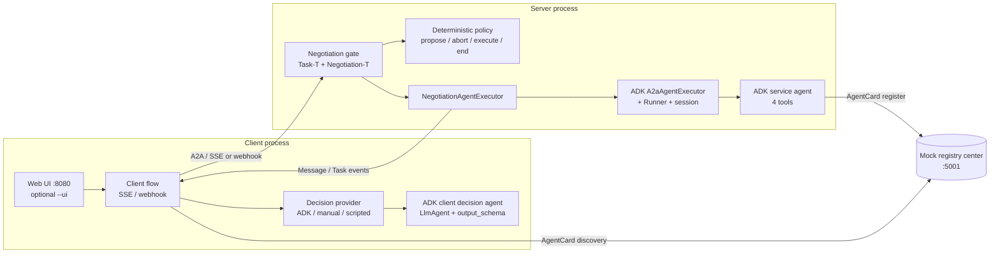

# RAN Energy Saving Sample (A2A + A2A-T + ADK)

A runnable reference for an agent-to-agent RAN (Radio Access Network) energy-saving service. A
client agent and a RAN domain server agent agree on an energy-saving task through A2A-T
`Negotiation-T`, then execute it through a standard A2A Task with Google ADK (Agent Development
Kit) agents on both sides.

The sample is written for two audiences: teams building a **client agent** and teams building a
**server agent**. When a component belongs to one side, this document names that side instead of
addressing an unspecified "you".

**Glossary**

| Term | Meaning |
| --- | --- |
| A2A | Agent2Agent protocol: transports messages and Tasks between agents. |
| A2A-T | The A2A-T SDK extension used here: `Task-T` (structured task prompts) and `Negotiation-T` (pre-task negotiation messages). |
| ADK | Google Agent Development Kit: builds the `LlmAgent`s, tools, `Runner`, and sessions used by this sample. |
| RAN | Radio Access Network: the radio cells and their energy/load behaviour. |
| SLA | Service Level Agreement: the guaranteed throughput floor a cell must keep. |
| OSS / BSS | Operations / Business Support Systems: a production integration target, not part of this sample. |
| OCS | Online Charging System: a production charging integration target, not part of this sample. |

## 1. What this sample solves

A client asks for RAN energy saving, for example "maximize energy saving while keeping a
time-segmented guaranteed throughput target". The request often cannot be executed exactly as
received:

- a required parameter is missing (which time-segmented throughput target?);
- a target is ambiguous (two throughput windows overlap);
- the request is infeasible under current conditions (a guaranteed rate during a long power
  outage).

Instead of rejecting immediately, the server opens a **Negotiation-T** session. Server and client
exchange standalone A2A `Message`s — `Propose`, `Accept`, `Reject`, `Abort` — **before any Task
exists**. When the client accepts, the negotiated `Task-T` prompt is handed to an ADK server agent,
which creates the Task and runs four deterministic tools: read the cell profile, evaluate the plan,
apply the plan, and write the report.

The sample demonstrates:

- four A2A-T performatives on a real A2A HTTP+JSON chain;
- true multi-round negotiation (`maxRounds = 3`), including counter-proposals;
- an ADK `LlmAgent` with tools and a structured `output_schema` on the client, and an ADK
  `LlmAgent` with tools on the server;
- an explicit integration seam between a pre-task negotiation gate and ADK's
  `A2aAgentExecutor`;
- deterministic offline runs (scripted SDK LLM + ADK fake model) and a live mode against an
  OpenAI-compatible endpoint;
- a CLI and a lightweight Web UI.

## 2. Architecture and layout



All negotiation happens **before the Task is created**: `Propose` / `Accept` / `Reject` /
`Abort` are standalone `Message`s, not Task events. Only an accepted negotiation produces a
Task, which the inner ADK `A2aAgentExecutor` creates and drives to `COMPLETED`.

### Directory layout

| Path | Responsibility |
| --- | --- |
| [`run_demo.py`](run_demo.py) | Three-process launcher: starts registry and server in the background, runs the CLI client in the foreground (or serves the Web UI with `--ui`), and stops the children afterwards. |
| [`env.example`](env.example) | Unified offline-ready configuration template. |
| [`agents/server_agent/`](agents/server_agent) | Server ADK agent: `agent.py` exports `root_agent`; `tools.py` holds the four tools; `prompts/service_instruction.md` is the instruction. |
| [`agents/client_agent/`](agents/client_agent) | Client ADK decision agent: `agent.py` exports `root_agent`; `tools.py` holds the SLA and impact tools; `prompts/request_instruction.md` is the instruction. |
| [`protocol/negotiation_gate.py`](protocol/negotiation_gate.py) | The server's only protocol entry: identifies pre-task requests, validates Task-T / Negotiation-T messages, and forwards accepted requests. |
| [`protocol/negotiation_policy.py`](protocol/negotiation_policy.py) | Pure deterministic server policy: `propose`, `abort`, `execute`, or `end`. Never calls an LLM. |
| [`protocol/server_executor.py`](protocol/server_executor.py) | Outer `AgentExecutor` around ADK's `A2aAgentExecutor`, plus the custom request converter and artifact interceptor. |
| [`protocol/server_app.py`](protocol/server_app.py) | Server assembly: AgentCard (declares `Task-T/v1` and `Negotiation-T/v1`), request handler, Starlette app, registry registration. |
| [`protocol/client_flow.py`](protocol/client_flow.py) | Client protocol flow: initial Task-T, multi-round negotiation, accept refill, and terminal handling over SSE or webhook. |
| [`protocol/client_runtime.py`](protocol/client_runtime.py) | Client assembly: per-run SDK `.env`, discovery, SDK client, transport, and decision provider. |
| [`protocol/decision_provider.py`](protocol/decision_provider.py) | Decision-provider protocol and the ADK, manual, and scripted implementations. |
| [`protocol/discovery.py`](protocol/discovery.py) | AgentCard discovery through the registry center or `/.well-known/agent-card.json`. |
| [`protocol/messages.py`](protocol/messages.py) | A2A-T metadata helpers: extension URIs, `templateUri`, `negotiationContext`, end message, sample-only metadata. |
| [`protocol/transcript.py`](protocol/transcript.py) | Structured run transcript written to `runs/<timestamp>-<scenario>.json` and `.md`. |
| [`shared/config.py`](shared/config.py) | Reads `.env` and builds the ADK model (fake model offline, `LiteLlm` live). |
| [`shared/agent_card.py`](shared/agent_card.py) | AgentCard identity constants shared by the client (discovery) and the server (card build). |
| [`shared/sdk_env.py`](shared/sdk_env.py) | Per-run SDK `.env` builder shared by both runtimes (no client↔server import). |
| [`shared/models.py`](shared/models.py) | `NegotiationDecision` (client `output_schema`) and the provider-facing proposal view. |
| [`shared/scenario.py`](shared/scenario.py) | Five scenario definitions: requests, expected performative/round sequence, terminal state, offline decisions. |
| [`shared/task_schema.py`](shared/task_schema.py) | Caller parameter schema used by server validation and client accept refill. |
| [`shared/ran_data.py`](shared/ran_data.py) + [`resources/ran_data/cells.json`](resources/ran_data/cells.json) | In-memory RAN dataset, plan evaluation, and process-local plan store. |
| [`shared/scripted_llm.py`](shared/scripted_llm.py) + [`resources/mock_llm/`](resources/mock_llm) | Scripted SDK `LLMClient` registered with the official factory; schema-routed canned responses. |
| [`shared/adk_fake_model.py`](shared/adk_fake_model.py) | Deterministic ADK `BaseLlm` used offline and in tests. |
| [`shared/registry_client.py`](shared/registry_client.py) | Registry center register/query HTTP calls. |
| [`shared/webhook_receiver.py`](shared/webhook_receiver.py) | Embedded webhook push receiver with token validation. |
| [`shared/sse_event_consumer.py`](shared/sse_event_consumer.py) | Normalizes A2A stream events into one event shape. |
| [`registry/`](registry) | Mock registry center (AgentCard register/query, port 5001). |
| [`web/`](web) | Starlette Web UI (`app.py`) and the single-page front end (`static/index.html`). |
| [`tests/`](tests) | Unit, integration, transport, Web UI, and five-scenario offline acceptance tests; `tests/js/` holds the Node harnesses run by pytest. |

## 3. Quickstart

Prerequisites: Python 3.12+ and [`uv`](https://docs.astral.sh/uv/). From a fresh checkout, install
the A2A-T SDK and its dev dependencies at the repository root, then add the sample dependencies to
the same `.venv`:

```bash
# 1. Repository root: install the SDK and its dev dependencies into .venv
uv sync --dev

# 2. a2a-t-sample: install the sample dependencies into the same .venv
cd a2a-t-sample
uv pip install -r requirements.txt
```

`uv sync` re-syncs the SDK environment exactly, so re-run step 2 after any later `uv sync --dev`.

Activate that environment before running any sample command (choose the form for your shell):

```bash
source ../.venv/Scripts/activate        # Git Bash / Windows (from a2a-t-sample/)
# source ../.venv/bin/activate          # Linux / macOS
# ../.venv/Scripts/Activate.ps1         # Windows PowerShell
```

Every later `python` is that activated interpreter.

`run_demo.py` falls back to `env.example`, so **offline runs need no `.env` file and no API key**.
To customize, copy the template:

```bash
cp env.example .env              # shared sample configuration
# or: cp ran-energy-saving/env.example ran-energy-saving/.env
```

### Offline CLI (no key, deterministic)

```bash
cd ran-energy-saving
python run_demo.py --scenario information --mode auto --model-mode offline
python run_demo.py --scenario target --mode auto --model-mode offline
```

If you skipped activation, use `../../.venv/Scripts/python.exe` (Windows) or
`../../.venv/bin/python` (Linux/macOS) instead of `python`.

Expected output for `information` (abridged: tool-artifact payload lines, ids and paths omitted):

```text
[run_demo] starting registry on 5001 ...
[run_demo] starting server on 8000 ...
[run_demo] running client (scenario=information, mode=auto, transport=sse, discovery=registry, language=en-US, model_mode=offline) ...
[client] agent-discovered: url=http://127.0.0.1:8000 discovery=registry
[client] event kind=propose performative=PROPOSE summary=## Information Negotiation Please supplement ...
[client] sse-received events=1
[client] decision-requested round=1
[client] event kind=status performative=status summary=TASK_STATE_SUBMITTED
[client] event kind=status performative=status summary=TASK_STATE_WORKING
[client] event kind=artifact performative=artifact summary=<id>: {"args": {"cell_id": "cell-001", "date": "<date>"}, "id": "<id>", "name": "get_cell_energy_profile"}
...  # 7 more tool-call artifacts; ids and payloads omitted
[client] event kind=artifact performative=artifact summary=RAN energy-saving task completed.
[client] event kind=status performative=status summary=TASK_STATE_COMPLETED
[client] sse-received events=12
[client] final_state=task_completed task_id=<uuid>
[client] report={"artifact_id": "<uuid>", "name": "energy saving intent report", "text": "RAN energy-saving task completed."}
[client] transcript: .../runs/<timestamp>-information.json
[client] transcript: .../runs/<timestamp>-information.md
[run_demo] stopped 2 background process(es)
```

Expected output for `target` (two rounds; the client counters in round 1, then accepts round 2;
abridged: tool-artifact payload lines, ids and paths omitted):

```text
[run_demo] starting registry on 5001 ...
[run_demo] starting server on 8000 ...
[run_demo] running client (scenario=target, mode=auto, transport=sse, discovery=registry, language=en-US, model_mode=offline) ...
[client] agent-discovered: url=http://127.0.0.1:8000 discovery=registry
[client] event kind=propose performative=PROPOSE summary=## Target Negotiation Target negotiation for the RAN energy saving task: the guaranteed throughput target has two overlapping time segments, {17:30~23:00,20M...
[client] sse-received events=1
[client] decision-requested round=1
[client] event kind=propose performative=PROPOSE summary=## Target Negotiation Revised proposal for round 2: cell cell-001, window 00:00~06:00, target rate 30%. Please accept this revised plan. ## Target Clarificat...
[client] sse-received events=1
[client] decision-requested round=2
[client] event kind=status performative=status summary=TASK_STATE_SUBMITTED
[client] event kind=status performative=status summary=TASK_STATE_WORKING
...  # 8 tool-call artifacts; ids and payloads omitted
[client] event kind=artifact performative=artifact summary=RAN energy-saving task completed.
[client] event kind=status performative=status summary=TASK_STATE_COMPLETED
[client] sse-received events=12
[client] final_state=task_completed task_id=<uuid>
[client] report={"artifact_id": "<uuid>", "name": "energy saving intent report", "text": "RAN energy-saving task completed."}
[client] transcript: .../runs/<timestamp>-target.json
[client] transcript: .../runs/<timestamp>-target.md
[run_demo] stopped 2 background process(es)
```

The two "propose" lines are the server's round-1 proposal and its revised round-2 proposal; the
second one renders the revision (cell, window and target rate), not a copy of round 1. The client's
own counter-proposal does not appear in its received-event log; open the transcript to see the full
two-way sequence (see §9).

### Live CLI (OpenAI-compatible endpoint)

```bash
python run_demo.py --scenario target --mode auto --model-mode live
```

Live mode uses `ADK_MODEL_*` for the two ADK agents and `A2AT_LLM_*` for the A2A-T SDK. Both must
point at the same OpenAI-compatible endpoint; `env.example` defaults to the local proxy at
`http://127.0.0.1:31943/v1`. The command runs end to end, but the negotiation sequence is
**model-dependent**: the SDK's LLM-backed extraction and semantic validation decide what reaches
the server. Offline mode is the reproducible reference used by the tests and by §4. A live run
should be treated as an integration smoke, not as an acceptance test.

**Live mode is best-effort.** In the `information` scenario the server-side semantic validation and
the client decision agent are model-driven: with the flash model the server may accept the
incomplete prompt (so no negotiation opens), or the client may return a decision that cannot be
parsed. Offline mode is deterministic and is the acceptance path.

### Web UI

```bash
python run_demo.py --ui --ui-port 8080 --scenario information --model-mode offline
```

Open <http://127.0.0.1:8080>. The page selects a scenario, `auto`/`manual` mode, and SSE/webhook;
it shows a live timeline, the final report, and JSON/Markdown transcript downloads. The language
and model mode are process-level and read-only (see `GET /api/meta`).

```bash
curl http://127.0.0.1:8080/api/meta
{"language":"en-US","modelMode":"offline","modelLabel":"offline (scripted)","scenarios":["information","target","feasibility","reject","abort"],"modes":["auto","manual"],"transports":["sse","webhook"],"discoveries":["registry","direct"],"defaultScenario":"information","defaultMode":"auto","defaultTransport":"sse","defaultDiscovery":"registry","finishedGraceMs":2000}
```

### Run Explorer

The `--ui` page is a run explorer, not just a result page: it starts a run from the browser and
shows the whole chain from dispatch to report, including the LLM requests/responses of both
processes. Offline is the deterministic reference; live is best-effort.

```bash
# Offline (no key, deterministic)
python run_demo.py --ui --scenario information --mode auto --model-mode offline
# open http://127.0.0.1:8080

# Live (best-effort; both SDK and ADK use the configured OpenAI-compatible endpoint)
python run_demo.py --ui --scenario information --mode auto --model-mode live
```

Use the left rail to pick a scenario and `auto`/`manual` mode, then **Start run**. The context
strip and `GET /api/meta` show the read-only process language and model mode.

#### The eight phases

| # | Phase | What it shows |
| ---: | --- | --- |
| 1 | Dispatch | Run accepted, client runtime built, discovery and transport ready, expected sequence. |
| 2 | Task-T generation | Client SDK slot extraction, content validation, rendered Task-T prompt. |
| 3 | Task validation | First A2A send, server gate validation, negotiation opened or task accepted directly. |
| 4 | Negotiation | Per round: server propose, decision request, decision, response, server validation. |
| 5 | Resolution | Accepted/rejected/aborted/ended, refilled Task-T and agreed parameters. |
| 6 | Execution | ADK turns, tool calls, intermediate artifacts and `WORKING` status. |
| 7 | Report | Report artifact payload and `COMPLETED`. |
| 8 | Done | Final state, transcript and summary. |

Each event row carries a global number, actor (client/server/LLM/tool/human/system), title,
latency, tokens, round and status. LLM and tool spans nest under the protocol step that caused
them. A decision is recorded when the provider returns, so it appears **before** the task events it
causes. The negotiation phase shows `R1 ✓ R2 ◐` chips; Resolution reads `Accepted`, `Rejected`,
`Aborted` or `Ended`. The timeline switches between **Story** (phase cards) and **Waterfall**
(flat durations) and filters by All/Protocol/LLM/Tools/Errors, actor, round and free-text search.

#### Inspector

Selecting a row opens the inspector with these tabs (not applicable tabs are disabled):

- **Summary** — what/why, key facts, causal links and the associated decision.
- **Protocol** — direction, message/task/context ids, template URI, negotiation context,
  Task-T/Negotiation-T text and raw parts.
- **LLM request** — stage, purpose, system instruction, messages, JSON schema, tools and
  generation parameters.
- **LLM response** — status, latency, tokens, raw and parsed output, function calls, parse errors,
  retries.
- **Tool call** — tool name, arguments, result, duration and error.
- **Raw JSON** — the full span envelope; copy/download always exports the complete payload.

Offline LLM calls do not report token usage; the UI shows `n/a (scripted)` rather than a made-up
`0`.

#### Trace, privacy and limits

`run_demo.py --ui` mints a per-run local token and points the server at the UI
(`A2AT_SAMPLE_TRACE_URL=http://127.0.0.1:<ui_port>`, `A2AT_SAMPLE_TRACE_TOKEN=<random>`); the
server POSTs its spans to `POST /api/runs/{runId}/trace` and the UI validates the run id and token.
Keep this endpoint on localhost: spans carry model prompts, tool arguments and results.

- Without a configured token the ingestion route fails closed (it never accepts unauthenticated
  spans), and a reused keep-alive server must carry the same recorded token.
- `Authorization`, `api_key` and `X-API-Key` are redacted and API keys are never recorded.
- Each LLM request/response payload is capped at 256 KB: the head and tail are kept and the span
  is marked `truncated`.
- `GET /api/runs/{id}/trace.json` returns the complete span list (unique `spanId`, monotonic `seq`)
  plus the transcript; `transcript.json` / `transcript.md` are also downloadable.
- CLI runs (no `--ui`) write the server side to `runs/<runId>/server-trace.jsonl` and print an
  LLM/tool/token summary.

#### `--keep-alive` and PID reuse

`--keep-alive` leaves the registry and server running after the client exits; stop them with
`python run_demo.py --stop`. The PID file (written `0600`, because it carries the local trace token)
also records the model mode, language, trace token and trace URL/UI port of those processes. A later
launch reuses them only when all of them match the requested run. On a mismatch (for example an
`offline` UI after a `live` keep-alive server, or a UI on a new `--ui-port` whose server still posts
to the old port) the launcher stops the recorded processes, prints the reason and starts fresh, so
an offline UI can never silently make live model calls and server spans never go to the wrong
process. A listening port with no PID record belongs to another process: the launcher refuses to
reuse it and asks you to free the port.

#### Limitations

- One active run per UI instance; traces and run state are in memory, so a UI restart loses them.
- Reloading `#run=<id>` replays the recorded stream; it does not resume a run lost with the process.
- Live output depends on the model's extraction/validation; use offline for acceptance.
- Server trace delivery is best-effort: the server batches spans (0.5 s flush) and the UI keeps the
  stream open for a grace window (`finishedGraceMs` in `GET /api/meta`, 2 s by default) after
  `finished` so the last batch arrives. If a batch is still late, the client merges
  `GET /api/runs/{id}/trace.json` on finalize; a batch that never reached the UI is absent from the
  timeline (the transcript and trace files remain the source of truth).
- LLM token usage is only shown when the provider reports it; live calls without usage render `n/a`,
  while offline (scripted) runs render `n/a (scripted)`.

### Manual decision mode

```bash
python run_demo.py --ui --mode manual --scenario target --ui-port 8080
```

`--mode manual` requires `--ui` (the decision form lives in the Web UI). For every server
`Propose`, the client flow waits for a decision submitted through
`POST /api/runs/{id}/decisions`; the default timeout is 300 seconds and a timeout becomes an
`Abort` decision.

## 4. The five scenarios

All sequences are initiated by the server. `S` = server, `C` = client; parentheses show the round.
The expected sequences are asserted by `tests/test_scenarios.py` and `tests/test_client_flow.py`.

| Scenario | Trigger | Negotiation sequence | Final state |
| --- | --- | --- | --- |
| `information` | The Task-T request omits the time-segmented guaranteed throughput target (`content.param_missing`). | `S:Propose(1)` → `C:Accept(1)` | Task `COMPLETED` + report (`task_completed`) |
| `target` | The guaranteed-throughput target has overlapping time segments (`content.value_not_allowed`). | `S:Propose(1)` → `C:Propose(1)` (counter) → `S:Propose(2)` (revision) → `C:Accept(2)` | Task `COMPLETED` + report (`task_completed`) |
| `feasibility` | A guaranteed rate conflicts with an 18-hour power outage (`content.rule_violation`). | `S:Propose(1)` (alternative plan) → `C:Accept(1)` | Task `COMPLETED` + report (`task_completed`) |
| `reject` | The client cannot provide the missing throughput target. | `S:Propose(1)` → `C:Reject(1)` → `S:Message("协商已结束")` | No Task (`no_task_negotiation_ended`) |
| `abort` | The client keeps counter-proposing a plan the policy cannot accept. | `S:Propose(1)` → `C:Propose(1)` → `S:Propose(2)` → `C:Propose(2)` → `S:Propose(3)` → `C:Propose(3)` → `S:Abort(3)` | No Task (`no_task_negotiation_aborted`) |

Notes:

- `target` keeps the client counter-proposal in round 1; only the server's revised plan advances
  to round 2, and the client's `Accept` stays in round 2.
- `reject` and `abort` never create a Task. `reject` ends with a plain A2A `Message` that carries
  no Negotiation-T metadata; `abort` is generated with the common abort template at
  `round = maxRounds = 3`.
- The mapping from the first Task-T validation error code to a negotiation type
  (`content.param_missing` → information, `content.value_not_allowed` → target,
  `content.rule_violation` → feasibility) is a **sample convention**, not an A2A-T contract. It is
  implemented in `NEGOTIATION_KIND_BY_ERROR_CODE` in
  [`protocol/negotiation_policy.py`](protocol/negotiation_policy.py).

## 5. ADK agent development

### Server agent

[`agents/server_agent/agent.py`](agents/server_agent/agent.py) exports `root_agent`, loadable by
`adk run` / `adk web`:

```python
root_agent = LlmAgent(
    name="ran_energy_service_agent",
    model=build_adk_model(),           # fake model offline, LiteLlm live
    instruction=SERVICE_INSTRUCTION,
    tools=[
        get_cell_energy_profile,
        evaluate_energy_saving_plan,
        apply_energy_saving_plan,
        generate_energy_saving_report,
    ],
)
```

| Tool | Inputs | Purpose |
| --- | --- | --- |
| `get_cell_energy_profile` | `cell_id`, `date` | Return the 24-hour load/energy curve, capacity/SLA, and accepted windows. |
| `evaluate_energy_saving_plan` | `cell_id`, `window`, `target_rate` | Check window, rate cap, and SLA; estimate saving and KPI impact. |
| `apply_energy_saving_plan` | `cell_id`, `window`, `target_rate` | Re-evaluate and write the plan to the process-local store. |
| `generate_energy_saving_report` | `plan_id` | Build the structured final report from the stored plan. |

Tools are deterministic functions over [`shared/ran_data.py`](shared/ran_data.py). Expected
failures (unknown cell, malformed input, infeasible plan) return structured
`{"ok": false, "error_code": ...}` dictionaries instead of raising, so the model can explain them.
The instruction (`prompts/service_instruction.md`) tells the agent to read first, evaluate second,
apply third, and report last; it must not skip the evaluation.

ADK runtime: [`protocol/server_executor.py`](protocol/server_executor.py) builds a `Runner` with
`InMemorySessionService`, uses `session_id = context.context_id`, and wraps the agent in ADK's
`A2aAgentExecutor` with `force_new_version=True`.

### Client decision agent

[`agents/client_agent/agent.py`](agents/client_agent/agent.py):

```python
root_agent = LlmAgent(
    name="ran_energy_request_agent",
    model=build_adk_model(),
    instruction=REQUEST_INSTRUCTION,
    tools=[get_sla_policy, evaluate_proposal_impact],
    output_schema=NegotiationDecision,
)
```

`get_sla_policy(cell_id)` returns the cell's SLA floor, maximum saving rate, and accepted windows.
`evaluate_proposal_impact(proposal)` parses a cell id, window, and rate from the proposal text and
returns the deterministic feasibility/impact view. `output_schema=NegotiationDecision` makes ADK
parse the model's structured answer; the client flow never parses free text.

[`protocol/decision_provider.py`](protocol/decision_provider.py) runs the agent through an
`InMemoryRunner`, keeps one ADK session per negotiation id (so later rounds see earlier proposals),
and falls back to a safe `accept` decision only in offline mode.

### Executor and interceptor integration

`NegotiationAgentExecutor` runs the gate first. A short-circuit outcome enqueues exactly one
standalone message (a negotiation `Propose`/`Abort`, or the plain end message) and creates no Task;
otherwise it delegates to the inner ADK executor. Two seams are configured explicitly:

- **`request_converter`** — ADK's default converter reads request-level metadata, but A2A-T
  payloads travel on `context.message.metadata`. The custom converter reads the Task-T prompt from
  there, replaces the short text label with the negotiated prompt, and mirrors the negotiation
  context into ADK session state for audit.
- **`ExecuteInterceptor.after_event` / `after_agent`** — the interceptor stamps the Task-T
  extension URI and template URI on the report artifact, attaches the negotiation context to the
  terminal status, and releases its per-session cache.

### What a customer replaces

The four tools and the two instructions are the business layer. A customer implementing its own
RAN service replaces the tool bodies with calls to its OSS/BSS/network-management systems and
rewrites the instructions; the ADK wiring, gate, policy shape, and executor seams stay.

## 6. A2A-T negotiation integration

### Message shape

Every negotiation message carries:

- `A2A-Extensions: Task-T/v1,Negotiation-T/v1`;
- the rendered Negotiation-T text under the Negotiation-T extension URI;
- `templateUri` — the template the text was rendered from;
- `negotiationContext = {id, round, maxRounds, performative}`.

`protocol/messages.py` is the only place that builds or reads these keys. The negotiation session
id is forced to the A2A `contextId` (sample convention).

### Gate

[`protocol/negotiation_gate.py`](protocol/negotiation_gate.py) is the server's single protocol
entry. It handles only **pre-task** requests (`context.current_task is None`; `context.task_id` is
not a reliable signal because `RequestContext` generates one in its constructor):

1. An initial Task-T request is validated with
   `validate_task_prompt_and_data_filling(prompt, TASK_PARAM_SCHEMA, TASK_TEMPLATE_URI)`.
2. A validation failure whose first error code maps to a negotiation type becomes the initial
   `Propose`; an unmappable failure becomes a terminal `REJECTED` Task with structured errors.
3. An `Accept` is validated with `validate_accept_prompt_and_data_filling`; the agreed Task-T
   prompt is then validated again and handed to the ADK executor.
4. A `Reject` or `Abort` is terminal: the gate answers with a plain message and creates no Task.
5. A client counter-`Propose` is validated with `validate_propose_prompt_and_data_filling`, then
   answered by the policy.

Every SDK call is synchronous, so the gate runs it with `asyncio.to_thread` to keep the server
event loop responsive.

### Policy engine

[`protocol/negotiation_policy.py`](protocol/negotiation_policy.py) is a pure function: state in,
`PolicyDecision` out. It never calls an LLM and never sends anything.

| Input | Decision |
| --- | --- |
| Initial validation failure | `propose` (round 1), or `abort` if already at the round budget. |
| Client `Accept` | `execute`. |
| Client `Reject` / `Abort` | `end`. |
| Client counter-`Propose` before `maxRounds` | `propose` at the next round, accepting the counter plan when feasible or revising it otherwise. |
| Client counter-`Propose` at `maxRounds` | `abort`, keeping the current round. |

The server never emits `Accept`: agreement is expressed by publishing a final acceptable
`Propose` that the client can accept. Without a `sampleProposal` (see below), the policy advances
through a preset revision sequence.

### Decision providers

| Provider | Used by | Behaviour |
| --- | --- | --- |
| `AdkDecisionProvider` | default `--mode auto` | Runs the client ADK agent; returns its structured `NegotiationDecision`. |
| `ManualDecisionProvider` | `--ui --mode manual` | Waits for the Web UI decision; 300 s timeout becomes `Abort`. |
| `ScriptedDecisionProvider` | tests (`MODE_SCRIPTED`; not exposed by `run_demo.py`) | Replays the scenario decisions in order. Offline `auto` mode instead keeps the ADK agent in the loop with the fake model. |

Every provider implements `respond(propose, session) -> NegotiationDecision`. Providers decide
**intent only**; the flow turns it into protocol content and never changes the round.

### Four performatives and round ownership

| Performative | Generated with | Meaning |
| --- | --- | --- |
| `Propose` | `generate_negotiation_propose_prompt_from_text` | Missing information, an ambiguity, an alternative, or a revision. |
| `Accept` | `generate_negotiation_accept_prompt_from_text` | Client accepts; the flow refills the Task-T prompt with `generate_task_prompt_from_data_with_schema`. |
| `Reject` | `generate_negotiation_reject_prompt_from_text` | Client declines; terminal. |
| `Abort` | `generate_negotiation_abort_prompt_from_text` | Server (at `maxRounds`) or client ends the session; terminal. |

Round rules:

- The **server** initiates and is the only side that advances the round (`round = 1` for its first
  `Propose`, then `round + 1` for each revision).
- The **client** always uses `session.with_performative(...)`, keeping the inbound round; it never
  calls `next_round()`.
- `maxRounds = 3`. At round 3 a counter-proposal cannot be followed by a server confirmation, so
  the server aborts at round 3 instead of advancing past the budget.

Negotiation content uses **`fromText` only**. (`fromData` for Negotiation-T is out of scope for
this sample; the Task-T accept refill uses the separate `fromDataWithSchema` API.)

### `sampleProposal`: a sample-only convention

A client counter-proposal may carry:

```json
"metadata": {"sampleProposal": {"cellId": "cell-001", "window": "00:00~06:00", "targetRate": "30"}}
```

`sampleProposal` is **not an A2A-T protocol field**. It lets the deterministic policy evaluate the
counter-proposal with `shared.ran_data.evaluate_plan`, so the offline demo behaves reproducibly. If
it is absent, the protocol still works: the policy advances through its preset revision sequence.
The key is defined in [`protocol/messages.py`](protocol/messages.py) and parsed in
[`protocol/negotiation_policy.py`](protocol/negotiation_policy.py).

## 7. Replace checklist

`KEEP` means the file is protocol/plumbing you can reuse as-is; `REPLACE` means it contains
sample business content or demo-only machinery.

### Client side

| File / function | Verdict | Why |
| --- | --- | --- |
| `protocol/client_flow.py` (`run_client_flow`) | KEEP | Protocol correctness: message sequence, metadata, transports, terminal handling. |
| `protocol/decision_provider.py` (`NegotiationDecisionProvider`, `AdkDecisionProvider`) | KEEP | The ADK integration and decision contract. |
| `agents/client_agent/agent.py` (`build_client_agent`) | KEEP | ADK wiring; replace only if your agent graph differs. |
| `agents/client_agent/prompts/request_instruction.md` | **REPLACE** | Your client's policy and wording. |
| `agents/client_agent/tools.py` (`get_sla_policy`, `evaluate_proposal_impact`) | **REPLACE** | Read your SLA/catalog systems instead of the in-memory dataset. |
| `shared/scenario.py` (scripted decisions, user requests) | **REPLACE** | Demo inputs; keep only for offline demos/tests. |
| `protocol/client_runtime.py` | KEEP | Assembly; adapt the SDK endpoint values via configuration. |
| `shared/scripted_llm.py`, `shared/adk_fake_model.py`, `resources/mock_llm/` | KEEP (offline/test only) | Deterministic tests; never use them in production. |
| `web/app.py`, `web/static/index.html` | KEEP or REPLACE | Developer UI; replace with your own UI if needed. |
| `shared/models.py` (`NegotiationDecision`) | KEEP | Extend fields only if your decision needs more payload. |

### Server side

| File / function | Verdict | Why |
| --- | --- | --- |
| `protocol/negotiation_gate.py` (`NegotiationGate`) | KEEP | Protocol entry and validation/short-circuit logic. |
| `protocol/server_executor.py` (`NegotiationAgentExecutor`, converter, interceptor) | KEEP | ADK integration seams. |
| `protocol/server_app.py` (`build_agent_card`, `build_server_runtime`) | KEEP | Assembly; replace card metadata/provider URL. |
| `protocol/negotiation_policy.py` (`decide` and rule helpers) | REPLACE the rules, KEEP the shape | The state machine is reusable; the business rules and proposal texts are sample-specific. |
| `agents/server_agent/agent.py` (`build_server_agent`) | KEEP | ADK wiring. |
| `agents/server_agent/prompts/service_instruction.md` | **REPLACE** | Your service procedure and wording. |
| `agents/server_agent/tools.py` (four tools) | **REPLACE** | Wire real RAN/OSS/BSS/network-management operations. |
| `shared/ran_data.py`, `resources/ran_data/cells.json` | **REPLACE** | In-memory demo data and plan store. |

### Both sides

| File / function | Verdict | Why |
| --- | --- | --- |
| `protocol/messages.py` | KEEP | A2A-T metadata assembly/parsing. |
| `protocol/discovery.py` | KEEP | Registry/direct discovery. |
| `shared/task_schema.py` + `TASK_TEMPLATE_URI` | **REPLACE** if the template differs | The caller schema and template are the contract both parties agree on. |
| `shared/config.py`, `env.example`, `.env` | **REPLACE values** | Endpoint, ports, language, discovery, transport. |
| `registry/` | **REPLACE** | This is a mock registry center; use your deployment's registry or bypass discovery. |
| `shared/webhook_receiver.py` + `A2AT_SAMPLE_WEBHOOK_TOKEN` | REPLACE auth, KEEP receiver | The static demo token is not production authentication. |
| `protocol/transcript.py` | KEEP | Run records; adapt the output directory if needed. |
| `run_demo.py` | KEEP (development only) | Three-process launcher, not a deployment tool. |
| `tests/` | KEEP / adapt | Replace scenario assertions with your own acceptance cases. |

## 8. Configuration reference

All sample keys are read by [`shared/config.py`](shared/config.py), `run_demo.py`, or the A2A-T
SDK. `run_demo.py` reads `A2AT_SAMPLE_UI_PORT` only as the default of `--ui-port`; passing
`--ui-port` overrides it. Full template: [`env.example`](env.example) (also
[`../env.example`](../env.example)).

| Key | Values | Effect |
| --- | --- | --- |
| `A2AT_SAMPLE_MODEL_MODE` | `offline` (default), `live` | `offline` = scripted SDK provider + deterministic ADK fake model; `live` = both use the OpenAI-compatible endpoint. |
| `A2AT_LANGUAGE` | `en-US`, `zh-CN` (default `zh-CN` when unset; `run_demo.py` defaults to `en-US`) | Process-level language for templates, canned responses, registry/server/client. Not switchable per run; the Web UI only displays it. |
| `A2AT_SAMPLE_HOST` / `A2AT_SAMPLE_PORT` | default `127.0.0.1` / `8000` | Server bind and advertised AgentCard interface. |
| `REGISTRY_CENTER_HOST` / `REGISTRY_CENTER_PORT` | default `127.0.0.1` / `5001` | Mock registry bind and lookup URL. |
| `A2AT_SAMPLE_DISCOVERY` | `registry` (default), `direct` | Discovery mode. |
| `A2AT_SAMPLE_DIRECT_SERVER_URL` | default `http://127.0.0.1:8000` | Base URL read by `direct` discovery. |
| `A2AT_SAMPLE_TRANSPORT` | `sse` (default), `webhook` | Client event transport. |
| `A2AT_SAMPLE_WEBHOOK_PORT` | default `9000` (`0` = ephemeral) | Embedded webhook receiver port. |
| `A2AT_SAMPLE_WEBHOOK_TOKEN` | default `demo-webhook-token` | Static push token checked against `X-A2A-Notification-Token`. |
| `A2AT_SAMPLE_WEBHOOK_IDLE_TIMEOUT` | default `300` (the HTTP budget) | Seconds without a push before a webhook phase ends; a phase must not end before the client gives up. |
| `A2AT_SAMPLE_HTTP_TIMEOUT_SECONDS` | default `300` (> 0) | Client HTTP budget of one A2A request: the `httpx` client timeout and `ClientCallContext.timeout` of every send. |
| `A2AT_SAMPLE_LLM_TIMEOUT_SECONDS` | default `120` (> 0) | Live LLM budget of one call (SDK structured call or ADK `LiteLlm` turn), written into the per-run SDK `.env`. |
| `A2AT_SAMPLE_LLM_MAX_ATTEMPTS` | default `1` (`1`..`10`) | Live SDK protocol retry limit per retryable step, written into the per-run SDK `.env`; OpenAI transport retries are disabled separately. |
| `A2AT_SAMPLE_UI_PORT` | default `8080` | Default bind port of the Web UI; read by `run_demo.py` as the default of `--ui-port`. |
| `A2AT_SAMPLE_TRACE_URL` | unset; `--ui` sets `http://127.0.0.1:<ui_port>` | Server trace endpoint (Web UI). Local demo only; the server POSTs spans there. |
| `A2AT_SAMPLE_TRACE_TOKEN` | unset; `--ui` mints a random token | Local token the server presents and the UI requires; unset disables ingestion (fails closed). |
| `A2AT_SAMPLE_TRACE_DIR` | unset; CLI sets `<sample>/runs` | Directory of the CLI server trace (`<dir>/<runId>/server-trace.jsonl`). |
| `ADK_MODEL_PROVIDER` | `litellm` | ADK model provider (only LiteLlm is implemented by this sample). |
| `ADK_MODEL_NAME` | default `openai/mass/volcengine/deepseek-v4.1-flash` | LiteLlm model id (provider prefix required). |
| `ADK_MODEL_API_BASE` | default `http://127.0.0.1:31943/v1` | OpenAI-compatible endpoint. |
| `ADK_MODEL_API_KEY` | default `not-needed` | Endpoint key. |
| `A2AT_LLM_PROVIDER` | `openai_traced` in live mode; overridden to `scripted_traced` offline | SDK provider (traced wrappers of `openai` / `scripted`; the trace capture never changes behavior). |
| `A2AT_LLM_MODEL` | default `mass/volcengine/deepseek-v4.1-flash` | SDK model id (no LiteLlm prefix). |
| `A2AT_LLM_API_KEY` | default `not-needed`; overridden offline | SDK endpoint key. |
| `A2AT_LLM_BASE_URL` | default `http://127.0.0.1:31943/v1` | SDK endpoint base URL. |
| `A2AT_LLM_MAX_TOKENS`, `A2AT_LLM_TEMPERATURE`, `A2AT_LLM_TIMEOUT_SECONDS` | SDK defaults (`A2AT_LLM_TIMEOUT_SECONDS` is overridden per run) | Structured-call limits. The per-run SDK `.env` always uses `A2AT_SAMPLE_LLM_TIMEOUT_SECONDS` / `A2AT_SAMPLE_LLM_MAX_ATTEMPTS`. |
| `A2AT_LLM_DETAIL_LOG_ENABLED` | `false` (default) | Print full LLM payloads (debug; may expose sensitive content). |
| `A2AT_SAMPLE_DEBUG` | `false` (default) | Extra sample debug logging. |

**Offline mode.** Before constructing `A2ATClient` / `A2ATServer`, the runtimes register the traced
wrappers (`scripted_traced`, live `openai_traced`) and build a temporary SDK `.env` with
`A2AT_LLM_PROVIDER=scripted_traced`, `A2AT_LLM_MODEL=scripted`, `A2AT_LLM_API_KEY=not-needed`. The
source `.env` is never modified. The ADK side uses `shared/adk_fake_model.py`. Logs and the Web UI
label the run `offline (scripted)`.

**Live mode.** Both SDK and ADK use the configured endpoint. On Windows, keep `PYTHONUTF8=1`
(`run_demo.py` sets it for its children). Live output depends on the model's extraction and
semantic validation; see §3.

**Timeout budgets.** The client sends every A2A request with `A2AT_SAMPLE_HTTP_TIMEOUT_SECONDS`
(300s default) in `ClientCallContext.timeout`, and the `httpx` client uses the same budget. In live
mode the server gate performs several LLM calls before it emits any event, so the client budget must
outlast that worst case; the old fixed 60s made the client give up while the server was still
working (`A2AClientTimeoutError`). Live LLM calls have a **120s per-call budget** (shared by SDK
structured calls and ADK `LiteLlm` turns; raise it for slower endpoints). The per-run SDK `.env`
carries `A2AT_LLM_TIMEOUT_SECONDS=120` and `A2AT_LLM_MAX_ATTEMPTS=1`. The OpenAI SDK's own transport
retries are disabled by the traced provider, and LiteLLM is built with `num_retries=0`, so one call
cannot silently become three attempts; a stuck call fails within the configured budget and the gate
answers with a structured protocol error message the client can display. Offline mode is unaffected
(the scripted provider makes no network call). The webhook idle backstop follows the same rule and
defaults to the 300s HTTP budget, so it cannot end a phase while the client is still waiting.

Existing `.env` files that set `A2AT_SAMPLE_WEBHOOK_IDLE_TIMEOUT=30` or `A2AT_LLM_TIMEOUT_SECONDS=60`
should be updated or removed: the new sample keys are `A2AT_SAMPLE_HTTP_TIMEOUT_SECONDS=300`,
`A2AT_SAMPLE_LLM_TIMEOUT_SECONDS=120`, and `A2AT_SAMPLE_LLM_MAX_ATTEMPTS=1`.

**Ports.** Defaults are server `8000`, registry `5001`, webhook `9000`, Web UI `8080`.
`run_demo.py` writes these into the per-run `.env` it hands to all three processes.

## 9. Testing and verification

Run from `a2a-t-sample/ran-energy-saving`, with the sample dependencies installed:

```bash
PYTHONPATH=. python -m pytest tests -q
python -m ruff check shared agents protocol web tests run_demo.py
```

(`python` must be the environment activated in §3; without activation use
`../../.venv/Scripts/python.exe` on Windows or `../../.venv/bin/python` on Linux/macOS.)

The suite is fully offline and deterministic (360 tests). What it covers:

| Test module | Coverage |
| --- | --- |
| `test_policy.py` | Every policy decision and round rule, including the abort at `maxRounds` and the error-code mapping. |
| `test_negotiation_gate.py` | Message classification, Task-T/Negotiation-T validation calls, round advance, terminal handling, and the real offline server. |
| `test_client_flow.py` | Five scenario flows, accept/counter/reject/abort message construction, the `sampleProposal` convention, and both transports. |
| `test_decision_provider.py` | Contract of the ADK, manual, and scripted providers, including manual timeout. |
| `test_scenarios.py` | End-to-end acceptance: a real server + real client + ADK fake model, asserting the exact performative/round sequence and final state. |
| `test_transports.py` | SSE and webhook produce the same performative sequence. |
| `test_web_ui.py` | `/api/meta`, run lifecycle, SSE events, manual decisions, downloads, error statuses, plus a real offline information run (8 phases, monotonic `seq`, a decision before the task events it causes, client/server LLM and tool spans, `trace.json`) and a real manual decision flow. |
| `test_web_static.py` | Static contract: served assets and module graph, no `innerHTML`, inspector tabs, CSS tokens; runs `node --check` on every JS module and the in-repo `tests/js` store and real-frame harnesses (skipped without Node). |
| `test_server_executor.py` | Request converter, artifact interceptor, executor delegation, AgentCard extensions, registry payload. |
| `test_server_tools.py`, `test_ran_data.py` | The four tools and the in-memory dataset. |
| `test_scripted_llm.py`, `test_adk_fake_model.py` | Schema routing and the deterministic ADK model. |
| `test_config.py`, `test_scenario.py`, `test_transcript.py`, `test_client_runtime.py` | Configuration, scenario definitions, transcripts, runtime assembly (including the client import that must not build a server model). |
| `test_run_demo.py` | Launcher defaults and PID reuse: compatible metadata reuses, a model-mode/language/token mismatch restarts, a foreign listener is refused. |

The JS harnesses live in [`tests/js`](tests/js): `store.test.mjs` replays synthetic frames and
`frames.test.mjs` replays the real SSE frames of the offline integration run. Both run from
`pytest` and skip cleanly when `node` is not installed.

### Five-scenario offline smoke

```bash
for s in information target feasibility reject abort; do
  python run_demo.py --scenario "$s" --mode auto --model-mode offline
done
```

Expected `[client] final_state` values:

| Scenario | `final_state` |
| --- | --- |
| `information` | `task_completed` |
| `target` | `task_completed` |
| `feasibility` | `task_completed` |
| `reject` | `no_task_negotiation_ended` |
| `abort` | `no_task_negotiation_aborted` |

### Transport and UI smoke

```bash
python run_demo.py --scenario information --mode auto --model-mode offline --transport webhook
python run_demo.py --scenario target --mode auto --model-mode offline --transport webhook
```

Both reach `task_completed`; the client logs
`[client] webhook-mode: push_url=http://127.0.0.1:9000/webhook`.

```bash
python run_demo.py --ui --ui-port 8080 --scenario information --model-mode offline
curl http://127.0.0.1:8080/api/meta
```

The UI smoke is confirmed when `/api/meta` returns the language, model mode, scenarios, modes,
transports, and defaults shown in §3.

### Live smoke

```bash
python run_demo.py --scenario target --mode auto --model-mode live
```

Requires a reachable OpenAI-compatible endpoint. The command is exercised manually; it is not part
of the automated suite because output depends on the model. With the local proxy used during this
sample's development, the run completed end to end but the SDK's semantic validation rejected the
target request (`task_rejected`) instead of opening the designed negotiation; offline mode is the
authoritative, reproducible demonstration.

Each run writes `runs/<timestamp>-<scenario>.json` and `.md` (gitignored). The Markdown file
contains the two-way timeline and the decisions table.

## 10. Production notes

The sample is deliberately a prototype. Before production:

- **Persistence.** Plans live in a process-local store (`shared/ran_data._PLANS`), Tasks in
  `InMemoryTaskStore`, push configs in `InMemoryPushNotificationConfigStore`, and ADK sessions in
  `InMemorySessionService`. Replace all four with durable stores; ADK also requires a persistent
  session service for multi-instance deployments.
- **Registry.** `registry/` is a mock. Use the deployment's real registry center or configure
  `direct` discovery with a stable AgentCard endpoint.
- **Webhook security.** `A2AT_SAMPLE_WEBHOOK_TOKEN` is a static demo token. Use per-client secrets,
  rotation, replay protection, and TLS; treat the receiver as an exposed HTTP endpoint.
- **Authentication and TLS.** The A2A server and registry have no authentication in this sample.
  Terminate TLS and add authentication/authorization at the gateway or in the A2A layer.
- **Model governance.** Live mode sends prompts and extracted parameters to the configured model
  endpoint. Apply data classification, redaction, rate limits, and provider agreements. Keep
  `A2AT_LLM_DETAIL_LOG_ENABLED=false` outside debugging.
- **Deterministic code owns protocol correctness.** Keep rounds, performatives, terminal states,
  and Task lifecycle in deterministic code; let the LLM produce intent, text, and tool calls only.
- **Offline machinery is test-only.** `shared/scripted_llm.py`, `shared/adk_fake_model.py`,
  `resources/mock_llm/`, and `shared/scenario.py` exist to make demos and tests reproducible; do
  not ship them as production paths.
- **Single-run Web UI.** The UI runs one concurrent run per app instance and is a developer tool;
  it is not a multi-tenant console.
- **SDK scope.** This sample does not modify `src/a2a_t/`. SDK defects should be handled as
  separate SDK changes, not patched inside the sample.
