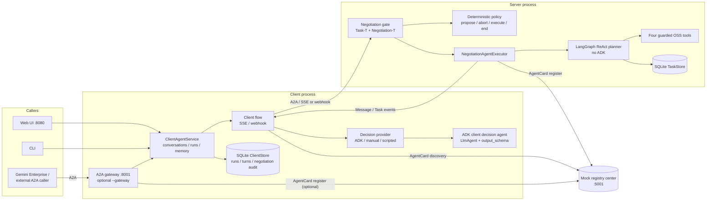
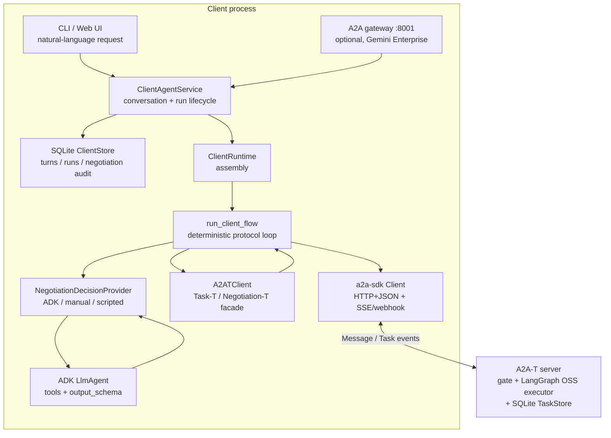
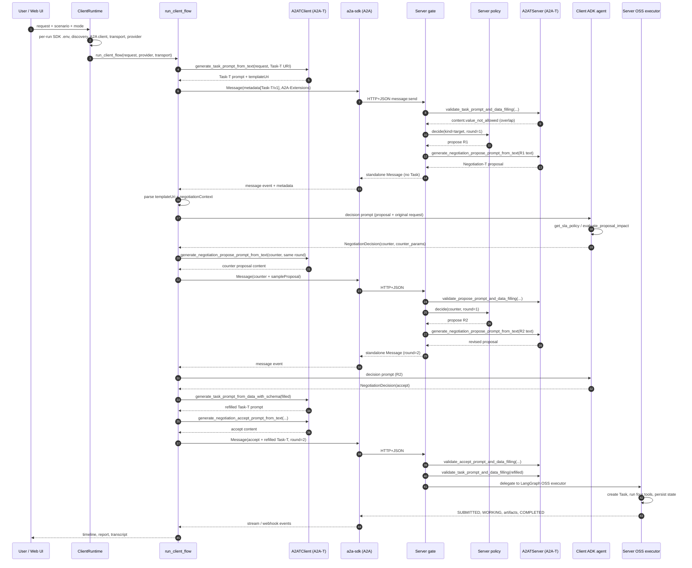
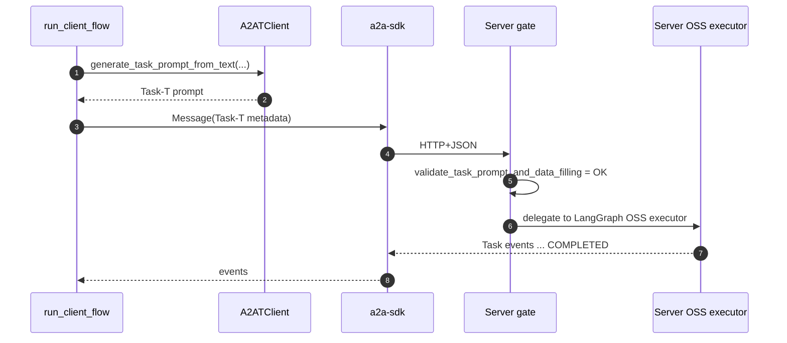
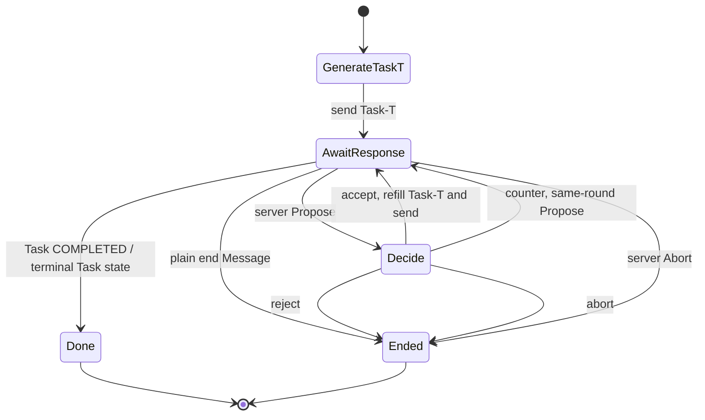
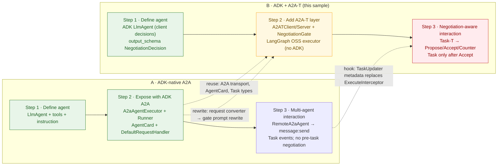
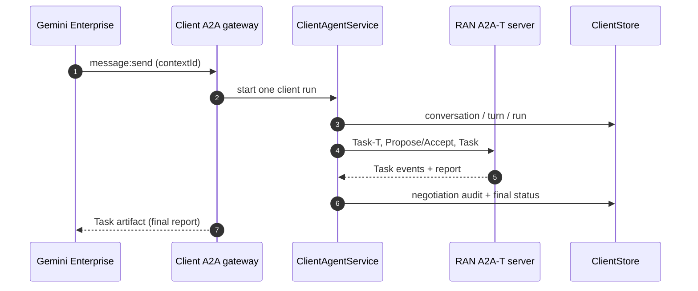
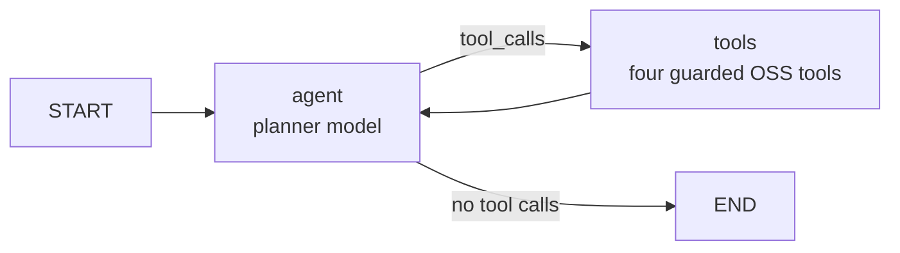

# RAN Energy Saving Sample (A2A + A2A-T + ADK client)

A runnable reference for an agent-to-agent RAN (Radio Access Network) energy-saving service. A
client agent and a RAN domain server agent agree on an energy-saving task through A2A-T
`Negotiation-T`, then execute it through a standard A2A Task. Google ADK (Agent Development Kit)
is used **only for the client decision agent**; the server is a plain A2A/A2A-T service with a
LangGraph ReAct executor over deterministic OSS tools.

The sample is written for two audiences: teams building a **client agent** and teams building a
**server agent**. Its primary purpose is the **client-side integration**: showing how one agent
combines A2A transport, A2A-T semantics, and ADK reasoning without letting the model own protocol
correctness. §2.1 is that integration guide; the rest of the document is the reference
implementation. When a component belongs to one side, this document names that side instead of
addressing an unspecified "you".

**Glossary**

| Term | Meaning |
| --- | --- |
| A2A | Agent2Agent protocol: transports messages and Tasks between agents. |
| A2A-T | The A2A-T SDK extension used here: `Task-T` (structured task prompts) and `Negotiation-T` (pre-task negotiation messages). |
| ADK | Google Agent Development Kit: builds the client `LlmAgent`, its tools, `Runner`, and sessions. The server does not use ADK. |
| RAN | Radio Access Network: the radio cells and their energy/load behaviour. |
| SLA | Service Level Agreement: the guaranteed throughput floor a cell must keep. |
| OSS / BSS | Operations / Business Support Systems: the server-side domain role, and a production integration target. The sample models the OSS task executor and its persisted Task store. |
| OCS | Online Charging System: a production charging integration target, not part of this sample. |

## 1. What this sample solves

A client asks for RAN energy saving, for example "maximize energy saving while keeping a
time-segmented guaranteed throughput target". The request often cannot be executed exactly as
received:

- a required parameter is missing (which time-segmented throughput target?);
- a target is ambiguous (two throughput windows overlap);
- the request is infeasible under current conditions (a guaranteed rate during a long power
  outage).

Instead of rejecting immediately, the server opens a **Negotiation-T** session. Server and client
exchange standalone A2A `Message`s — `Propose`, `Accept`, `Reject`, `Abort` — **before any Task
exists**. When the client accepts, the negotiated `Task-T` prompt is handed to a **LangGraph ReAct
planner**, which creates the Task, chooses and runs four guarded OSS tools (read the cell profile,
evaluate the plan, apply the plan, write the report), and persists every Task transition in SQLite.

The sample demonstrates:

- four A2A-T performatives on a real A2A HTTP+JSON chain;
- true multi-round negotiation (`maxRounds = 3`), including counter-proposals;
- an ADK `LlmAgent` with tools and a structured `output_schema` on the client; the server has no
  ADK model and runs a LangGraph ReAct planner over deterministic OSS tools;
- an explicit integration seam between the pre-task negotiation gate and the task executor;
- deterministic offline runs (scripted SDK LLM + client ADK fake model + scripted LangGraph planner)
  and a live mode against an OpenAI-compatible endpoint;
- two SQLite stores: the server's A2A `TaskStore` and the client's conversation/run/negotiation
  store, plus Web UI tables for both;
- an optional inbound A2A gateway so the client agent can also serve as a Gemini Enterprise
  backend agent;
- a CLI and a lightweight Web UI.

## 2. Architecture and layout



All negotiation happens **before the Task is created**: `Propose` / `Accept` / `Reject` /
`Abort` are standalone `Message`s, not Task events. Only an accepted negotiation produces a
Task, which the LangGraph executor creates and drives to `COMPLETED`; the server uses no ADK agent,
but its planner is an LLM in live mode.

### 2.1 Client-layer integration: A2A, A2A-T, and ADK

The sample's primary goal is the **client-side integration**, not the RAN business logic. A client
agent has to combine three layers that solve different problems:

| Layer | Responsibility | Owns | Does not do |
| --- | --- | --- | --- |
| **A2A** (`a2a-sdk`) | Transport and lifecycle: discover the AgentCard, send `Message`s, stream events or receive webhook pushes, represent the `Task` and its states. | HTTP+JSON, SSE/webhook, `contextId`, `Message`, `Task`, `TaskState`. | It does not know what Task-T or Negotiation-T means. |
| **A2A-T** (`a2a_t`) | Semantic layer on top of A2A: extract and validate Task-T parameters, render Task-T prompts, generate and validate Negotiation-T performatives, carry `templateUri` and `negotiationContext`. | `A2ATClient` / `A2ATServer` facade, templates, structured validation, extension metadata. | It does not open HTTP connections or run agents. |
| **ADK** (`google-adk`, client only) | Reasoning and tools: decide what to do with a proposal, call client-side tools, produce a structured `NegotiationDecision`. | `LlmAgent`, tools, `output_schema`, `Runner`, sessions. | It never puts protocol content on the wire, never chooses a round or performative, and never parses raw A2A-T metadata. The server does not use ADK; its execution planner is LangGraph. |
| **Deterministic client flow** (this sample) | Orchestration and protocol correctness: call the right A2A-T API, send the right A2A message, keep rounds and performatives consistent, handle terminal states. | `protocol/client_flow.py`. | It does not make business decisions; those come from the provider. |
| **Client application service + store** (this sample) | Conversation identity, run lifecycle, per-conversation concurrency, recent-turn memory and audit. | `protocol/client_service.py`, `protocol/client_store.py`. | It does not speak A2A or make decisions. |
| **A2A gateway** (optional, this sample) | The client agent's inbound A2A surface for Gemini Enterprise or another caller. | `protocol/client_gateway.py`. | It does not replace the outbound A2A-T flow; it starts one client run per inbound message. |

The one-line mental model:

> **A2A moves the message. A2A-T gives it meaning. ADK supplies the decision. The flow keeps the
> protocol honest.**

#### Client component model



`ClientAgentService` owns conversation identity, persistence, memory and per-conversation
concurrency. `ClientRuntime` is per-run assembly only: it builds a per-run A2A-T SDK `.env`,
registers the traced and scripted providers, creates `A2ATClient`, discovers the server AgentCard,
creates the a2a-sdk client, selects the transport and the decision provider. `run_client_flow` is
where the integration actually happens.

#### End-to-end sequence: target scenario (counter, then accept)

This is the most complete path: the initial Task-T is rejected by validation, the server opens a
target negotiation, the client counters, the server revises, and the client accepts.



The critical structural point: **round-1 and round-2 proposals are standalone `Message`s, not Task
events.** The A2A `Task` appears only after the gate validates the `Accept` and the refilled Task-T.

#### Direct path: Task-T validates without negotiation

If the initial Task-T is complete and valid, the gate never opens a negotiation; the same request
continues into the LangGraph OSS executor. This is the Run Explorer case where phases 4 and 5
stay empty.



#### Terminal paths: reject and abort

`Reject` and `Abort` are also standalone `Negotiation-T` messages. The server validates the terminal
message best-effort, returns a plain A2A `Message` (no Negotiation-T metadata), and **creates no
Task**. The client flow ends as `no_task_negotiation_ended` (client reject) or
`no_task_negotiation_aborted` (server abort at `maxRounds`).



#### Where the A2A-T SDK is called

Every A2A-T call is synchronous and returns generated content or validated parameters. **It does not
send anything.** The flow then wraps the content in an A2A `Message` and the a2a-sdk transport sends
it.

| Moment | Call | Side | Result |
| --- | --- | --- | --- |
| Initial Task-T | `A2ATClient.generate_task_prompt_from_text(request, TASK_TEMPLATE_URI)` | Client | Rendered Task-T prompt; slot extraction and content validation happen here. |
| Initial validation | `A2ATServer.validate_task_prompt_and_data_filling(prompt, TASK_PARAM_SCHEMA, TASK_TEMPLATE_URI)` | Server | Filled parameters or structured `SlotValidationError`s. |
| Server opening proposal | `A2ATServer.generate_negotiation_propose_prompt_from_text(text, context, template_uri)` | Server | `MetadataContent` for `Propose`. |
| Client decision message | `A2ATClient.generate_negotiation_{accept,propose,reject,abort}_prompt_from_text(...)` | Client | `MetadataContent` for the chosen performative. |
| Counter validation | `A2ATServer.validate_propose_prompt_and_data_filling(...)` | Server | Validated counter or structured errors. |
| Accept validation | `A2ATServer.validate_accept_prompt_and_data_filling(...)` | Server | Validated accept. |
| Task-T refill | `A2ATClient.generate_task_prompt_from_data_with_schema(filled, TASK_PARAM_SCHEMA, TASK_TEMPLATE_URI)` | Client | The final agreed Task-T prompt sent with `Accept`. |
| Final Task-T validation | `A2ATServer.validate_task_prompt_and_data_filling(...)` | Server | Gate approval; only now is a Task created. |

`MetadataContent.build_metadata_content()` produces the wire metadata (`Task-T/v1` or
`Negotiation-T/v1` value, `templateUri`, and for negotiation messages `negotiationContext`).
[`protocol/messages.py`](protocol/messages.py) defines the A2A-T metadata keys and helpers, and
[`protocol/client_flow.py`](protocol/client_flow.py) assembles the outbound metadata map and sends
it.

#### How ADK plugs into the client

The ADK agent is deliberately **not** part of the wire path:

1. `run_client_flow` parses the inbound `Propose` into a `NegotiationProposeView` and a
   `NegotiationContext`.
2. `AdkDecisionProvider.respond(propose, session)` builds a decision prompt containing the proposal,
   its negotiation type and round, and the original user request.
3. The provider runs `agents.client_agent.agent.build_client_agent` through an `InMemoryRunner`,
   keeping one ADK session per negotiation id so later rounds see earlier proposals.
4. The agent may call `get_sla_policy` and `evaluate_proposal_impact`;
   `output_schema=NegotiationDecision` makes ADK return a typed decision.
5. The flow turns `action` into exactly one A2A-T performative. **The model never sets `round`,
   `performative`, `templateUri`, or message metadata.**

This is the integration seam to keep if you replace the business logic: swap the tools and the
instruction, keep `NegotiationDecision` and `AdkDecisionProvider`, and let the flow remain
deterministic.

#### Integration recipe for a new client

1. Configure the A2A-T SDK through its **file-based** `.env`; build a per-run file instead of
   mutating the source. The SDK reads `A2AT_LLM_*` from that file, not from process environment
   variables.
2. Discover the server AgentCard and confirm it declares `Task-T/v1` and `Negotiation-T/v1`.
3. Create the a2a-sdk client with streaming for SSE, or with streaming disabled plus a push
   notification config for webhook.
4. Send the initial Task-T as an A2A `Message`: short text label in `parts`, Task-T prompt under the
   Task-T extension URI in `metadata`, plus `templateUri`; set `A2A-Extensions`.
5. Treat every inbound standalone `Message` with a `negotiationContext` as a negotiation step, not
   as a Task event. Dispatch on `templateUri`, not on prose.
6. Ask your decision provider for intent, then call the matching A2A-T generator with
   `session.with_performative(...)`. Never call `next_round()` on the client; the server owns rounds.
7. On `accept`, refill the Task-T with `generate_task_prompt_from_data_with_schema` and send both
   the refilled Task-T and the Negotiation-T accept in one message.
8. Consume Task events only after the accept; stop at `COMPLETED`, a terminal rejection/failure, or
   the plain end message.

The canonical implementation is [`protocol/client_runtime.py`](protocol/client_runtime.py)
(assembly) and [`protocol/client_flow.py`](protocol/client_flow.py) (protocol loop). The replace
checklist in §7 marks which files are reusable and which are sample business content.

### 2.2 ADK-native A2A vs ADK + A2A-T

The left side is the baseline an ADK developer gets from ADK's built-in A2A support. The right side
is this sample: the same ADK authoring step, plus the A2A-T semantic layer and a deterministic
server.



**Legend:** green = reused from ADK/A2A; amber = injected hook; red = new or rewritten.

| Seam | ADK-native A2A | ADK + A2A-T (this sample) | Verdict |
| --- | --- | --- | --- |
| Transport, AgentCard, `Task`/event types | `a2a-sdk` | `a2a-sdk` | Reuse |
| Client reasoning | `RemoteA2aAgent` or an ADK agent | ADK `LlmAgent` + `Runner` + `output_schema`, narrowed to decisions | Reuse |
| Initial request conversion | `A2ARequestToAgentRunRequestConverter` | `NegotiationGate` reads message metadata and rewrites the Task-T prompt | Rewrite |
| Pre-task protocol | None | Gate + `NegotiationAgentExecutor` standalone messages | Rewrite |
| Server execution | ADK agent + tools + session | `LangGraphTaskExecutor` + LangGraph ReAct planner + four guarded tools | Rewrite |
| Artifact/status metadata | `ExecuteInterceptor.after_event` / `after_agent` | `TaskUpdater.add_artifact(metadata=...)` / `update_status(metadata=...)` | Hook |
| Memory/continuity | ADK `SessionService` keyed by `contextId` | Client SQLite store (`conversations`/`turns`) + `contextId`/`taskId`; server SQLite `TaskStore` | Rewrite |
| Observability | ADK `TracePlugin` | Client ADK tracing + server LangGraph planner/tool spans | Reuse client, rewrite server |
| Inbound surface | ADK A2A server endpoint | Optional standalone A2A gateway (`ClientGatewayExecutor`) | Rewrite |

The important boundary: A2A's transport, AgentCard and Task types are reused unchanged. A2A-T adds
the pre-task protocol and structured prompts; the server executor is a LangGraph ReAct graph, not
an ADK agent. The client ADK agent only produces a `NegotiationDecision`; it never writes protocol
metadata or rounds.

### 2.3 Two systems, two databases, and the inbound gateway

The client and the RAN server are separate systems and keep separate state:

| Owner | Store | Tables / content | Written by |
| --- | --- | --- | --- |
| Client | `runs/client-state.sqlite3` (`A2AT_SAMPLE_CLIENT_DB`) | `conversations`, `turns`, `runs`, `negotiation_events`, `task_snapshots` | `ClientAgentService` |
| Server | `runs/task-status.sqlite3` (`A2AT_SAMPLE_TASK_DB`) | A2A `Task` blob + summary columns | `SqliteTaskStore` |

The client store is the queryable audit/index layer; full transcripts and trace spans stay in
`runs/<runId>/` files. It provides:

- **conversation identity**: a client `conversation_id` and an optional `external_id` from the
  caller (for example the Gemini Enterprise conversation id);
- **turn memory**: the newest `A2AT_SAMPLE_CLIENT_MEMORY_TURNS` turns are injected into the next
  decision prompt and Task-T generation;
- **run lifecycle**: `running` / `finished` / `failed` / `interrupted`, with one active run per
  conversation and independent conversations;
- **negotiation audit**: every inbound `Propose` and outbound decision with round, performative,
  content and rationale;
- **task snapshot**: the last A2A Task state observed by the client;
- **restart handling**: a run whose owning process is gone is marked `interrupted`; a live second
  process (gateway + Web UI) keeps its runs.

The optional **inbound A2A gateway** (`run_demo.py --gateway`, port 8001) makes the client agent a
backend agent for Gemini Enterprise or any A2A caller:



One inbound message maps to one client run; the inbound `contextId` becomes the client
`conversation_id`. Negotiation progress stays in the client store and Web UI; the gateway returns
the final report artifact. Manual decisions are disabled on the gateway path.

### Directory layout

| Path | Responsibility |
| --- | --- |
| [`run_demo.py`](run_demo.py) | Multi-process launcher: starts registry, server and (with `--gateway`) the inbound A2A gateway in the background, runs the CLI client in the foreground (or serves the Web UI with `--ui`), and stops the children afterwards. |
| [`env.example`](env.example) | Unified offline-ready configuration template. |
| [`agents/server_agent/`](agents/server_agent) | Server-side LangGraph execution: `planner.py` (scripted/live model + prompt), `langgraph_tools.py` (guarded tools + `PlanGuard`), `graph.py` (ReAct state graph), `tools.py` (pure OSS tools). No ADK. |
| [`agents/client_agent/`](agents/client_agent) | Client ADK decision agent: `agent.py` exports `root_agent`; `tools.py` holds the SLA and impact tools; `prompts/request_instruction.md` is the instruction. |
| [`protocol/negotiation_gate.py`](protocol/negotiation_gate.py) | The server's only protocol entry: identifies pre-task requests, validates Task-T / Negotiation-T messages, and forwards accepted requests. |
| [`protocol/negotiation_policy.py`](protocol/negotiation_policy.py) | Pure deterministic server policy: `propose`, `abort`, `execute`, or `end`. Never calls an LLM. |
| [`protocol/server_executor.py`](protocol/server_executor.py) | Outer negotiation executor plus `LangGraphTaskExecutor`: runs the ReAct planner and publishes the A2A Task lifecycle. No ADK. |
| [`protocol/sqlite_task_store.py`](protocol/sqlite_task_store.py) | SQLite `TaskStore` for persisted A2A Task state and the UI task summaries. |
| [`protocol/server_app.py`](protocol/server_app.py) | Server assembly: AgentCard (declares `Task-T/v1` and `Negotiation-T/v1`), request handler, Starlette app, registry registration. |
| [`protocol/client_flow.py`](protocol/client_flow.py) | Client protocol flow: initial Task-T, multi-round negotiation, accept refill, and terminal handling over SSE or webhook. |
| [`protocol/client_runtime.py`](protocol/client_runtime.py) | Client per-run assembly: per-run SDK `.env`, discovery, SDK client, transport, and decision provider. |
| [`protocol/client_service.py`](protocol/client_service.py) | Client application service: conversations, run lifecycle, memory injection, per-conversation concurrency, persistence hooks. |
| [`protocol/client_store.py`](protocol/client_store.py) | Client SQLite store: conversations, turns, runs, negotiation audit, Task snapshots. |
| [`protocol/client_gateway.py`](protocol/client_gateway.py) | Optional inbound A2A gateway: one inbound message -> one client run -> final report artifact. |
| [`protocol/decision_provider.py`](protocol/decision_provider.py) | Decision-provider protocol and the ADK, manual, and scripted implementations. |
| [`protocol/discovery.py`](protocol/discovery.py) | AgentCard discovery through the registry center or `/.well-known/agent-card.json`. |
| [`protocol/messages.py`](protocol/messages.py) | A2A-T metadata helpers: extension URIs, `templateUri`, `negotiationContext`, end message, sample-only metadata. |
| [`protocol/transcript.py`](protocol/transcript.py) | Structured run transcript written to `runs/<timestamp>-<scenario>.json` and `.md`. |
| [`shared/config.py`](shared/config.py) | Reads `.env`, resolves both database paths, gateway and planner settings, and builds the client ADK model (fake model offline, `LiteLlm` live). |
| [`shared/agent_card.py`](shared/agent_card.py) | AgentCard identity constants shared by the client (discovery) and the server (card build). |
| [`shared/sdk_env.py`](shared/sdk_env.py) | Per-run SDK `.env` builder shared by both runtimes (no client↔server import). |
| [`shared/models.py`](shared/models.py) | `NegotiationDecision` (client `output_schema`) and the provider-facing proposal view. |
| [`shared/scenario.py`](shared/scenario.py) | Five scenario definitions: requests, expected performative/round sequence, terminal state, offline decisions. |
| [`shared/task_schema.py`](shared/task_schema.py) | Caller parameter schema used by server validation and client accept refill. |
| [`shared/ran_data.py`](shared/ran_data.py) + [`resources/ran_data/cells.json`](resources/ran_data/cells.json) | In-memory RAN dataset, plan evaluation, and process-local plan store. |
| [`shared/scripted_llm.py`](shared/scripted_llm.py) + [`resources/mock_llm/`](resources/mock_llm) | Scripted SDK `LLMClient` registered with the official factory; schema-routed canned responses. |
| [`shared/adk_fake_model.py`](shared/adk_fake_model.py) | Deterministic client ADK `BaseLlm` used offline and in tests. |
| [`shared/registry_client.py`](shared/registry_client.py) | Registry center register/query HTTP calls. |
| [`shared/webhook_receiver.py`](shared/webhook_receiver.py) | Embedded webhook push receiver with token validation. |
| [`shared/sse_event_consumer.py`](shared/sse_event_consumer.py) | Normalizes A2A stream events into one event shape. |
| [`registry/`](registry) | Mock registry center (AgentCard register/query, port 5001). |
| [`web/`](web) | Starlette Web UI (`app.py`) and the single-page front end (`static/index.html`). |
| [`tests/`](tests) | Unit, integration, transport, Web UI, and five-scenario offline acceptance tests; `tests/js/` holds the Node harnesses run by pytest. |

## 3. Quickstart

Prerequisites: Python 3.12+ and [`uv`](https://docs.astral.sh/uv/). From a fresh checkout, install
the A2A-T SDK and its dev dependencies at the repository root, then add the sample dependencies to
the same `.venv`:

```bash
# 1. Repository root: install the SDK and its dev dependencies into .venv
uv sync --dev

# 2. a2a-t-sample: install the sample dependencies into the same .venv
cd a2a-t-sample
uv pip install -r requirements.txt
```

`uv sync` re-syncs the SDK environment exactly, so re-run step 2 after any later `uv sync --dev`.

Activate that environment before running any sample command (choose the form for your shell):

```bash
source ../.venv/Scripts/activate        # Git Bash / Windows (from a2a-t-sample/)
# source ../.venv/bin/activate          # Linux / macOS
# ../.venv/Scripts/Activate.ps1         # Windows PowerShell
```

Every later `python` is that activated interpreter.

`run_demo.py` falls back to `env.example`, so **offline runs need no `.env` file and no API key**.
To customize, copy the template:

```bash
cp env.example .env              # shared sample configuration
# or: cp ran-energy-saving/env.example ran-energy-saving/.env
```

### Offline CLI (no key, deterministic)

```bash
cd ran-energy-saving
python run_demo.py --scenario information --mode auto --model-mode offline
python run_demo.py --scenario target --mode auto --model-mode offline
```

If you skipped activation, use `../../.venv/Scripts/python.exe` (Windows) or
`../../.venv/bin/python` (Linux/macOS) instead of `python`.

Expected output for `information` (abridged: tool-artifact payload lines, ids and paths omitted):

```text
[run_demo] starting registry on 5001 ...
[run_demo] starting server on 8000 ...
[run_demo] running client (scenario=information, mode=auto, transport=sse, discovery=registry, language=en-US, model_mode=offline) ...
[client] agent-discovered: url=http://127.0.0.1:8000 discovery=registry
[client] event kind=propose performative=PROPOSE summary=## Information Negotiation Please supplement ...
[client] sse-received events=1
[client] decision-requested round=1
[client] event kind=status performative=status summary=TASK_STATE_SUBMITTED
[client] event kind=status performative=status summary=TASK_STATE_WORKING
[client] event kind=artifact performative=artifact summary={"ok": true, "cell_id": "cell-001", ...}
...  # 2 more tool results, then the report artifact
[client] event kind=artifact performative=artifact summary=energy saving intent report: {"ok": true, "summary": "..."}
[client] event kind=status performative=status summary=RAN energy-saving task completed.
[client] event kind=status performative=status summary=TASK_STATE_COMPLETED
[client] sse-received events=<n>
[client] final_state=task_completed task_id=<uuid>
[client] report={"ok": true, "summary": "Plan plan-cell-001-001 applied ...", ...}
[client] transcript: .../runs/<timestamp>-information.json
[client] transcript: .../runs/<timestamp>-information.md
[run_demo] stopped 2 background process(es)
```

Expected output for `target` (two rounds; the client counters in round 1, then accepts round 2;
abridged: tool-artifact payload lines, ids and paths omitted):

```text
[run_demo] starting registry on 5001 ...
[run_demo] starting server on 8000 ...
[run_demo] running client (scenario=target, mode=auto, transport=sse, discovery=registry, language=en-US, model_mode=offline) ...
[client] agent-discovered: url=http://127.0.0.1:8000 discovery=registry
[client] event kind=propose performative=PROPOSE summary=## Target Negotiation Target negotiation for the RAN energy saving task: the guaranteed throughput target has two overlapping time segments, {17:30~23:00,20M...
[client] sse-received events=1
[client] decision-requested round=1
[client] event kind=propose performative=PROPOSE summary=## Target Negotiation Revised proposal for round 2: cell cell-001, window 00:00~06:00, target rate 30%. Please accept this revised plan. ## Target Clarificat...
[client] sse-received events=1
[client] decision-requested round=2
[client] event kind=status performative=status summary=TASK_STATE_SUBMITTED
[client] event kind=status performative=status summary=TASK_STATE_WORKING
...  # 3 tool results + the report artifact
[client] event kind=artifact performative=artifact summary=energy saving intent report: {"ok": true, "summary": "..."}
[client] event kind=status performative=status summary=RAN energy-saving task completed.
[client] event kind=status performative=status summary=TASK_STATE_COMPLETED
[client] sse-received events=<n>
[client] final_state=task_completed task_id=<uuid>
[client] report={"ok": true, "summary": "Plan plan-cell-001-001 applied ...", ...}
[client] transcript: .../runs/<timestamp>-target.json
[client] transcript: .../runs/<timestamp>-target.md
[run_demo] stopped 2 background process(es)
```

The two "propose" lines are the server's round-1 proposal and its revised round-2 proposal; the
second one renders the revision (cell, window and target rate), not a copy of round 1. The client's
own counter-proposal does not appear in its received-event log; open the transcript to see the full
two-way sequence (see §9).

### Live CLI (OpenAI-compatible endpoint)

```bash
python run_demo.py --scenario target --mode auto --model-mode live
```

Live mode uses `ADK_MODEL_*` for the **client** ADK decision agent, `A2AT_LLM_*` for the A2A-T SDK
on both sides, and `A2AT_SAMPLE_PLANNER_*` (defaulting to the ADK endpoint/model) for the server
LangGraph planner. All must point at the same OpenAI-compatible endpoint; `env.example` defaults
to the local proxy at `http://127.0.0.1:31943/v1`. The command runs end to end, but the negotiation
sequence and the planner's tool choice are **model-dependent**: the SDK's LLM-backed extraction and
semantic validation decide what reaches the server, and the planner chooses the OSS plan. The tools
remain deterministic and guarded. Offline mode is the reproducible reference used by the tests and
by §4. A live run should be treated as an integration smoke, not as an acceptance test.

**Live mode is best-effort, with deterministic guards.** The SDK semantic verdict and the client
decision agent are model-driven, but the sample re-checks the caller schema's required fields and
the designed conflict conditions (overlapping target segments, guaranteed rate during a background
outage) before accepting a Task-T. The client accept path also answers only the requested
information item and normalizes the target to the template's three-segment limit. If the decision
model answers with prose instead of the requested JSON (some OpenAI-compatible gateways drop the
response format), the provider extracts a fenced or embedded JSON object and, when that still
fails, makes one corrective turn in the same ADK session before raising. The SDK's structured calls
(slot extraction, validation) apply the same tolerance: a fenced or prose-wrapped JSON object is
accepted, while genuinely invalid JSON still fails. Offline mode remains the acceptance path.

### Web UI

```bash
python run_demo.py --ui --ui-port 8080 --scenario information --model-mode offline
# LAN access (trusted networks only; the demo UI has no authentication):
python run_demo.py --ui --ui-host 0.0.0.0 --ui-port 8080
```

Open <http://127.0.0.1:8080> (or `http://<host-ip>:8080` when bound to `0.0.0.0`). The page selects
a scenario, `auto`/`manual` mode, and SSE/webhook; it shows a live timeline, the final report, and
JSON/Markdown transcript downloads. The language and model mode are process-level and read-only
(see `GET /api/meta`).

The run setup also has an editable **Original user request** box. It is prefilled with the selected
scenario's default request and sent as `userRequest` on `POST /api/runs`; the client uses it for
Task-T generation instead of the canned request. An empty box falls back to the scenario default,
and **Reset to scenario default** restores the canned text. This is the quickest way to demonstrate
negotiation with a request that is not one of the five presets.

```bash
curl http://127.0.0.1:8080/api/meta
# `scenarioRequests` carries the editable default request of every scenario.
```

### Run Explorer

The `--ui` page is a run explorer, not just a result page: it starts a run from the browser and
shows the whole chain from dispatch to report, including the LLM requests/responses of both
processes. Offline is the deterministic reference; live is best-effort.

```bash
# Offline (no key, deterministic)
python run_demo.py --ui --scenario information --mode auto --model-mode offline
# open http://127.0.0.1:8080

# Live (best-effort; SDK on both sides, ADK client only, same OpenAI-compatible endpoint)
python run_demo.py --ui --scenario information --mode auto --model-mode live
```

Use the left rail to pick a scenario and `auto`/`manual` mode, then **Start run**. The context
strip and `GET /api/meta` show the read-only process language and model mode.

#### Run history

Both databases are readable from the page. The collapsed **History** panel below the timeline has
three tabs and never pushes the explorer off the first screen:

| Tab | Source | Columns |
| --- | --- | --- |
| **OSS tasks** | `GET /api/tasks` → `runs/task-status.sqlite3` | task id, state, context, update time, report summary, run id |
| **Client runs** | `GET /api/client/runs` → `runs/client-state.sqlite3` | run id, conversation, scenario, status, final state, start time, request |
| **Conversations** | `GET /api/client/conversations` | conversation, turns, runs, updated |

The tasks tab refreshes on start/finish and while a run is active, so a `WORKING` row appears
before the run ends. **View** loads `GET /api/client/runs/{id}` (turns, negotiation audit,
transcript links) or `GET /api/client/conversations/{id}` (turns and runs). Every table is
read-only for the page; the server or client service is the only writer.

#### UI language

The interface ships English and Chinese (`zh-CN`) copy in `web/static/js/i18n/` — no build step and
no network request. The header menu selects **Auto**, **English** or **中文** and remembers the
choice in `localStorage`; `?lang=en` / `?lang=zh-CN` overrides it for one page load. **Auto** follows
`A2AT_LANGUAGE`, so a Chinese process gets a Chinese interface and Chinese scenario text together.
When the interface language differs from the process language, the context strip shows a quiet
`UI 中文 · data en-US` hint. Protocol identifiers (`Task-T`, `Negotiation-T`, `PROPOSE`, tool names,
JSON payload values) stay in English so they still match the specification and the trace.

#### Inbound A2A gateway

The client agent can also act as a backend A2A agent:

```bash
python run_demo.py --ui --gateway --ui-port 8080 --gateway-port 8001 --model-mode offline
```

The gateway serves an AgentCard at `http://127.0.0.1:8001/.well-known/agent-card.json` and accepts
`POST /message:send` (A2A HTTP+JSON, `A2A-Version: 1.0`). One inbound message starts one client run
and returns the final report as a Task artifact. Add `--gateway-register` to register the gateway
card with the mock registry center. The Web UI and the gateway share the client database but are
separate processes; a live gateway run keeps its `running` rows because the restart sweep checks the
owning PID.

```bash
curl -X POST http://127.0.0.1:8001/message:send \
  -H 'Content-Type: application/json' -H 'A2A-Version: 1.0' \
  -d '{"message":{"messageId":"m1","role":"ROLE_USER","contextId":"conv-1",
       "parts":[{"text":"Maximize energy saving while keeping the throughput target."}]}}'
```

#### The eight phases

| # | Phase | What it shows |
| ---: | --- | --- |
| 1 | Dispatch | Run accepted, client runtime built, discovery and transport ready, expected sequence. |
| 2 | Task-T generation | Client SDK slot extraction, content validation, rendered Task-T prompt. |
| 3 | Task validation | First A2A send, server gate validation, negotiation opened or task accepted directly. |
| 4 | Negotiation | Per round: server propose, decision request, decision, response, server validation. |
| 5 | Resolution | Accepted/rejected/aborted/ended, refilled Task-T and agreed parameters. |
| 6 | Execution | Deterministic OSS tool calls, intermediate artifacts and `WORKING` status. |
| 7 | Report | Report artifact payload and `COMPLETED`. |
| 8 | Done | Final state, transcript and summary. |

Each event row carries a global number, actor (client/server/LLM/tool/human/system), title,
latency, tokens, round and status. LLM and tool spans nest under the protocol step that caused
them. A decision is recorded when the provider returns, so it appears **before** the task events it
causes. The negotiation phase shows `R1 ✓ R2 ◐` chips; Resolution reads `Accepted`, `Rejected`,
`Aborted` or `Ended`. The timeline switches between **Story** (phase cards) and **Waterfall**
(flat durations) and filters by All/Protocol/LLM/Tools/Errors, actor, round and free-text search.

#### Inspector

Selecting a row opens the inspector with these tabs (not applicable tabs are disabled):

- **Summary** — what/why, key facts, causal links and the associated decision.
- **Protocol** — direction, message/task/context ids, template URI, negotiation context,
  Task-T/Negotiation-T text and raw parts.
- **LLM request** — stage, purpose, system instruction, messages, JSON schema, tools and
  generation parameters.
- **LLM response** — status, latency, tokens, raw and parsed output, function calls, parse errors,
  retries.
- **Tool call** — tool name, arguments, result, duration and error.
- **Raw JSON** — the full span envelope; copy/download always exports the complete payload.

Offline LLM calls do not report token usage; the UI shows `n/a (scripted)` rather than a made-up
`0`.

#### Trace, privacy and limits

`run_demo.py --ui` mints a per-run local token and points the server at the UI
(`A2AT_SAMPLE_TRACE_URL=http://127.0.0.1:<ui_port>`, `A2AT_SAMPLE_TRACE_TOKEN=<random>`); the
server POSTs its spans to `POST /api/runs/{runId}/trace` and the UI validates the run id and token.
Keep this endpoint on localhost: spans carry model prompts, tool arguments and results.

- Without a configured token the ingestion route fails closed (it never accepts unauthenticated
  spans), and a reused keep-alive server must carry the same recorded token.
- `Authorization`, `api_key` and `X-API-Key` are redacted and API keys are never recorded.
- Each LLM request/response payload is capped at 256 KB: the head and tail are kept and the span
  is marked `truncated`.
- `GET /api/runs/{id}/trace.json` returns the complete span list (unique `spanId`, monotonic `seq`)
  plus the transcript; `transcript.json` / `transcript.md` are also downloadable.
- CLI runs (no `--ui`) write the server side to `runs/<runId>/server-trace.jsonl` and print an
  LLM/tool/token summary.

#### `--keep-alive` and PID reuse

`--keep-alive` leaves the registry and server running after the client exits; stop them with
`python run_demo.py --stop`. The PID file (written `0600`, because it carries the local trace token)
also records the model mode, language, trace token and trace URL/UI port of those processes. A later
launch reuses them only when all of them match the requested run. On a mismatch (for example an
`offline` UI after a `live` keep-alive server, or a UI on a new `--ui-port` whose server still posts
to the old port) the launcher stops the recorded processes, prints the reason and starts fresh, so
an offline UI can never silently make live model calls and server spans never go to the wrong
process. A listening port with no PID record belongs to another process: the launcher refuses to
reuse it and asks you to free the port.

#### Limitations

- One active run per UI instance; traces and run state are in memory, so a UI restart loses them.
- Reloading `#run=<id>` replays the recorded stream; it does not resume a run lost with the process.
- Live output depends on the model's extraction/validation; use offline for acceptance.
- Server trace delivery is best-effort: the server batches spans (0.5 s flush) and the UI keeps the
  stream open for a grace window (`finishedGraceMs` in `GET /api/meta`, 2 s by default) after
  `finished` so the last batch arrives. If a batch is still late, the client merges
  `GET /api/runs/{id}/trace.json` on finalize; a batch that never reached the UI is absent from the
  timeline (the transcript and trace files remain the source of truth).
- LLM token usage is only shown when the provider reports it; live calls without usage render `n/a`,
  while offline (scripted) runs render `n/a (scripted)`.

### Manual decision mode

```bash
python run_demo.py --ui --mode manual --scenario target --ui-port 8080
```

`--mode manual` requires `--ui` (the decision form lives in the Web UI). For every server
`Propose`, the client flow waits for a decision submitted through
`POST /api/runs/{id}/decisions`; the default timeout is 300 seconds and a timeout becomes an
`Abort` decision.

## 4. The five scenarios

All sequences are initiated by the server. `S` = server, `C` = client; parentheses show the round.
The expected sequences are asserted by `tests/test_scenarios.py` and `tests/test_client_flow.py`.

| Scenario | Trigger | Negotiation sequence | Final state |
| --- | --- | --- | --- |
| `information` | The Task-T request omits the time-segmented guaranteed throughput target (`content.param_missing`). | `S:Propose(1)` → `C:Accept(1)` | Task `COMPLETED` + report (`task_completed`) |
| `target` | The guaranteed-throughput target has overlapping time segments (`content.value_not_allowed`). | `S:Propose(1)` → `C:Propose(1)` (counter) → `S:Propose(2)` (revision) → `C:Accept(2)` | Task `COMPLETED` + report (`task_completed`) |
| `feasibility` | A guaranteed rate conflicts with an 18-hour power outage (`content.rule_violation`). | `S:Propose(1)` (alternative plan) → `C:Accept(1)` | Task `COMPLETED` + report (`task_completed`) |
| `reject` | The client cannot provide the missing throughput target. | `S:Propose(1)` → `C:Reject(1)` → `S:Message("协商已结束")` | No Task (`no_task_negotiation_ended`) |
| `abort` | The client keeps counter-proposing a plan the policy cannot accept. | `S:Propose(1)` → `C:Propose(1)` → `S:Propose(2)` → `C:Propose(2)` → `S:Propose(3)` → `C:Propose(3)` → `S:Abort(3)` | No Task (`no_task_negotiation_aborted`) |

Notes:

- `target` keeps the client counter-proposal in round 1; only the server's revised plan advances
  to round 2, and the client's `Accept` stays in round 2.
- `reject` and `abort` never create a Task. `reject` ends with a plain A2A `Message` that carries
  no Negotiation-T metadata; `abort` is generated with the common abort template at
  `round = maxRounds = 3`.
- The mapping from the first Task-T validation error code to a negotiation type
  (`content.param_missing` → information, `content.value_not_allowed` → target,
  `content.rule_violation` → feasibility) is a **sample convention**, not an A2A-T contract. It is
  implemented in `NEGOTIATION_KIND_BY_ERROR_CODE` in
  [`protocol/negotiation_policy.py`](protocol/negotiation_policy.py).

## 5. Client ADK agent and LangGraph server executor

### Server: LangGraph ReAct executor (no ADK)

The server has no `LlmAgent`, no ADK `Runner`, and no ADK session. After the gate approves a
Task-T, [`protocol/server_executor.py`](protocol/server_executor.py) runs a small LangGraph ReAct
graph:



- **agent**: calls the planner model with a system prompt that carries the accepted Task-T, the
  dataset catalog, and the tool rules. The model chooses the next tool and its parameters.
- **tools**: runs the requested tools; each tool returns structured JSON and updates a per-run
  `PlanGuard`.
- The model is `ScriptedChatModel` offline (the four sample calls in order) and `ChatOpenAI` live.
  Both run through the same graph. No persistent checkpointer is used; the A2A `TaskStore` is the
  task-level source of truth.
- `A2AT_SAMPLE_PLANNER_MAX_STEPS` is the graph recursion limit; an over-limit planner fails the
  Task with an explicit message.

The **tools enforce the business order**, so a model cannot apply an unevaluated plan or generate a
report without a plan id:

| Tool | Inputs | Precondition | Purpose |
| --- | --- | --- | --- |
| `get_cell_energy_profile` | `cell_id`, `date` | none | Return the 24-hour load/energy curve, capacity/SLA, and accepted windows. |
| `evaluate_energy_saving_plan` | `cell_id`, `window`, `target_rate` | profile of the same cell | Check window, rate cap, and SLA; estimate saving and KPI impact. |
| `apply_energy_saving_plan` | `cell_id`, `window`, `target_rate` | same plan evaluated successfully | Re-evaluate and write the plan to the process-local store. |
| `generate_energy_saving_report` | `plan_id` | exact plan applied | Build the structured final report from the stored plan. |

A precondition failure returns `{"ok": false, "error_code": "tool_order_violation", ...}`; the
planner may correct itself within the step budget. Expected business failures (unknown cell,
malformed input, infeasible plan) return other structured `error_code` values. If the planner
cannot produce a successful report, the Task ends `FAILED` instead of publishing an empty report.

The executor publishes a normal A2A Task lifecycle with `TaskUpdater`:

1. enqueue `Task(SUBMITTED)` with the request history;
2. `start_work()` -> `WORKING`;
3. one `tool result` artifact per non-report tool call, plus a `tool` trace span;
4. one `llm` trace span per planner turn, parented to the execution span;
5. the report artifact with `Task-T/v1`, `templateUri`, negotiation context and run id metadata;
6. `COMPLETED` with the final text.

Every Task transition is saved by [`protocol/sqlite_task_store.py`](protocol/sqlite_task_store.py)
when `A2AT_SAMPLE_TASK_DB` is set. The Web UI reads the same file read-only for its task table.

### Client ADK decision agent

[`agents/client_agent/agent.py`](agents/client_agent/agent.py):

```python
root_agent = LlmAgent(
    name="ran_energy_request_agent",
    model=build_adk_model(),
    instruction=REQUEST_INSTRUCTION,
    tools=[get_sla_policy, evaluate_proposal_impact],
    output_schema=NegotiationDecision,
)
```

`get_sla_policy(cell_id)` returns the cell's SLA floor, maximum saving rate, and accepted windows.
`evaluate_proposal_impact(proposal)` parses a cell id, window, and rate from the proposal text and
returns the deterministic feasibility/impact view. `output_schema=NegotiationDecision` makes ADK
parse the model's structured answer; the client flow never parses free text.

[`protocol/decision_provider.py`](protocol/decision_provider.py) runs the agent through an
`InMemoryRunner`, keeps one ADK session per negotiation id (so later rounds see earlier proposals),
and falls back to a safe `accept` decision only in offline mode. `ClientAgentService` injects the
newest conversation turns (default 6) into every decision prompt and into Task-T generation, so a
follow-up such as "the same plan for cell-002" keeps the earlier context.

The decision agent calls `get_sla_policy` / `evaluate_proposal_impact` when the proposal names a
concrete cell, window, or rate. For the `information` scenario the prompt asks it to call
`get_sla_policy` for both sample cells before deciding, so the tool rows appear there too. The
`target` scenario remains the clearest multi-round example. If no negotiation opens, the client
decision agent is never invoked and therefore has no tool calls.

### Executor and persistence integration

`NegotiationAgentExecutor` runs the gate first. A short-circuit outcome enqueues exactly one
standalone message (a negotiation `Propose`/`Abort`, or the plain end message) and creates no Task;
otherwise it delegates to `LangGraphTaskExecutor`. The A2A-T metadata that the old ADK
`request_converter` and `ExecuteInterceptor` used to inject is now written directly by the
LangGraph executor:

- the gate rewrites `context.message` to the agreed Task-T prompt;
- the planner prompt carries the accepted Task-T and the accepted negotiation context;
- the executor stamps the report artifact and terminal status with `Task-T/v1`, `templateUri`,
  `negotiationContext` and the sample run id;
- `TaskUpdater` emits the standard A2A status/artifact events, and the SQLite `TaskStore` persists
  each transition.

### What a customer replaces

The four tools, `PlanGuard`, and the planner prompt are the server business layer. A customer
implementing its own RAN service replaces the tool bodies with calls to its OSS/BSS/network-
management systems, replaces the sample prompt/planner model with its own policy, and keeps the
graph shell, the A2A executor lifecycle, and the TaskStore. On the client, replace the two ADK
tools, the instruction, and the conversation/turn schema. The A2A-T gate, policy state machine,
deterministic flow, client service, gateway, and TaskStore shapes stay.

## 6. A2A-T negotiation integration

### Message shape

Every negotiation message carries:

- `A2A-Extensions: Task-T/v1,Negotiation-T/v1`;
- the rendered Negotiation-T text under the Negotiation-T extension URI;
- `templateUri` — the template the text was rendered from;
- `negotiationContext = {id, round, maxRounds, performative}`.

`protocol/messages.py` is the only place that builds or reads these keys. The negotiation session
id is forced to the A2A `contextId` (sample convention).

### Gate

[`protocol/negotiation_gate.py`](protocol/negotiation_gate.py) is the server's single protocol
entry. It handles only **pre-task** requests (`context.current_task is None`; `context.task_id` is
not a reliable signal because `RequestContext` generates one in its constructor):

1. An initial Task-T request is validated with
   `validate_task_prompt_and_data_filling(prompt, TASK_PARAM_SCHEMA, TASK_TEMPLATE_URI)`.
2. A validation failure whose first error code maps to a negotiation type becomes the initial
   `Propose`; an unmappable failure becomes a terminal `REJECTED` Task with structured errors.
3. An `Accept` is validated with `validate_accept_prompt_and_data_filling`; the agreed Task-T
   prompt is then validated again and handed to the LangGraph executor.
4. A `Reject` or `Abort` is terminal: the gate answers with a plain message and creates no Task.
5. A client counter-`Propose` is validated with `validate_propose_prompt_and_data_filling`, then
   answered by the policy.

Every SDK call is synchronous, so the gate runs it with `asyncio.to_thread` to keep the server
event loop responsive.

### Policy engine

[`protocol/negotiation_policy.py`](protocol/negotiation_policy.py) is a pure function: state in,
`PolicyDecision` out. It never calls an LLM and never sends anything.

| Input | Decision |
| --- | --- |
| Initial validation failure | `propose` (round 1), or `abort` if already at the round budget. |
| Client `Accept` | `execute`. |
| Client `Reject` / `Abort` | `end`. |
| Client counter-`Propose` before `maxRounds` | `propose` at the next round, accepting the counter plan when feasible or revising it otherwise. |
| Client counter-`Propose` at `maxRounds` | `abort`, keeping the current round. |

The server never emits `Accept`: agreement is expressed by publishing a final acceptable
`Propose` that the client can accept. Without a `sampleProposal` (see below), the policy advances
through a preset revision sequence.

### Decision providers

| Provider | Used by | Behaviour |
| --- | --- | --- |
| `AdkDecisionProvider` | default `--mode auto` | Runs the client ADK agent; returns its structured `NegotiationDecision`. |
| `ManualDecisionProvider` | `--ui --mode manual` | Waits for the Web UI decision; 300 s timeout becomes `Abort`. |
| `ScriptedDecisionProvider` | tests (`MODE_SCRIPTED`; not exposed by `run_demo.py`) | Replays the scenario decisions in order. Offline `auto` mode instead keeps the ADK agent in the loop with the fake model. |

Every provider implements `respond(propose, session) -> NegotiationDecision`. Providers decide
**intent only**; the flow turns it into protocol content and never changes the round.

### Four performatives and round ownership

| Performative | Generated with | Meaning |
| --- | --- | --- |
| `Propose` | `generate_negotiation_propose_prompt_from_text` | Missing information, an ambiguity, an alternative, or a revision. |
| `Accept` | `generate_negotiation_accept_prompt_from_text` | Client accepts; the flow refills the Task-T prompt with `generate_task_prompt_from_data_with_schema`. |
| `Reject` | `generate_negotiation_reject_prompt_from_text` | Client declines; terminal. |
| `Abort` | `generate_negotiation_abort_prompt_from_text` | Server (at `maxRounds`) or client ends the session; terminal. |

Round rules:

- The **server** initiates and is the only side that advances the round (`round = 1` for its first
  `Propose`, then `round + 1` for each revision).
- The **client** always uses `session.with_performative(...)`, keeping the inbound round; it never
  calls `next_round()`.
- `maxRounds = 3`. At round 3 a counter-proposal cannot be followed by a server confirmation, so
  the server aborts at round 3 instead of advancing past the budget.

Negotiation content uses **`fromText` only**. (`fromData` for Negotiation-T is out of scope for
this sample; the Task-T accept refill uses the separate `fromDataWithSchema` API.)

### `sampleProposal`: a sample-only convention

A client counter-proposal may carry:

```json
"metadata": {"sampleProposal": {"cellId": "cell-001", "window": "00:00~06:00", "targetRate": "30"}}
```

`sampleProposal` is **not an A2A-T protocol field**. It lets the deterministic policy evaluate the
counter-proposal with `shared.ran_data.evaluate_plan`, so the offline demo behaves reproducibly. If
it is absent, the protocol still works: the policy advances through its preset revision sequence.
The key is defined in [`protocol/messages.py`](protocol/messages.py) and parsed in
[`protocol/negotiation_policy.py`](protocol/negotiation_policy.py).

## 7. Replace checklist

`KEEP` means the file is protocol/plumbing you can reuse as-is; `REPLACE` means it contains
sample business content or demo-only machinery.

### Client side

| File / function | Verdict | Why |
| --- | --- | --- |
| `protocol/client_flow.py` (`run_client_flow`) | KEEP | Protocol correctness: message sequence, metadata, transports, terminal handling. |
| `protocol/decision_provider.py` (`NegotiationDecisionProvider`, `AdkDecisionProvider`) | KEEP | The ADK integration and decision contract. |
| `agents/client_agent/agent.py` (`build_client_agent`) | KEEP | ADK wiring; replace only if your agent graph differs. |
| `agents/client_agent/prompts/request_instruction.md` | **REPLACE** | Your client's policy and wording. |
| `agents/client_agent/tools.py` (`get_sla_policy`, `evaluate_proposal_impact`) | **REPLACE** | Read your SLA/catalog systems instead of the in-memory dataset. |
| `shared/scenario.py` (scripted decisions, user requests) | **REPLACE** | Demo inputs; keep only for offline demos/tests. |
| `protocol/client_runtime.py` | KEEP | Per-run assembly; adapt the SDK endpoint values via configuration. |
| `protocol/client_service.py` | KEEP | Conversation identity, run lifecycle, memory and per-conversation concurrency. |
| `protocol/client_store.py` | KEEP | Minimal durable client store; swap for your database in production. |
| `protocol/client_gateway.py` | KEEP (adapt the AgentCard/identity) | Optional inbound A2A surface; replace the demo agent card, auth and registration. |
| `shared/scripted_llm.py`, `shared/adk_fake_model.py`, `resources/mock_llm/` | KEEP (offline/test only) | Deterministic tests; never use them in production. |
| `web/app.py`, `web/static/index.html` | KEEP or REPLACE | Developer UI; replace with your own UI if needed. |
| `shared/models.py` (`NegotiationDecision`) | KEEP | Extend fields only if your decision needs more payload. |

### Server side

| File / function | Verdict | Why |
| --- | --- | --- |
| `protocol/negotiation_gate.py` (`NegotiationGate`) | KEEP | Protocol entry and validation/short-circuit logic. |
| `protocol/server_executor.py` (`NegotiationAgentExecutor`, `LangGraphTaskExecutor`) | KEEP the shell | The A2A lifecycle, graph loop and gate wiring are reusable; the planner prompt/model and tools are business logic. |
| `agents/server_agent/planner.py` | **REPLACE** the prompt/model policy | Keep the `ScriptedChatModel` for offline tests; point the live model at your endpoint and prompt. |
| `agents/server_agent/langgraph_tools.py` (`PlanGuard`, tool wrappers) | **REPLACE** the order rules | Keep the wrapper shape; adapt the business preconditions. |
| `protocol/sqlite_task_store.py` (`SqliteTaskStore`) | KEEP | Minimal durable A2A TaskStore; swap for your database in production. |
| `protocol/server_app.py` (`build_agent_card`, `build_server_runtime`) | KEEP | Assembly; replace card metadata/provider URL and TaskStore. |
| `protocol/negotiation_policy.py` (`decide` and rule helpers) | REPLACE the rules, KEEP the shape | The state machine is reusable; the business rules and proposal texts are sample-specific. |
| `agents/server_agent/tools.py` (four tools) | **REPLACE** | Wire real RAN/OSS/BSS/network-management operations. |
| `shared/ran_data.py`, `resources/ran_data/cells.json` | **REPLACE** | In-memory demo data and plan store. |

### Both sides

| File / function | Verdict | Why |
| --- | --- | --- |
| `protocol/messages.py` | KEEP | A2A-T metadata assembly/parsing. |
| `protocol/discovery.py` | KEEP | Registry/direct discovery. |
| `shared/task_schema.py` + `TASK_TEMPLATE_URI` | **REPLACE** if the template differs | The caller schema and template are the contract both parties agree on. |
| `shared/config.py`, `env.example`, `.env` | **REPLACE values** | Endpoint, ports, language, discovery, transport. |
| `registry/` | **REPLACE** | This is a mock registry center; use your deployment's registry or bypass discovery. |
| `shared/webhook_receiver.py` + `A2AT_SAMPLE_WEBHOOK_TOKEN` | REPLACE auth, KEEP receiver | The static demo token is not production authentication. |
| `protocol/transcript.py` | KEEP | Run records; adapt the output directory if needed. |
| `run_demo.py` | KEEP (development only) | Three-process launcher, not a deployment tool. |
| `tests/` | KEEP / adapt | Replace scenario assertions with your own acceptance cases. |

## 8. Configuration reference

All sample keys are read by [`shared/config.py`](shared/config.py), `run_demo.py`, or the A2A-T
SDK. `run_demo.py` reads `A2AT_SAMPLE_UI_PORT` only as the default of `--ui-port`; passing
`--ui-port` overrides it. Full template: [`env.example`](env.example) (also
[`../env.example`](../env.example)).

| Key | Values | Effect |
| --- | --- | --- |
| `A2AT_SAMPLE_MODEL_MODE` | `offline` (default), `live` | `offline` = scripted SDK provider + deterministic client ADK fake model + scripted LangGraph planner; `live` = SDK on both sides, client ADK model and server LangGraph planner use the OpenAI-compatible endpoint. |
| `A2AT_LANGUAGE` | `en-US`, `zh-CN` (default `zh-CN` when unset; `run_demo.py` defaults to `en-US`) | Process-level language for templates, canned responses, registry/server/client. Not switchable per run; the Web UI only displays it. |
| `A2AT_SAMPLE_HOST` / `A2AT_SAMPLE_PORT` | default `127.0.0.1` / `8000` | Server bind and advertised AgentCard interface. |
| `REGISTRY_CENTER_HOST` / `REGISTRY_CENTER_PORT` | default `127.0.0.1` / `5001` | Mock registry bind and lookup URL. |
| `A2AT_SAMPLE_DISCOVERY` | `registry` (default), `direct` | Discovery mode. |
| `A2AT_SAMPLE_DIRECT_SERVER_URL` | default `http://127.0.0.1:8000` | Base URL read by `direct` discovery. |
| `A2AT_SAMPLE_TRANSPORT` | `sse` (default), `webhook` | Client event transport. |
| `A2AT_SAMPLE_WEBHOOK_PORT` | default `9000` (`0` = ephemeral) | Embedded webhook receiver port. |
| `A2AT_SAMPLE_WEBHOOK_TOKEN` | default `demo-webhook-token` | Static push token checked against `X-A2A-Notification-Token`. |
| `A2AT_SAMPLE_WEBHOOK_IDLE_TIMEOUT` | default `300` (the HTTP budget) | Seconds without a push before a webhook phase ends; a phase must not end before the client gives up. |
| `A2AT_SAMPLE_HTTP_TIMEOUT_SECONDS` | default `300` (> 0) | Client HTTP budget of one A2A request: the `httpx` client timeout and `ClientCallContext.timeout` of every send. |
| `A2AT_SAMPLE_LLM_TIMEOUT_SECONDS` | default `120` (> 0) | Live LLM budget of one call (SDK structured call or ADK `LiteLlm` turn), written into the per-run SDK `.env`. |
| `A2AT_SAMPLE_LLM_MAX_ATTEMPTS` | default `1` (`1`..`10`) | Live SDK protocol retry limit per retryable step, written into the per-run SDK `.env`; OpenAI transport retries are disabled separately. |
| `A2AT_SAMPLE_UI_HOST` | default `127.0.0.1` | Default bind host of the Web UI; read by `run_demo.py` as the default of `--ui-host`. Use `0.0.0.0` to expose it on all interfaces (trusted networks only). |
| `A2AT_SAMPLE_UI_PORT` | default `8080` | Default bind port of the Web UI; read by `run_demo.py` as the default of `--ui-port`. |
| `A2AT_SAMPLE_TRACE_URL` | unset; `--ui` sets `http://127.0.0.1:<ui_port>` | Server trace endpoint (Web UI). Local demo only; the server POSTs spans there. |
| `A2AT_SAMPLE_TRACE_TOKEN` | unset; `--ui` mints a random token | Local token the server presents and the UI requires; unset disables ingestion (fails closed). |
| `A2AT_SAMPLE_TRACE_DIR` | unset; CLI sets `<sample>/runs` | Directory of the CLI server trace (`<dir>/<runId>/server-trace.jsonl`). |
| `A2AT_SAMPLE_TASK_DB` | unset = in-memory; `run_demo.py` writes `<sample>/runs/task-status.sqlite3` | Absolute SQLite path of the server's persisted A2A Task store, also read by `GET /api/tasks`. |
| `A2AT_SAMPLE_CLIENT_DB` | unset = in-memory; `run_demo.py` writes `<sample>/runs/client-state.sqlite3` | Absolute SQLite path of the client's conversation/run/negotiation store. |
| `A2AT_SAMPLE_CLIENT_MEMORY_TURNS` | default `6` (>= 0) | Number of recent conversation turns injected into the next decision prompt and Task-T generation. |
| `A2AT_SAMPLE_GATEWAY_HOST` / `A2AT_SAMPLE_GATEWAY_PORT` | default `127.0.0.1` / `8001` | Optional inbound A2A gateway bind and advertised AgentCard interface. |
| `A2AT_SAMPLE_GATEWAY_REGISTER` | `0` (default), `1` | Register the gateway AgentCard with the registry center. |
| `A2AT_SAMPLE_GATEWAY_SCENARIO` | default `information` | Scenario used for an inbound gateway request. |
| `A2AT_SAMPLE_PLANNER_MODEL` | default: the ADK model without its `openai/` prefix | LangChain model id of the server planner. |
| `A2AT_SAMPLE_PLANNER_API_BASE` / `A2AT_SAMPLE_PLANNER_API_KEY` | default: the ADK endpoint/key | Server planner endpoint. |
| `A2AT_SAMPLE_PLANNER_TIMEOUT_SECONDS` | default `120` (> 0) | Per-call server planner budget. |
| `A2AT_SAMPLE_PLANNER_MAX_STEPS` | default `12` (> 0) | LangGraph recursion limit of one accepted Task. |
| `ADK_MODEL_PROVIDER` | `litellm` | Client ADK model provider (only LiteLlm is implemented by this sample). |
| `ADK_MODEL_NAME` | default `openai/mass/volcengine/deepseek-v4.1-flash` | LiteLlm model id (provider prefix required). |
| `ADK_MODEL_API_BASE` | default `http://127.0.0.1:31943/v1` | OpenAI-compatible endpoint. |
| `ADK_MODEL_API_KEY` | default `not-needed` | Endpoint key. |
| `A2AT_LLM_PROVIDER` | `openai_traced` in live mode; overridden to `scripted_traced` offline | SDK provider (traced wrappers of `openai` / `scripted`; the trace capture never changes behavior). |
| `A2AT_LLM_MODEL` | default `mass/volcengine/deepseek-v4.1-flash` | SDK model id (no LiteLlm prefix). |
| `A2AT_LLM_API_KEY` | default `not-needed`; overridden offline | SDK endpoint key. |
| `A2AT_LLM_BASE_URL` | default `http://127.0.0.1:31943/v1` | SDK endpoint base URL. |
| `A2AT_LLM_MAX_TOKENS`, `A2AT_LLM_TEMPERATURE`, `A2AT_LLM_TIMEOUT_SECONDS` | SDK defaults (`A2AT_LLM_TIMEOUT_SECONDS` is overridden per run) | Structured-call limits. The per-run SDK `.env` always uses `A2AT_SAMPLE_LLM_TIMEOUT_SECONDS` / `A2AT_SAMPLE_LLM_MAX_ATTEMPTS`. |
| `A2AT_LLM_DETAIL_LOG_ENABLED` | `false` (default) | Print full LLM payloads (debug; may expose sensitive content). |
| `A2AT_SAMPLE_DEBUG` | `false` (default) | Extra sample debug logging. |

**Offline mode.** Before constructing `A2ATClient` / `A2ATServer`, the runtimes register the traced
wrappers (`scripted_traced`, live `openai_traced`) and build a temporary SDK `.env` with
`A2AT_LLM_PROVIDER=scripted_traced`, `A2AT_LLM_MODEL=scripted`, `A2AT_LLM_API_KEY=not-needed`. The
source `.env` is never modified. The client ADK agent uses `shared/adk_fake_model.py`; the server
planner uses `ScriptedChatModel`, which emits the four sample tool calls in order. Logs and the Web
UI label the run `offline (scripted)`.

**Live mode.** The SDK on both sides, the client ADK agent and the server LangGraph planner use the
configured endpoint. The tools remain deterministic and guarded; only the planner's tool choice and
parameters are model-driven. On Windows, keep `PYTHONUTF8=1` (`run_demo.py` sets it for its
children). Live output depends on the model's extraction, semantic validation and planning; see §3.

**Timeout budgets.** The client sends every A2A request with `A2AT_SAMPLE_HTTP_TIMEOUT_SECONDS`
(300s default) in `ClientCallContext.timeout`, and the `httpx` client uses the same budget. In live
mode the server gate performs several LLM calls before it emits any event, so the client budget must
outlast that worst case; the old fixed 60s made the client give up while the server was still
working (`A2AClientTimeoutError`). Live LLM calls have a **120s per-call budget** (shared by SDK
structured calls and client ADK `LiteLlm` turns; raise it for slower endpoints). The per-run SDK `.env`
carries `A2AT_LLM_TIMEOUT_SECONDS=120` and `A2AT_LLM_MAX_ATTEMPTS=1`. The OpenAI SDK's own transport
retries are disabled by the traced provider, and LiteLLM is built with `num_retries=0`, so one call
cannot silently become three attempts; a stuck call fails within the configured budget and the gate
answers with a structured protocol error message the client can display. Offline mode is unaffected
(the scripted provider makes no network call). The webhook idle backstop follows the same rule and
defaults to the 300s HTTP budget, so it cannot end a phase while the client is still waiting.

Existing `.env` files that set `A2AT_SAMPLE_WEBHOOK_IDLE_TIMEOUT=30` or `A2AT_LLM_TIMEOUT_SECONDS=60`
should be updated or removed: the new sample keys are `A2AT_SAMPLE_HTTP_TIMEOUT_SECONDS=300`,
`A2AT_SAMPLE_LLM_TIMEOUT_SECONDS=120`, and `A2AT_SAMPLE_LLM_MAX_ATTEMPTS=1`.

**Ports.** Defaults are server `8000`, registry `5001`, webhook `9000`, Web UI `8080` and the
optional A2A gateway `8001`, all on `127.0.0.1`. `run_demo.py` writes these into the per-run `.env`
it hands to the child processes. The UI binds loopback by default; `--ui-host 0.0.0.0` (or
`A2AT_SAMPLE_UI_HOST=0.0.0.0`) exposes it on all interfaces. The server-to-UI trace POST still
targets `127.0.0.1`, which is correct when the UI and server run on the same host. The demo UI and
gateway have no authentication, so only expose them on a trusted network.

## 9. Testing and verification

Run from `a2a-t-sample/ran-energy-saving`, with the sample dependencies installed:

```bash
PYTHONPATH=. python -m pytest tests -q
python -m ruff check shared agents protocol web tests run_demo.py
```

(`python` must be the environment activated in §3; without activation use
`../../.venv/Scripts/python.exe` on Windows or `../../.venv/bin/python` on Linux/macOS.)

The suite is fully offline and deterministic (419 tests). What it covers:

| Test module | Coverage |
| --- | --- |
| `test_policy.py` | Every policy decision and round rule, including the abort at `maxRounds` and the error-code mapping. |
| `test_negotiation_gate.py` | Message classification, Task-T/Negotiation-T validation calls, round advance, terminal handling, and the real offline server. |
| `test_client_flow.py` | Five scenario flows, accept/counter/reject/abort message construction, the `sampleProposal` convention, and both transports. |
| `test_decision_provider.py` | Contract of the ADK, manual, and scripted providers, including manual timeout. |
| `test_scenarios.py` | End-to-end acceptance: a real server + real client + client ADK fake model, asserting the exact performative/round sequence and final state. |
| `test_transports.py` | SSE and webhook produce the same performative sequence. |
| `test_web_ui.py` | `/api/meta`, `/api/tasks`, `/api/client/runs`, `/api/client/conversations`, run lifecycle, SSE events, manual decisions, downloads, error statuses, plus a real offline information run (8 phases, monotonic `seq`, a decision before the task events it causes, client LLM spans, server planner/tool spans, `trace.json`) and a real manual decision flow. |
| `test_web_static.py` | Static contract: served assets and module graph, no `innerHTML`, inspector tabs and CSS tokens, every element id used by `main.js` exists in the shell; runs `node --check` on every JS module and the in-repo `tests/js` store, i18n and real-frame harnesses (skipped without Node). |
| `test_server_executor.py` | LangGraph Task lifecycle, report metadata, planner failure path, gate delegation, AgentCard extensions, registry payload. |
| `test_server_planner.py` | Scripted planner sequence, guarded tool order, offline/live model selection, prompt content. |
| `test_client_store.py` | Conversation/turn sequencing, run idempotency, negotiation audit, Task snapshots, stale-run sweep, read-only helpers. |
| `test_client_service.py` | Run persistence, conversation memory, one active run per conversation, failure/interrupt handling. |
| `test_client_gateway.py` | Inbound A2A message -> one run -> report artifact, conflict handling, cancellation, gateway card. |
| `test_sqlite_task_store.py` | Task save/get/delete, list filters/pagination, summaries/run ids, concurrent saves, read-only missing DB. |
| `test_server_tools.py`, `test_ran_data.py` | The four tools and the in-memory dataset. |
| `test_scripted_llm.py`, `test_adk_fake_model.py` | Schema routing and the deterministic client ADK model. |
| `test_config.py`, `test_scenario.py`, `test_transcript.py`, `test_client_runtime.py` | Configuration (including both databases, gateway and planner keys), scenario definitions, transcripts, runtime assembly, and the server import that must not load ADK. |
| `test_run_demo.py` | Launcher defaults and PID reuse: compatible metadata reuses, a model-mode/language/token mismatch restarts, a foreign listener is refused. |

The JS harnesses live in [`tests/js`](tests/js): `store.test.mjs` replays synthetic frames and
`frames.test.mjs` replays the real SSE frames of the offline integration run. Both run from
`pytest` and skip cleanly when `node` is not installed.

### Five-scenario offline smoke

```bash
for s in information target feasibility reject abort; do
  python run_demo.py --scenario "$s" --mode auto --model-mode offline
done
```

Expected `[client] final_state` values:

| Scenario | `final_state` |
| --- | --- |
| `information` | `task_completed` |
| `target` | `task_completed` |
| `feasibility` | `task_completed` |
| `reject` | `no_task_negotiation_ended` |
| `abort` | `no_task_negotiation_aborted` |

### Transport and UI smoke

```bash
python run_demo.py --scenario information --mode auto --model-mode offline --transport webhook
python run_demo.py --scenario target --mode auto --model-mode offline --transport webhook
```

Both reach `task_completed`; the client logs
`[client] webhook-mode: push_url=http://127.0.0.1:9000/webhook`.

```bash
python run_demo.py --ui --ui-port 8080 --scenario information --model-mode offline
curl http://127.0.0.1:8080/api/meta
```

The UI smoke is confirmed when `/api/meta` returns the language, model mode, scenarios, modes,
transports, and defaults shown in §3, and `/api/client/runs` returns the run with its turns.

### Gateway smoke

```bash
python run_demo.py --ui --gateway --ui-port 8080 --gateway-port 8001 --model-mode offline
curl -X POST http://127.0.0.1:8001/message:send \
  -H 'Content-Type: application/json' -H 'A2A-Version: 1.0' \
  -d '{"message":{"messageId":"m1","role":"ROLE_USER","contextId":"conv-gw",
       "parts":[{"text":"Maximize energy saving while keeping the throughput target."}]}}'
curl 'http://127.0.0.1:8080/api/client/runs?limit=5'
```

The gateway response is a `TASK_STATE_COMPLETED` Task with an `energy saving intent report`
artifact; `/api/client/runs` shows the corresponding client run and conversation. The sample was
verified end to end with this exact sequence in offline mode.

### Live smoke

```bash
python run_demo.py --scenario target --mode auto --model-mode live
```

Requires a reachable OpenAI-compatible endpoint. The command is exercised manually; it is not part
of the automated suite because output depends on the model. The client negotiation is model-driven
and the server planner chooses the OSS tool calls; the tools and their order guards are
deterministic. Offline mode remains the authoritative, reproducible demonstration.

Each run writes `runs/<timestamp>-<scenario>.json` and `.md` (gitignored). The Markdown file
contains the two-way timeline and the decisions table.

## 10. Production notes

The sample is deliberately a prototype. Before production:

- **Persistence.** The two SQLite stores are the demo persistence layer: server Tasks
  (`protocol/sqlite_task_store.py`) and client conversations/runs/negotiations
  (`protocol/client_store.py`). Production should use your database and migrations. Plans still
  live in a process-local store (`shared/ran_data._PLANS`), push configs use
  `InMemoryPushNotificationConfigStore`, the client ADK decision agent uses `InMemorySessionService`,
  and the LangGraph executor uses no persistent checkpointer. Replace the plan/session stores and add
  a durable graph checkpointer only if you need resume-after-restart semantics. The server has no
  ADK session.
- **Registry.** `registry/` is a mock. Use the deployment's real registry center or configure
  `direct` discovery with a stable AgentCard endpoint.
- **Webhook security.** `A2AT_SAMPLE_WEBHOOK_TOKEN` is a static demo token. Use per-client secrets,
  rotation, replay protection, and TLS; treat the receiver as an exposed HTTP endpoint.
- **Authentication and TLS.** The A2A server, the inbound gateway and the registry have no
  authentication in this sample. Terminate TLS and add authentication/authorization at the gateway
  or in the A2A layer; the gateway's `A2A-Version: 1.0` and AgentCard are not security controls.
- **Model governance.** Live mode sends prompts and extracted parameters to the configured model
  endpoint, and the server LangGraph planner sends the accepted Task-T plus tool results. Apply data
  classification, redaction, rate limits, and provider agreements. Keep
  `A2AT_LLM_DETAIL_LOG_ENABLED=false` outside debugging.
- **Deterministic code owns protocol correctness.** Keep rounds, performatives, terminal states,
  and Task lifecycle in deterministic code; let the LLM produce intent, text, and tool calls only.
- **Offline machinery is test-only.** `shared/scripted_llm.py`, `shared/adk_fake_model.py`,
  `resources/mock_llm/`, and `shared/scenario.py` exist to make demos and tests reproducible; do
  not ship them as production paths.
- **Run concurrency.** The client service allows one active run per conversation and independent
  conversations concurrently; the Web UI is still a developer tool, not a multi-tenant console.
  Multi-process deployments also need a shared concurrency/locking mechanism beyond the per-process
  check.
- **SDK scope.** This sample does not modify `src/a2a_t/`. SDK defects should be handled as
  separate SDK changes, not patched inside the sample.
- **Gemini Enterprise.** Gemini Enterprise consumes an A2A AgentCard registered in Google Cloud
  Agent Registry; the card advertises the service URL and interfaces, while conversation continuity
  remains the agent's responsibility (`contextId`/`taskId` + a durable conversation/session store).
  This sample's optional gateway is that inbound surface; its client `conversations`/`turns` store is
  the memory seam. See the official registration guide:
  <https://docs.cloud.google.com/gemini/enterprise/docs/register-and-manage-an-adk-agent>.
