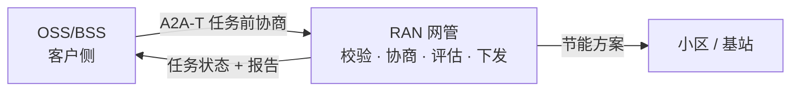
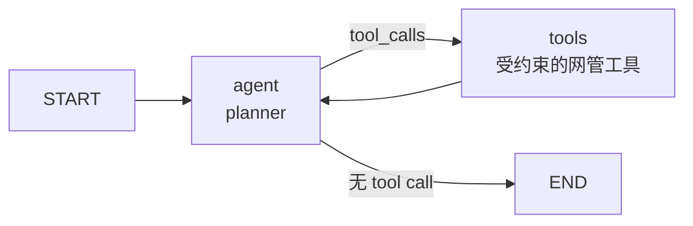

# RAN 节能样例：开发者技术指南

> 写给需要**接入或改造**这套交互的开发者。客户方案（业务视角、系统间交互、典型场景、客户价值）见 [README-zh.md](README-zh.md)。

## 0. 怎么读这份文档

按你的角色选一条路径。每条路径都从“先跑起来”开始，不需要先读协议。

| 你是 | 阅读顺序 | 读完你能 |
| --- | --- | --- |
| 只想看效果 | 1 | 跑通离线协商，在 UI 里看懂一次交互 |
| OSS 侧开发 | 1 → 2 → 3 | 接入 A2A-T 客户端，接上自己的决策逻辑 |
| 网管侧开发 | 1 → 2 → 4 | 把任务前协商处理器、执行器与工具接到真实网管 |
| 查字段或参数 | 5 / 6 | 查到消息字段、配置项与默认值 |

六个最常用的词（完整术语表见[附录 A](#附录-a-术语表)）：

| 词 | 一句话 |
| --- | --- |
| A2A | 智能体之间传消息与 Task 的协议 |
| A2A-T | 在 A2A 上加任务前协商与结构化任务提示的扩展 |
| OSS | 客户侧系统：提出节能目标、做协商决策 |
| NMS / 网管 | 执行侧系统：校验、协商、评估、下发、出报告 |
| Task-T | 结构化任务提示词 |
| Negotiation-T | 任务创建前的协商消息 |

## 1. 10 分钟跑通（教程）

**本节目标：** 不写代码，跑通一次离线协商，并看懂 OSS 与网管之间发生了什么。
**前置：** Python 3.12+、[`uv`](https://docs.astral.sh/uv/)，仓库已检出。

### 1.1 安装

```bash
# 1. 仓库根目录：SDK 与开发依赖
uv sync --dev

# 2. a2a-t-sample：样例依赖（与 SDK 共用一个 .venv）
cd a2a-t-sample
uv pip install -r requirements.txt

# 3. 激活（在 a2a-t-sample/ 下执行）
source ../.venv/Scripts/activate        # Git Bash / Windows
# source ../.venv/bin/activate          # Linux / macOS
```

下文所有 `python` 都指这个已激活的解释器。没有激活时，Windows 用
`../../.venv/Scripts/python.exe`，Linux/macOS 用 `../../.venv/bin/python`。

**如何验证：** `python -c "import a2a_t; print(a2a_t.__name__)"` 不报错。

### 1.2 跑一次离线协商

```bash
cd ran-energy-saving
python run_demo.py --scenario information --mode auto --model-mode offline
```

离线模式不需要 `.env`，也不需要 API key：`run_demo.py` 会回退到 `env.example`。

**如何验证：** 终端最后出现：

```text
[client] final_state=task_completed task_id=<uuid>
[client] report={"ok": true, "summary": "Plan plan-cell-001-001 applied ..."}
[run_demo] stopped 2 background process(es)
```

**常见错误：**

| 现象 | 原因 | 处理 |
| --- | --- | --- |
| 端口被占用 | 上次的 `--keep-alive` 进程还在 | `python run_demo.py --stop` |
| `ModuleNotFoundError: a2a_t` | 没有激活环境 | 用绝对路径的 venv Python，或重新 `uv sync --dev` |
| 启动即失败并提示语言/模型模式不一致 | 已有进程以另一组参数运行 | 先 `--stop`，再用新参数启动 |

### 1.3 在 UI 里看懂交互

```bash
python run_demo.py --ui --scenario information --model-mode offline
# 打开 http://127.0.0.1:8080
```

页面默认打开演示视图。先选场景，必要时修改网络操作工程师的请求，再点 **发起节能任务**：

- 右侧协商栏实时呈现 OSS 与 RAN 网管的每次提议、反提议、接受、拒绝或中止及其轮次，可展开查看该轮
  提议的完整内容；
- 左列展示流程图、网管执行过程与结果；
- 请求卡是唯一可编辑的输入；传输、模型和语言都来自启动参数。

需要阶段、LLM 与工具调用、原始报文和历史记录时，加 `--ui-mode explorer`，使用 Run Explorer 的
左侧栏、时间线与检查器。

**如何验证：** 演示视图最终出现节能报告；拒绝与中止场景显示“未创建任务”。

## 2. 架构速览（解释）

**本节目标：** 读完能画出两个系统与一次运行的生命周期，并知道每个需求该改哪个文件。

### 2.1 两个系统，一条协商链



三层职责不要混：

| 层 | 负责 | 不负责 |
| --- | --- | --- |
| A2A（a2a-sdk） | 发现 AgentCard、发送 Message、接收 Task 事件 | 不理解协商含义 |
| A2A-T（a2a_t） | Task-T 与 Negotiation-T 的生成、校验、元数据 | 不发 HTTP、不跑智能体 |
| 业务 | OSS 决策；网管评估与下发 | 不手工拼协议字段 |

一句话：**A2A 负责送到，A2A-T 负责说清楚，业务负责决定做什么。**

### 2.2 一次运行的生命周期

| # | 阶段 | 发生什么 | 主要代码 |
| --- | --- | --- | --- |
| 1 | 派发 | 客户端装配运行时、发现 AgentCard | `protocol/client_runtime.py` |
| 2 | 任务生成 | 把自然语言请求转成 Task-T | `protocol/client_flow.py` |
| 3 | 校验 | 网管校验 Task-T；失败则开启协商 | `protocol/pre_task_negotiation.py` |
| 4 | 协商 | 提议、决策、反提议（最多 3 轮） | `pre_task_negotiation.py`、`decision_provider.py` |
| 5 | 决议 | 接受/拒绝/中止；接受时重填 Task-T | `client_flow.py`、`pre_task_negotiation.py` |
| 6 | 网管执行 | 评估并下发节能方案 | `server_executor.py`、`demo/agents/server_agent/` |
| 7 | 报告 | 发布报告 artifact，Task 进入 COMPLETED | `server_executor.py` |
| 8 | 结束 | 写运行记录，UI 回放 | `protocol/client_service/`、`demo/web/` |

### 2.3 代码地图：按需求找入口

| 你想改 | 从这里开始 |
| --- | --- |
| OSS 的决策逻辑 | `demo/agents/client_agent/` + `protocol/decision_provider.py` |
| OSS 的协议循环 | `protocol/client_flow.py` |
| OSS 的会话与运行记录 | `protocol/client_service/`、`protocol/client_store/` |
| 把 OSS 暴露成 A2A 后端 | `protocol/client_gateway.py` |
| 网管的协商规则 | `protocol/pre_task_negotiation.py`、`protocol/negotiation_policy.py`、`demo/task_t_precheck.py` |
| 网管的执行流程 | `protocol/server_executor.py`、`demo/agents/server_agent/` |
| 接入真实网管接口 | `demo/agents/server_agent/tools.py` |
| Task 持久化 | `protocol/sqlite_task_store.py` |
| Web UI | `demo/web/`（`presentation/` 演示视图，`static/` Run Explorer） |
| 部署暴露哪些运行 | 实现 `protocol/run_spec.py` 的 `RunCatalog` |
| accept 时填入哪些值 | 实现 `protocol/run_spec.py` 的 `ClientPolicy` |
| planner 图与工具 | 实现 `protocol/server_agent_spec.py` 的 `ServerAgentFactory` |
| 反提议方案的可行性 | 实现 `protocol/negotiation_policy.py` 的 `PlanEvaluator` |
| 语义校验通过的 Task-T 是否仍需协商 | 实现 `protocol/pre_task_negotiation.py` 的 `TaskTPrecheck` |

### 2.4 哪些是样例，哪些要替换

- **直接复用**：A2A-T 任务前协商处理器、确定性协议流程、客户端服务与存储、网管执行外壳、TaskStore 结构、日志与 trace 管线、运行规格接口。
- **需要替换**：客户端决策 agent 与工具、网管的四个工具实现、planner 提示词/模型、会话与轮次 schema、演示用的方案评估器。
- **仅演示（`demo/`）**：场景目录、数据集、fake/scripted 模型、mock 注册中心、Web UI、启动器与示例 agent。

### 2.5 demo 包与组合接缝

`protocol/` 与 `shared/` 是可复用核心，`demo/` 放所有为了让交互可离线复现而存在的东西。核心模块在 import 时不加载 demo；由组合根（启动器、Web UI、Gateway CLI、网管服务入口）显式接线：

| 接缝 | 接口 | 演示实现 |
| --- | --- | --- |
| 具名运行 | `RunCatalog` / `RunSpec`（`protocol/run_spec.py`） | `demo/catalog.py` |
| accept 值 | `ClientPolicy`（`protocol/run_spec.py`） | `DEMO_CLIENT_POLICY` |
| 离线模型与 provider | `offline_model_factory` / `install_offline_provider` | `demo/composition.py` |
| 客户端决策 agent | `agent_factory` | `demo/agents/client_agent/` |
| 网管 planner | `ServerAgentFactory`（`protocol/server_agent_spec.py`） | `demo/agents/server_agent/factory.py` |
| 方案可行性 | `PlanEvaluator`（`protocol/negotiation_policy.py`） | `demo/plan_evaluator.py` |
| 初始 Task-T 预检 | `TaskTPrecheck`（`protocol/pre_task_negotiation.py`） | `demo/task_t_precheck.py` |

`tests/test_demo_boundary.py` 会在全新解释器中导入全部核心模块，并断言没有任何 `demo.*` 被加载。演示入口是 `run_demo.py`（对 `demo/run_demo.py` 的兼容壳）、`demo/web/`、`demo/registry/`，以及 `protocol.server_app.main` 内的延迟导入。

## 3. OSS 侧开发指南（操作）

**本节目标：** 把样例的客户端换成你自己的 OSS 决策逻辑，同时保持协议正确。
**前置：** 读完第 1、2 节；知道 `protocol/client_flow.py` 是协议循环。

### 3.1 你需要实现什么

| 必须 | 说明 |
| --- | --- |
| AgentCard 发现 | registry 或 direct；见 `protocol/discovery.py` |
| Task-T 生成并发送 | 由 A2A-T SDK 生成，流程层发送 |
| 收到提议后给出决策 | 实现 `respond(propose, session) -> NegotiationDecision` |
| accept 时重填 Task-T | 用提议要求的值补齐参数 |
| 终态处理 | reject / abort 后不再等待 Task |

可选：会话记忆、人工决策、入站 A2A Gateway、Web UI。

### 3.2 接入 A2A-T 客户端

一次运行只做三件事：生成 SDK 环境、发现网管、装配运行时。

```python
# protocol/client_runtime.py（节选）
sdk_env = prepare_client_sdk_env(config, env_path)      # 每次运行独立的 SDK .env
discovered = await discover_agent(                       # registry 或 direct
    discovery=config.discovery,
    organization=AGENT_CARD_ORGANIZATION,
    name=AGENT_CARD_NAME,
    registry_center_url=config.registry_url,
)
runtime = await build_client_runtime(
    config,
    scenario,
    mode,
    transport,
    catalog=catalog,                    # 由组合根提供的 RunCatalog
    client_agent_factory=agent_factory,  # 可选：构造 ADK 决策 agent
)
```

**为什么需要独立的 `.env`：** A2A-T SDK 从环境变量读取模型与端点；每次运行写一份临时文件，避免运行之间互相污染。

**如何验证：** 客户端日志出现 `agent-discovered: url=... discovery=...`。

### 3.3 接上你的决策逻辑

决策只回答一个问题：**接受、拒绝、中止，还是反提议**。协议内容由流程层生成。

```python
class NegotiationDecisionProvider(Protocol):
    async def respond(
        self, propose: NegotiationProposeView, session: NegotiationContext
    ) -> NegotiationDecision: ...
```

样例提供三个实现：

| Provider | 使用方 | 行为 |
| --- | --- | --- |
| `AdkDecisionProvider` | 默认 `--mode auto` | 运行客户端 ADK 智能体，返回结构化 `NegotiationDecision`。 |
| `ManualDecisionProvider` | `--ui --mode manual` | 等待 Web UI 决策；300 秒超时后转为 `Abort`。 |
| `ScriptedDecisionProvider` | 测试（`MODE_SCRIPTED`；`run_demo.py` 不暴露） | 按顺序回放场景决策。离线 `auto` 模式则让 ADK 智能体配合 fake model 留在决策回路中。 |

所有 Provider 都实现 `respond(propose, session) -> NegotiationDecision`。Provider 只决定**意图**；流程层负责生成协议内容，且从不改变 round。

`AdkDecisionProvider` 需要决策 agent：可以直接传 `agent=`，或传 `agent_factory=`（演示组合根传 `demo.agents.client_agent.agent.build_client_agent`）。Provider 本身不再导入样例 agent，部署方可以接自己的 ADK 图。

**ADK 会话存在哪。** `AdkDecisionProvider` 为每次协商保留一个 ADK 会话，让智能体看到前面几轮的提议。设置 `A2AT_SAMPLE_CLIENT_DB` 时，这些会话落在同一个 SQLite 文件里，进程重启后仍在；未设置（单元测试、临时运行）则留在内存。落盘的会话就是这次协商的审计记录——模型收到的提示词、给出的回答与看到的工具结果——按 `A2AT_SAMPLE_ADK_SESSION_RETENTION_DAYS`（默认 7 天）保留。清扫在客户端启动时执行，之后在每次运行前最多每小时执行一次，长驻进程不会无限增长。数据库打不开时记一条警告并降级为内存：决策不依赖审计存储。

自己接一个模型时，最容易出错的是“模型返回了散文而不是 JSON”。样例的 `AdkDecisionProvider` 会先尝试从围栏或正文中提取 JSON 对象，再追加一次纠正性追问；仍然失败才报错。你的实现至少要做到：

1. 输出能解析成 `NegotiationDecision`；
2. 反提议必须带 `counter_params`（`cellId`、`window`、`targetRate`）；
3. accept 时把提议要求的值放进 `filled_params`。

**如何验证：** 客户端日志出现 `decision-made action=... round=...`；离线五场景的 `final_state` 与[§5.3](#53-五个场景的协议序列)一致。

### 3.4 可选：作为 A2A 后端暴露

如果 OSS 侧也要被 Gemini Enterprise 或其他 A2A 调用方调用，用 `protocol/client_gateway.py`：

```bash
python run_demo.py --ui --gateway --ui-port 8080 --gateway-port 8001 --model-mode offline
```

一条入站 `message:send` 启动一次客户端运行，返回最终报告 artifact；入站 `contextId` 映射为客户端会话。Gateway 不替代出站 A2A-T 流程。

#### 进度通知

客户端与网管协商期间，入站 Task 不再静默。网关把一组稳定的内部里程碑映射为外层 `WORKING` 状态更新：

| 里程碑 | 状态文本 | metadata |
| --- | --- | --- |
| 请求已接收 | Request accepted. Negotiating with the RAN server. | `phase=dispatch` |
| 协商提议 | Negotiation round N: the RAN server proposed an `<kind>` negotiation. | `phase=negotiation`、`round`、`performative`、`kind` |
| 客户端决策 | Negotiation round N: the client chose `<action>`. | `phase=negotiation`、`round`、`action` |
| 网管任务开始 | The RAN server accepted the task and started execution. | `phase=execution`、`state` |

两种投递方式消费同一组事件：`message:stream` 在打开的流上转发；`message:send` 调用方通过内联
`configuration.taskPushNotificationConfig` 或 `POST /tasks/{id}/pushNotificationConfigs` 注册 webhook
接收。最终报告 artifact 与终态保持不变。

约束：每个 Task 最多 8 条进度，按里程碑去重；trace span、提示词、工具结果与原始提案内容不外发。

webhook URL 会校验（必须是绝对 http(s) URL、不得内嵌凭据；非回环地址只允许 HTTPS）。注册信息存放在
Gateway Task 数据库的 `push_notification_configs` 表（schema 版本 2），重启不丢；未配置
`A2AT_SAMPLE_GATEWAY_TASK_DB` 时使用内存。SDK sender 对每个事件只尝试一次 POST，失败记录日志；
生产应增加重试/排队与出站白名单（SSRF）。

### 3.5 自检清单

- [ ] 能发现网管 AgentCard（registry 或 direct）
- [ ] Task-T 能生成并发送
- [ ] 收到提议后能产出合法决策
- [ ] accept 时重填了 Task-T 参数
- [ ] reject/abort 不创建 Task
- [ ] 运行记录可回放，会话可续接

**常见错误：**

| 现象 | 原因 | 处理 |
| --- | --- | --- |
| `DecisionProviderError: ... no parseable NegotiationDecision` | 模型输出不是 JSON | 收紧提示词；保留一次纠正重试；离线用 fallback |
| 任务前协商处理器拒绝 accept | 没有用协商结果重填 Task-T | 把 `filled_params` 交给 `generate_task_prompt_from_data_with_schema` |
| HTTP 409 `run_conflict` | 同一会话已有运行 | 等待结束或换会话；客户端数据库的部分唯一索引保证跨进程互斥 |

## 4. 网管侧开发指南（操作）

**本节目标：** 把任务前协商处理器、执行器与工具接到真实网管系统。
**前置：** 读完第 1、2 节；知道 `protocol/server_app.py` 是应用装配入口。

### 4.1 你需要实现什么

| 必须 | 说明 |
| --- | --- |
| AgentCard | 名称、描述、A2A-T 扩展声明；见 `shared/agent_card.py` |
| 任务前协商 | 校验 Task-T，失败时提出提议而不是直接拒绝 |
| 完整 Task 生命周期 | SUBMITTED / WORKING / artifacts / COMPLETED |
| 评估与下发 | 用真实网管接口替换样例工具 |
| 报告 | 最终报告 artifact，带 A2A-T 元数据 |

### 4.2 任务前协商处理器与策略

[`protocol/pre_task_negotiation.py`](protocol/pre_task_negotiation.py) 是服务端唯一协议入口，只处理**任务前**请求（`context.current_task is None`；`context.task_id` 不是可靠信号，因为 `RequestContext` 构造时会生成一个）：

1. 初始 Task-T 请求通过 `validate_task_prompt_and_data_filling(prompt, TASK_PARAM_SCHEMA, TASK_TEMPLATE_URI)` 校验。
2. 校验失败且首个错误码可映射到协商类型时，生成初始 `Propose`；不可映射时返回带结构化错误的终态 `REJECTED` Task。
3. `Accept` 通过 `validate_accept_prompt_and_data_filling` 校验；随后再次校验协商确定的 Task-T 提示词并交给网管执行（LangGraph）。
4. `Reject` 或 `Abort` 是终态：处理器回一条普通消息，不创建 Task。
5. 客户端反提议通过 `validate_propose_prompt_and_data_filling` 校验，再由策略引擎应答。

处理器只负责协议流程。两个注入缝把业务规则挡在外面：

- `TaskTPrecheck` 在 SDK 接受 Task-T 之后运行，仍可开启协商（必填字段缺失、目标时段冲突、不可行的停电保障）。演示实现是 `demo/task_t_precheck.py`；不注入时处理器直接信任 SDK 的结论。
- 协商策略（见下）决定已开启协商的下一步。

所有 SDK 调用都是同步的，因此处理器用 `asyncio.to_thread` 执行，避免阻塞服务端事件循环。

[`protocol/negotiation_policy.py`](protocol/negotiation_policy.py) 是纯函数：输入状态，输出 `PolicyDecision`。它不调用 LLM，也不发送任何消息。

| 输入 | 决策 |
| --- | --- |
| 初始校验失败 | `propose`（第 1 轮）；若已到轮次上限则 `abort`。 |
| 客户端 `Accept` | `execute`。 |
| 客户端 `Reject` / `Abort` | `end`。 |
| 客户端在 `maxRounds` 之前反提议 | 在下一轮 `propose`：反提议方案可行则接受，否则修订。 |
| 客户端在 `maxRounds` 反提议 | `abort`，保持当前 round。 |

服务端从不发出 `Accept`：它通过发布一个客户端可接受的最终 `Propose` 来表达同意。若没有 `sampleProposal`（见下文），策略按预设修订序列推进。

### 4.3 执行器与工具：接真实网管

网管执行是一张小的 LangGraph ReAct 图：模型选工具，工具返回结构化结果，直到生成报告。



| 工具 | 前置条件 | 作用 |
| --- | --- | --- |
| `get_cell_energy_profile` | 无 | 读取 24 小时负载/能耗、容量与可用窗口 |
| `evaluate_energy_saving_plan` | 已读同一小区 | 校验窗口、节能率与 SLA，估算影响 |
| `apply_energy_saving_plan` | 同一方案已评估成功 | 下发方案（样例写入进程内存储） |
| `generate_energy_saving_report` | 已成功下发 | 生成最终报告 |

工具顺序由 `PlanGuard` 强制；越序返回 `tool_order_violation`，planner 可在步数预算内纠正。把 `demo/agents/server_agent/tools.py` 替换为真实网管调用即可，图外壳与顺序约束保留。

执行器从外部接收图：

```python
# protocol/server_app.py（节选）
executor = build_negotiation_executor(
    handler=PreTaskNegotiationHandler(
        prompt_server,
        policy=negotiation_policy,
        precheck=task_t_precheck,
    ),
    agent_factory=server_agent_factory,   # 为一次任务构建图、工具与提示词
    config=config,
)
```

`ServerAgentFactory` 返回 `ServerAgentSpec`（图、模型、系统提示词、报告工具名、初始消息、工具结果解析器）。演示实现是 `demo/agents/server_agent/factory.py`；真实网管返回自己的图。演示在 `demo/plan_evaluator.py` 用 `RanDataPlanEvaluator` 绑定策略，在 `demo/task_t_precheck.py` 绑定 `RanDataTaskTPrecheck`。

**如何验证：** 服务端 trace 出现四个工具 span；Task 以 `COMPLETED` 结束并带报告 artifact。

### 4.4 任务存储与状态

`protocol/sqlite_task_store.py` 是一个最小 A2A `TaskStore`：`save/get/list/delete`，WAL + busy timeout，写失败只记录日志，不破坏协议执行。设置 `A2AT_SAMPLE_TASK_DB` 后，Web UI 以只读方式打开同一文件渲染任务表。入站 Gateway 用同一个存储实现，由 `A2AT_SAMPLE_GATEWAY_TASK_DB` 指定文件，因此入站 Task 重启后仍在。

两套数据库共用 `shared/sqlite.py`：统一的连接设置，以及记录在 `PRAGMA user_version` 中的有序迁移列表。旧版本数据库打开时自动升级；比当前代码更新的数据库会直接报错。新增迁移只需向对应 store 的 `_MIGRATIONS` 追加一个函数，不要修改已有迁移。

### 4.5 自检清单

- [ ] AgentCard 可访问，声明了 A2A-T 扩展
- [ ] Task-T 校验失败时开启协商，而不是直接拒绝
- [ ] 提议/修订遵守 `maxRounds`
- [ ] 工具顺序受约束，越序有结构化错误
- [ ] Task 生命周期完整，报告带元数据
- [ ] Task 状态可持久化与查询

**常见错误：**

| 现象 | 原因 | 处理 |
| --- | --- | --- |
| 工具返回 `tool_order_violation` | 没先读画像或没先评估 | 按顺序调用；让 planner 重试 |
| planner 超过步数上限 | 模型反复试错 | 调大 `A2AT_SAMPLE_PLANNER_MAX_STEPS` 或收紧提示词 |
| UI 任务表为空 | 未设置 `A2AT_SAMPLE_TASK_DB` | 设置绝对路径后重启服务端 |

## 5. 协议参考

### 5.1 消息结构

每条协商消息都携带：

- `A2A-Extensions: Task-T/v1,Negotiation-T/v1`；
- Negotiation-T 扩展 URI 下的渲染文本；
- `templateUri` —— 文本渲染自的模板；
- `negotiationContext = {id, round, maxRounds, performative}`。

`protocol/messages.py` 是唯一构建/读取这些键的地方。协商会话 id 被强制设为 A2A `contextId`（样例约定）。

### 5.2 四类 performative 与轮次归属

| Performative | 生成方法 | 含义 |
| --- | --- | --- |
| `Propose` | `generate_negotiation_propose_prompt_from_text` | 缺失信息、歧义、替代方案或修订方案。 |
| `Accept` | `generate_negotiation_accept_prompt_from_text` | 客户端接受；流程层用 `generate_task_prompt_from_data_with_schema` 重填 Task-T 提示词。 |
| `Reject` | `generate_negotiation_reject_prompt_from_text` | 客户端拒绝；终态。 |
| `Abort` | `generate_negotiation_abort_prompt_from_text` | 服务端（到达 `maxRounds`）或客户端结束会话；终态。 |

轮次规则：

- **服务端**发起协商，并且是唯一推进 round 的一侧（首个 `Propose` 为 `round = 1`，每次修订为 `round + 1`）。
- **客户端**始终使用 `session.with_performative(...)` 保持入站 round，从不调用 `next_round()`。
- `maxRounds = 3`。第 3 轮的反提议之后无法再跟服务端确认，因此服务端在第 3 轮直接 `abort`，不会越过轮次上限。

协商内容**只使用 `fromText`**。（Negotiation-T 的 `fromData` 不在本样例范围内；Task-T 的 accept 重填使用独立的 `fromDataWithSchema` API。）

### 5.3 五个场景的协议序列

所有序列都由服务端发起。`S` = 服务端，`C` = 客户端；括号内为 round。期望序列由 `tests/test_scenarios.py` 与 `tests/test_client_flow.py` 断言。

| 场景 | 业务说法 | 触发 | 协商序列 | 最终状态 |
| --- | --- | --- | --- | --- |
| `information` | 目标缺参数：网管问、OSS 补 | Task-T 请求缺少分时段保障速率目标（`content.param_missing`）。 | `S:Propose(1)` → `C:Accept(1)` | Task `COMPLETED` + 报告（`task_completed`） |
| `target` | 时段冲突：先纠偏再执行 | 保障吞吐目标的时间段重叠（`content.value_not_allowed`）。 | `S:Propose(1)` → `C:Propose(1)`（反提议） → `S:Propose(2)`（修订） → `C:Accept(2)` | Task `COMPLETED` + 报告（`task_completed`） |
| `feasibility` | 条件不可行：网管给替代方案 | 保障速率与 18 小时停电冲突（`content.rule_violation`）。 | `S:Propose(1)`（替代方案） → `C:Accept(1)` | Task `COMPLETED` + 报告（`task_completed`） |
| `reject` | OSS 无法提供：协商结束 | 客户端无法提供缺失的保障速率目标。 | `S:Propose(1)` → `C:Reject(1)` → `S:Message("协商已结束")` | 无 Task（`no_task_negotiation_ended`） |
| `abort` | 反复不收敛：达到轮次上限后主动中止 | 客户端反复反提议策略始终无法接受的方案。 | `S:Propose(1)` → `C:Propose(1)` → `S:Propose(2)` → `C:Propose(2)` → `S:Propose(3)` → `C:Propose(3)` → `S:Abort(3)` | 无 Task（`no_task_negotiation_aborted`） |

说明：

- `target` 中客户端反提议保持第 1 轮；只有服务端修订方案进入第 2 轮，客户端 `Accept` 也保持第 2 轮。
- `reject` 与 `abort` 都不创建 Task。`reject` 以一条不含 Negotiation-T 元数据的普通 A2A `Message` 结束；`abort` 使用通用 abort 模板，在 `round = maxRounds = 3` 发出。
- 首个 Task-T 校验错误码到协商类型的映射（`content.param_missing` → information、`content.value_not_allowed` → target、`content.rule_violation` → feasibility）是**样例约定**，不是 A2A-T 契约。实现位于 [`protocol/negotiation_policy.py`](protocol/negotiation_policy.py) 的 `NEGOTIATION_KIND_BY_ERROR_CODE`。

### 5.4 `sampleProposal`：仅样例约定

客户端反提议可以携带：

```json
"metadata": {"sampleProposal": {"cellId": "cell-001", "window": "00:00~06:00", "targetRate": "30"}}
```

`sampleProposal` **不是 A2A-T 协议字段**。它让确定性策略可以用 `shared.ran_data.evaluate_plan` 评估反提议，从而保证离线演示可复现。若缺失，协议仍然工作：策略按预设修订序列推进。该键定义在 [`protocol/messages.py`](protocol/messages.py)，解析在 [`protocol/negotiation_policy.py`](protocol/negotiation_policy.py)。

## 6. 配置参考

所有样例键由 [`shared/config.py`](shared/config.py)、`run_demo.py` 或 A2A-T SDK 读取。`run_demo.py` 只把 `A2AT_SAMPLE_UI_PORT` 作为 `--ui-port` 的默认值；显式传入 `--ui-port` 会覆盖它。完整模板：[`env.example`](env.example)（以及 [`../env.example`](../env.example)）。

| 键 | 取值 | 作用 |
| --- | --- | --- |
| `A2AT_SAMPLE_MODEL_MODE` | `offline`（默认）、`live` | `offline` = 脚本化 SDK Provider + 确定性客户端 ADK fake model + 脚本化 LangGraph planner；`live` = 两侧 SDK、客户端 ADK 与服务端 LangGraph planner 使用 OpenAI-compatible 端点。 |
| `A2AT_LANGUAGE` | `en-US`、`zh-CN`（未设置时默认 `zh-CN`；`run_demo.py` 默认 `en-US`） | 进程级语言，作用于模板、预置响应、注册中心/服务端/客户端。不能按运行切换；Web UI 只展示当前值。 |
| `A2AT_SAMPLE_HOST` / `A2AT_SAMPLE_PORT` | 默认 `127.0.0.1` / `8000` | 服务端绑定与 AgentCard 对外接口。 |
| `REGISTRY_CENTER_HOST` / `REGISTRY_CENTER_PORT` | 默认 `127.0.0.1` / `5001` | Mock 注册中心绑定与查询 URL。 |
| `A2AT_SAMPLE_DISCOVERY` | `registry`（默认）、`direct` | 服务发现方式。 |
| `A2AT_SAMPLE_DIRECT_SERVER_URL` | 默认 `http://127.0.0.1:8000` | `direct` 发现读取的基础 URL。 |
| `A2AT_SAMPLE_TRANSPORT` | `sse`（默认）、`webhook` | 客户端事件传输。 |
| `A2AT_SAMPLE_WEBHOOK_PORT` | 默认 `9000`（`0` = 临时端口） | 内置 webhook 接收器端口。 |
| `A2AT_SAMPLE_WEBHOOK_TOKEN` | 默认 `demo-webhook-token` | 与 `X-A2A-Notification-Token` 比对的静态推送 token。 |
| `A2AT_SAMPLE_WEBHOOK_IDLE_TIMEOUT` | 默认 `300`（与 HTTP 预算一致） | 无推送多少秒后结束 webhook 阶段；阶段不能早于客户端预算结束。 |
| `A2AT_SAMPLE_HTTP_TIMEOUT_SECONDS` | 默认 `300`（> 0） | 单次 A2A 请求的客户端 HTTP 预算：`httpx` 客户端超时与每次发送的 `ClientCallContext.timeout`。 |
| `A2AT_SAMPLE_LLM_TIMEOUT_SECONDS` | 默认 `120`（> 0） | 在线单次 LLM 调用预算（SDK 结构化调用或 ADK `LiteLlm` turn），写入每次运行的 SDK `.env`。 |
| `A2AT_SAMPLE_LLM_MAX_ATTEMPTS` | 默认 `1`（`1`..`10`） | 在线 SDK 每个可重试步骤的协议级尝试次数，写入每次运行的 SDK `.env`；OpenAI 传输层重试另行关闭。 |
| `A2AT_SAMPLE_UI_HOST` | 默认 `127.0.0.1` | Web UI 的默认绑定主机；`run_demo.py` 将其作为 `--ui-host` 的默认值读取。设为 `0.0.0.0` 可监听所有网卡（仅限可信网络）。 |
| `A2AT_SAMPLE_UI_PORT` | 默认 `8080` | Web UI 的默认绑定端口；`run_demo.py` 将其作为 `--ui-port` 的默认值读取。 |
| `A2AT_SAMPLE_TRACE_URL` | 默认未设置；`--ui` 设为 `http://127.0.0.1:<ui_port>` | 服务端 trace 端点（Web UI）。仅用于本地演示；服务端把 span POST 到这里。 |
| `A2AT_SAMPLE_TRACE_TOKEN` | 默认未设置；`--ui` 生成随机 token | 服务端出示、UI 校验的本地 token；未设置时 ingest 路由关闭（失败关闭）。 |
| `A2AT_SAMPLE_TRACE_DIR` | 默认未设置；CLI 设为 `<sample>/runs` | CLI 服务端 trace 目录（`<dir>/<runId>/server-trace.jsonl`）。 |
| `A2AT_SAMPLE_TASK_DB` | 未设置 = 内存；`run_demo.py` 写入 `<sample>/runs/task-status.sqlite3` | 服务端持久化 A2A Task 存储的绝对 SQLite 路径，也由 `GET /api/tasks` 读取。 |
| `A2AT_SAMPLE_CLIENT_DB` | 未设置 = 内存；`run_demo.py` 写入 `<sample>/runs/client-state.sqlite3` | 客户端会话/运行/协商存储，以及 ADK 决策智能体会话的绝对 SQLite 路径。 |
| `A2AT_SAMPLE_CLIENT_MEMORY_TURNS` | 默认 `6`（>= 0） | 注入下一次决策提示词与 Task-T 生成的最近会话轮数。 |
| `A2AT_SAMPLE_ADK_SESSION_RETENTION_DAYS` | 默认 `7`（>= 1） | 决策智能体会话作为审计数据保留的天数，到期由启动/定期清扫删除。 |
| `A2AT_SAMPLE_GATEWAY_HOST` / `A2AT_SAMPLE_GATEWAY_PORT` | 默认 `127.0.0.1` / `8001` | 可选入站 A2A Gateway 的绑定与 AgentCard 对外接口。 |
| `A2AT_SAMPLE_GATEWAY_TASK_DB` | 未设置 = 内存；`run_demo.py` 写入 `<sample>/runs/gateway-task-status.sqlite3` | 入站 Gateway 的 Task 存储绝对 SQLite 路径。 |
| `A2AT_SAMPLE_AUTH_TOKEN` | 未设置 = 开放（仅回环） | Web UI `/api/*` 与入站 Gateway A2A 路由的 Bearer token。绑定非回环地址却未配置时启动失败。trace ingest 路由例外，它使用每次运行独立的 `A2AT_SAMPLE_TRACE_TOKEN`。 |
| `A2AT_SAMPLE_SERVER_AUTH_TOKEN` | 未设置 = 开放（仅回环） | A2A 服务端的服务 token。客户端在每次 A2A 调用中携带；服务端除 AgentCard 与健康检查外都要求它，并在卡片上声明 bearer scheme。服务端绑定非回环地址却未配置时启动失败。 |
| `A2AT_SAMPLE_GATEWAY_REGISTER` | `0`（默认）、`1` | 是否把 Gateway AgentCard 注册到注册中心。 |
| `A2AT_SAMPLE_GATEWAY_SCENARIO` | 默认 `information` | 入站 Gateway 请求使用的场景。 |
| `A2AT_SAMPLE_PLANNER_MODEL` | 默认：ADK 模型去掉 `openai/` 前缀 | 服务端 planner 的 LangChain 模型 id。 |
| `A2AT_SAMPLE_PLANNER_API_BASE` / `A2AT_SAMPLE_PLANNER_API_KEY` | 默认：ADK 端点/key | 服务端 planner 端点。 |
| `A2AT_SAMPLE_PLANNER_TIMEOUT_SECONDS` | 默认 `120`（> 0） | 服务端 planner 单次调用预算。 |
| `A2AT_SAMPLE_PLANNER_MAX_STEPS` | 默认 `12`（> 0） | 单个已接受 Task 的 LangGraph 递归上限。 |
| `ADK_MODEL_PROVIDER` | `litellm` | 客户端 ADK 模型 Provider（本样例只实现 LiteLlm）。 |
| `ADK_MODEL_NAME` | 默认 `openai/mass/volcengine/deepseek-v4.1-flash` | LiteLlm 模型 id（需要 provider 前缀）。 |
| `ADK_MODEL_API_BASE` | 默认 `http://127.0.0.1:31943/v1` | OpenAI-compatible 端点。 |
| `ADK_MODEL_API_KEY` | 默认 `not-needed` | 端点 key。 |
| `A2AT_LLM_PROVIDER` | 在线为 `openai_traced`；离线被覆盖为 `scripted_traced` | SDK Provider（`openai` / `scripted` 的 traced 包装；trace 捕获不改变行为）。 |
| `A2AT_LLM_MODEL` | 默认 `mass/volcengine/deepseek-v4.1-flash` | SDK 模型 id（不带 LiteLlm 前缀）。 |
| `A2AT_LLM_API_KEY` | 默认 `not-needed`；离线被覆盖 | SDK 端点 key。 |
| `A2AT_LLM_BASE_URL` | 默认 `http://127.0.0.1:31943/v1` | SDK 端点基础 URL。 |
| `A2AT_LLM_MAX_TOKENS`、`A2AT_LLM_TEMPERATURE`、`A2AT_LLM_TIMEOUT_SECONDS` | SDK 默认值（`A2AT_LLM_TIMEOUT_SECONDS` 会按运行被覆盖） | 结构化调用限制。每次运行的 SDK `.env` 始终使用 `A2AT_SAMPLE_LLM_TIMEOUT_SECONDS` / `A2AT_SAMPLE_LLM_MAX_ATTEMPTS`。 |
| `A2AT_LLM_DETAIL_LOG_ENABLED` | `false`（默认） | 打印完整 LLM 载荷（调试；可能暴露敏感内容）。 |
| `A2AT_SAMPLE_LOG_LEVEL` | 默认 `INFO` | 根日志级别：`DEBUG` / `INFO` / `WARNING` / `ERROR` / `CRITICAL`。 |
| `A2AT_SAMPLE_LOG_FORMAT` | 默认 `text`，可选 `json` | 每条记录一行；`json` 会把 `runId` / `conversationId` / `taskId` / `contextId` / `negotiationId` / `round` 作为顶层字段。 |

**离线模式。** 在构造 `A2ATClient` / `A2ATServer` 之前，运行时注册 traced 包装（离线 `scripted_traced`、在线 `openai_traced`），并生成临时 SDK `.env`，写入 `A2AT_LLM_PROVIDER=scripted_traced`、`A2AT_LLM_MODEL=scripted`、`A2AT_LLM_API_KEY=not-needed`。源 `.env` 不会被修改。客户端 ADK agent 使用 `demo/adk_fake_model.py`；服务端 planner 使用 `ScriptedChatModel`，按顺序发出四个样例工具调用。日志与 Web UI 标注为 `offline (scripted)`。

**在线模式。** 两侧 SDK、客户端 ADK agent 与服务端 LangGraph planner 使用配置端点。工具保持确定性并受顺序约束；只有 planner 的工具选择与参数由模型驱动。Windows 下保持 `PYTHONUTF8=1`（`run_demo.py` 会为子进程设置）。在线输出依赖模型的抽取、语义校验与规划，见 §1.1。

**超时预算。** 客户端每次 A2A 请求都通过 `ClientCallContext.timeout` 携带 `A2AT_SAMPLE_HTTP_TIMEOUT_SECONDS`（默认 300s），`httpx` 客户端使用同一预算。在线模式下服务端任务前协商处理器在发出任何事件前会执行多次 LLM 调用，因此客户端预算必须长于该最坏情况；原先固定的 60s 会让客户端在服务端仍在工作时提前放弃（`A2AClientTimeoutError`）。在线 LLM 调用拥有 **120s 单次调用预算**（SDK 结构化调用与客户端 ADK `LiteLlm` turn 共用；更慢的端点可继续调高）。每次运行的 SDK `.env` 写入 `A2AT_LLM_TIMEOUT_SECONDS=120` 与 `A2AT_LLM_MAX_ATTEMPTS=1`。traced Provider 关闭了 OpenAI SDK 自身的传输层重试，LiteLLM 也以 `num_retries=0` 构建，因此一次调用不会悄悄变成三次尝试；卡住的调用会在配置预算内失败，处理器随后返回结构化的协议错误消息供客户端展示。离线模式不受影响（脚本化 Provider 不发起网络调用）。webhook 空闲兜底遵循同一原则，默认等于 300s 的 HTTP 预算，客户端仍在等待时不会提前结束阶段。

已有的 `.env` 若设置了 `A2AT_SAMPLE_WEBHOOK_IDLE_TIMEOUT=30` 或 `A2AT_LLM_TIMEOUT_SECONDS=60`，应更新或删除：新的样例键为 `A2AT_SAMPLE_HTTP_TIMEOUT_SECONDS=300`、`A2AT_SAMPLE_LLM_TIMEOUT_SECONDS=120`、`A2AT_SAMPLE_LLM_MAX_ATTEMPTS=1`。

**端口。** 默认服务端 `8000`、注册中心 `5001`、webhook `9000`、Web UI `8080`、可选 A2A Gateway `8001`（均绑定 `127.0.0.1`）。`run_demo.py` 会把这些值写入交给子进程的每次运行 `.env`。Web UI 默认只监听回环地址；`--ui-host 0.0.0.0`（或 `A2AT_SAMPLE_UI_HOST=0.0.0.0`）可监听所有网卡。服务端向 UI 发送 trace 时仍使用 `127.0.0.1`，在 UI 与服务端同机运行时这是正确的。UI、Gateway 与服务端只在回环地址上开放；绑定非回环地址必须配置对应 token（`A2AT_SAMPLE_AUTH_TOKEN` 或 `A2AT_SAMPLE_SERVER_AUTH_TOKEN`）。

## 7. 测试与验收

在 `a2a-t-sample/ran-energy-saving` 下运行（已安装样例依赖）：

```bash
PYTHONPATH=. python -m pytest tests -q
python -m ruff check shared protocol demo tests run_demo.py
uvx --from ty==0.0.92 ty check .
```

（`python` 必须是 §1.1 中激活的环境；若未激活，Windows 使用 `../../.venv/Scripts/python.exe`，Linux/macOS 使用 `../../.venv/bin/python`。）

测试套件完全离线且确定性（485 个测试）。覆盖范围：

| 测试模块 | 覆盖内容 |
| --- | --- |
| `test_policy.py` | 所有策略决策与轮次规则，包括 `maxRounds` 时的 abort 与错误码映射。 |
| `test_pre_task_negotiation.py` | 消息识别、Task-T/Negotiation-T 校验调用、轮次推进、终态处理、预检注入，以及真实离线服务端。 |
| `test_task_t_precheck.py` | 演示预检：必填字段缺失、目标时段重叠、不可行的停电保障，以及合法 Task-T。 |
| `test_client_flow.py` | 五场景流程、accept/counter/reject/abort 消息构造、`sampleProposal` 约定、两种传输。 |
| `test_decision_provider.py` | ADK、manual、scripted 三种 Provider 的契约，包括 manual 超时、会话落盘、内存降级与保留期清扫。 |
| `test_scenarios.py` | 端到端验收：真实服务端 + 真实客户端 + 客户端 ADK fake model，断言精确 performative/round 序列与终态；另含带鉴权服务端与真实 SDK 客户端的组合。 |
| `test_transports.py` | SSE 与 webhook 产生相同 performative 序列。 |
| `test_web_ui.py` | `/api/meta`、`/api/tasks`、`/api/client/runs`、`/api/client/conversations`、运行生命周期、SSE 事件、人工决策、下载、错误状态码，以及真实离线信息运行（8 阶段、seq 单调、决策先于任务事件、客户端 LLM span、服务端 planner/tool span、`trace.json`）与真实人工决策流程。 |
| `test_web_static.py` | 静态契约：资源与模块图、禁止 `innerHTML`、检查器标签页与 CSS token、`main.js` 用到的每个元素 id 都存在于页面；`node --check` 全部 JS，并运行仓库内 `tests/js` 的 store、i18n 与真实帧 harness（无 Node 时跳过）。 |
| `test_server_executor.py` | LangGraph Task 生命周期、报告元数据、planner 失败路径、任务前处理器委托、AgentCard 扩展、注册载荷。 |
| `test_server_planner.py` | 脚本化 planner 序列、工具顺序约束、离线/在线模型选择、提示词内容。 |
| `test_client_store.py` | 会话/轮次序列、运行幂等、协商审计、Task 快照、过期运行清理、原子 claim 冲突、v1→v2 迁移、只读助手。 |
| `test_client_service.py` | 运行持久化、会话记忆、两个 manager 之间的每会话单活跃运行、死进程回收、失败/中断处理、运行指标。 |
| `test_client_gateway.py` | 入站 A2A 消息 -> 一次运行 -> 报告 artifact、进度状态、`message:stream` 投递、内联 push 配置到 webhook、冲突处理、取消、Gateway 卡片。 |
| `test_gateway_progress.py` | 里程碑映射、去重、进度上限，以及忽略 trace/artifact。 |
| `test_sqlite_push_config_store.py` | push 注册 CRUD、owner 隔离、跨 owner 分发、重启后保留、schema 版本 2。 |
| `test_sqlite_task_store.py` | Task save/get/delete、列表过滤/分页、摘要/run id、并发保存、缺失 DB 的只读行为。 |
| `test_server_tools.py`、`test_ran_data.py` | 四个工具与进程内数据集。 |
| `test_scripted_llm.py`、`test_adk_fake_model.py` | schema 路由与确定性客户端 ADK 模型。 |
| `test_config.py`、`test_scenario.py`、`test_transcript.py`、`test_client_runtime.py` | 配置（含两套数据库、Gateway 与 planner 键）、场景定义、运行记录、运行时装配，以及服务端导入不加载 ADK。 |
| `test_logging_setup.py` | text/JSON 格式、上下文向子任务传播、凭据脱敏、环境变量驱动配置。 |
| `test_demo_boundary.py` | 全新解释器导入全部核心模块，断言不加载 `demo.*`；缺少 run catalog 时运行时直接拒绝。 |
| `test_sqlite.py` | 共用连接设置、有序迁移、拒绝更新版本、只读访问不创建文件。 |
| `test_http_security.py` | 回环绑定策略、Bearer 中间件、公开路径模式、`/health` 与 `/ready`、Web UI token 接线。 |
| `test_server_auth.py` | 客户端→服务端 Bearer：message/task 与 `/{tenant}` 路由默认拒绝、AgentCard 与健康检查公开、卡片安全声明、客户端请求头。 |
| `test_metrics.py` | Counter/Gauge/Summary 渲染、标签转义、reset 语义、`/metrics` 文本输出。 |
| `test_run_demo.py` | 启动器默认值与 PID 复用：元数据匹配则复用，模型模式/语言/token 不一致则重启，两套 SQLite 路径都会写入，外来监听则拒绝。 |

JS harness 位于 [`tests/js`](tests/js)：`store.test.mjs` 重放合成帧，`frames.test.mjs` 重放离线集成运行的真实 SSE 帧。两者都由 `pytest` 驱动，未安装 `node` 时干净跳过。

### 五场景离线 smoke

```bash
for s in information target feasibility reject abort; do
  python run_demo.py --scenario "$s" --mode auto --model-mode offline
done
```

预期 `[client] final_state`：

| 场景 | `final_state` |
| --- | --- |
| `information` | `task_completed` |
| `target` | `task_completed` |
| `feasibility` | `task_completed` |
| `reject` | `no_task_negotiation_ended` |
| `abort` | `no_task_negotiation_aborted` |

### 传输与 UI smoke

```bash
python run_demo.py --scenario information --mode auto --model-mode offline --transport webhook
python run_demo.py --scenario target --mode auto --model-mode offline --transport webhook
```

两者都到达 `task_completed`；客户端日志出现 `[client] webhook-mode: push_url=http://127.0.0.1:9000/webhook`。

```bash
python run_demo.py --ui --ui-port 8080 --scenario information --model-mode offline
curl http://127.0.0.1:8080/api/meta
```

`/api/meta` 返回 §1.1 所示的语言、模型模式、场景、模式、传输与默认值，且 `/api/client/runs` 返回带轮次的运行，即视为 UI smoke 通过。

### Gateway smoke

```bash
python run_demo.py --ui --gateway --ui-port 8080 --gateway-port 8001 --model-mode offline
curl -X POST http://127.0.0.1:8001/message:send \
  -H 'Content-Type: application/json' -H 'A2A-Version: 1.0' \
  -d '{"message":{"messageId":"m1","role":"ROLE_USER","contextId":"conv-gw",
       "parts":[{"text":"在满足吞吐目标的前提下最大化节能。"}]}}'
curl 'http://127.0.0.1:8080/api/client/runs?limit=5'
```

Gateway 返回 `TASK_STATE_COMPLETED` 的 Task 与 `energy saving intent report` artifact；`/api/client/runs` 显示对应的客户端运行与会话。该序列已在离线模式下端到端验证。

### 在线 smoke

```bash
python run_demo.py --scenario target --mode auto --model-mode live
```

需要可访问的 OpenAI-compatible 端点。该命令仅手工执行，不进入自动套件，因为输出依赖模型。客户端协商由模型驱动，服务端 planner 选择网管工具调用；工具及其顺序约束是确定性的。离线模式仍是权威、可复现的演示。

每次运行写入 `runs/<timestamp>-<scenario>.json` 与 `.md`（已 gitignore）。Markdown 文件包含双向时间线与决策表。

## 8. 生产化清单

本样例刻意保持原型性质。生产化之前：

- **持久化。** 本样例的 SQLite 存储包括：服务端 Task（`protocol/sqlite_task_store.py`）、入站 Gateway Task（同一实现，独立文件）与客户端会话/运行/协商（`protocol/client_store/`）。`shared/sqlite.py` 通过 `PRAGMA user_version` 执行有序 schema 迁移；生产仍应使用自有数据库与迁移工具。方案仍保存在进程内存储（`demo/ran_data._PLANS`）。入站 push 注册持久化在 Gateway Task 数据库；未配置该数据库时回退到 SDK 的内存存储。客户端 ADK 决策会话按 `A2AT_SAMPLE_ADK_SESSION_RETENTION_DAYS`（默认 7 天）作为审计数据保留，到期清扫；其中包含提示词与工具结果，保留窗口应按审计与数据合规要求设定，并据此规划客户端数据库容量。网管执行不引入持久 checkpointer，只有需要断点恢复时才增加；服务端没有 ADK 会话。
- **日志。** 客户端、网管与 Gateway 共用一条 stdlib 日志流；接入采集器时设 `A2AT_SAMPLE_LOG_FORMAT=json`。每条记录带 `runId` / `conversationId` / `taskId` / `contextId` / `negotiationId` / `round`，可跨进程追踪一次协商。凭据会被脱敏，提示词与工具结果只做摘要，不在 `info` 级别整段输出。
- **注册中心。** `registry/` 是 mock。使用部署环境的真实注册中心，或配置 `direct` 发现并固定 AgentCard 端点。
- **Webhook 安全。** `A2AT_SAMPLE_WEBHOOK_TOKEN` 是静态演示 token。生产应使用按客户端的密钥、轮换、重放防护与 TLS；把接收器视为对外暴露的 HTTP 端点。
- **鉴权与 TLS。** 两个独立边界：`A2AT_SAMPLE_AUTH_TOKEN` 保护入站 Web UI `/api/*` 与 Gateway 路由；`A2AT_SAMPLE_SERVER_AUTH_TOKEN` 保护 A2A 服务端（客户端携带，卡片声明 scheme）。两者在绑定非回环地址却未配置时都会启动失败。trace ingest 路由使用每次运行的 trace token，而不是用户 Bearer。mock 注册中心仍为开放。应在部署网关终止 TLS；`A2A-Version: 1.0` 与 AgentCard 不是安全控制。
- **健康检查。** Web UI、Gateway 与服务端都提供 `/health`（存活）与 `/ready`（SQLite 可访问）。平台探针应使用它们，而不是业务路由。
- **推送投递。** Gateway 会校验调用方提供的 webhook（绝对 http(s) URL、无内嵌凭据；非回环只允许 HTTPS），并发送 A2A 通知 token。SDK sender 每个事件只 POST 一次并记录失败；生产需要重试/排队、死信路径与出站白名单以防止 SSRF。push 注册存放在 Gateway Task 数据库，应按敏感文件保护。样例的 Bearer 中间件只认证调用方，不填充 `ServerCallContext.user`，因此所有注册共享空 owner 分区；多租户部署必须在调用上下文中提供已认证用户。
- **指标。** 三个进程都通过 `/metrics` 输出 Prometheus 文本：客户端运行状态/终态、在途运行、运行耗时、按侧与轮次的协商消息、服务端任务终态。指标注册表是进程内的，应逐个进程抓取（或由采集器聚合）。配置 token 时该路由受 Bearer 保护。
- **模型治理。** 在线模式会把提示词与抽取参数发送到配置的模型端点，服务端 LangGraph planner 还会发送已接受的 Task-T 与工具结果。应落实数据分级、脱敏、限流与供应商协议。非调试场景保持 `A2AT_LLM_DETAIL_LOG_ENABLED=false`。
- **协议正确性由确定性代码掌握。** round、performative、终态与 Task 生命周期必须留在确定性代码中；LLM 只负责意图、文本与工具调用。
- **离线机制仅供测试。** `demo/scripted_llm.py`、`demo/adk_fake_model.py`、`resources/mock_llm/` 与 `demo/scenario.py` 用于可复现的演示与测试，不要作为生产路径发布。
- **运行并发。** 客户端服务允许每个会话一个活跃运行，不同会话可并发。客户端数据库的部分唯一索引使 claim 在共享该数据库的多个进程（Web UI 与 Gateway）之间也是原子的。owner 进程的存活通过 PID 判断，因此该保证仅限同机；多主机部署应使用外部租约（例如带心跳的数据库行），不要把 PID 当作身份。Web UI 仍是开发者工具，不是多租户控制台。
- **SDK 范围。** 本样例不修改 `src/a2a_t/`。SDK 缺陷应作为独立 SDK 变更处理，不要在样例内打补丁。
- **Gemini Enterprise。** Gemini Enterprise 通过 Google Cloud Agent Registry 消费 A2A AgentCard；卡片声明服务 URL 与接口，而对话连续性仍由智能体自己负责（`contextId`/`taskId` + 持久化会话存储）。本样例的可选 Gateway 就是这个入站接口，客户端 `conversations`/`turns` 库就是记忆缝。参考官方注册指南：<https://docs.cloud.google.com/gemini/enterprise/docs/register-and-manage-an-adk-agent>。

## 附录 A. 术语表

| 术语 | 含义 |
| --- | --- |
| A2A | Agent2Agent 协议：在智能体之间传输消息与 Task。 |
| A2A-T | 本样例使用的 A2A-T SDK 扩展：`Task-T`（结构化任务提示词）与 `Negotiation-T`（任务创建前的协商消息）。 |
| ADK | Google Agent Development Kit：本样例用它构建客户端 `LlmAgent`、工具、`Runner` 与会话；服务端不使用 ADK。 |
| RAN | Radio Access Network，无线接入网：本样例中的小区及其负载/能耗行为。 |
| SLA | Service Level Agreement，服务等级协议：小区必须保障的吞吐下限。 |
| OSS / BSS | 运营支撑系统 / 业务支撑系统：本样例的**客户侧**，提出节能诉求并决定协商回答。 |
| NMS / 网管 | 网络管理系统：本样例的**执行侧**——RAN 网管智能体校验并协商任务，随后评估方案、下发到小区并生成报告。 |
| OCS | Online Charging System，在线计费系统：生产环境的计费集成目标，不属于本样例。 |

## 附录 B. 文件地图与替换清单

### B.1 目录

| 路径 | 职责 |
| --- | --- |
| [`run_demo.py`](run_demo.py) | 多进程启动器：后台启动注册中心、服务端（以及 `--gateway` 时的入站 A2A Gateway），前台运行 CLI 客户端（`--ui` 时改为 Web UI），结束后停止子进程。 |
| [`env.example`](env.example) | 统一的、可直接离线运行的配置模板。 |
| [`demo/agents/server_agent/`](demo/agents/server_agent) | 服务端 LangGraph 执行：`planner.py`（脚本化/在线模型 + 提示词）、`langgraph_tools.py`（受约束工具 + `PlanGuard`）、`graph.py`（ReAct 状态图）、`tools.py`（纯网管工具）；不使用 ADK。 |
| [`demo/agents/client_agent/`](demo/agents/client_agent) | 客户端 ADK 决策智能体：`agent.py` 导出 `root_agent`；`tools.py` 为 SLA 与影响评估工具；`prompts/request_instruction.md` 为 instruction。 |
| [`protocol/pre_task_negotiation.py`](protocol/pre_task_negotiation.py) | 服务端唯一协议入口：识别任务前请求、校验 Task-T / Negotiation-T 消息，并转发被接受的请求；声明 `TaskTPrecheck` 注入缝。 |
| [`demo/task_t_precheck.py`](demo/task_t_precheck.py) | 演示 `TaskTPrecheck`：必填字段缺失、目标时段重叠、不可行的停电保障。 |
| [`protocol/negotiation_policy.py`](protocol/negotiation_policy.py) | 纯确定性服务端策略：`propose`、`abort`、`execute`、`end`，不调用 LLM。 |
| [`protocol/server_executor.py`](protocol/server_executor.py) | 外层协商执行器与 `LangGraphTaskExecutor`：运行 ReAct planner 并发布 A2A Task 生命周期；不使用 ADK。 |
| [`protocol/sqlite_task_store.py`](protocol/sqlite_task_store.py) | SQLite `TaskStore`，持久化 A2A Task 状态并为 UI 提供任务摘要；schema v2 同时拥有 Gateway push 配置表。 |
| [`protocol/server_app.py`](protocol/server_app.py) | 服务端装配：AgentCard（声明 `Task-T/v1` 与 `Negotiation-T/v1`）、请求处理器、Starlette 应用、注册中心注册。 |
| [`protocol/client_flow.py`](protocol/client_flow.py) | 客户端协议流程：初始 Task-T、多轮协商、accept 重填、SSE/webhook 终态处理。 |
| [`protocol/client_runtime.py`](protocol/client_runtime.py) | 客户端单次运行装配：每次运行的 SDK `.env`、服务发现、SDK 客户端、传输、决策 Provider。 |
| [`protocol/client_service/`](protocol/client_service) | 客户端应用服务，拆为 `run_state.py`（运行状态、span、决策）与 `run_manager.py`（生命周期、会话、持久化钩子）。 |
| [`protocol/client_store/`](protocol/client_store) | 客户端持久化，拆为 `store.py`（写入）与 `reader.py`（UI 只读查询）。 |
| [`protocol/client_gateway.py`](protocol/client_gateway.py) | 可选入站 A2A Gateway：一条入站消息 -> 一次客户端运行 -> 进度状态与最终报告 artifact。 |
| [`protocol/gateway_progress.py`](protocol/gateway_progress.py) | 把运行里程碑映射为外层 `WORKING` 状态（去重、限流、不外发原始载荷）。 |
| [`protocol/gateway_push.py`](protocol/gateway_push.py) | webhook URL 校验与带校验的 push 配置存储包装。 |
| [`protocol/sqlite_push_config_store.py`](protocol/sqlite_push_config_store.py) | Gateway Task 数据库中的 SQLite push 注册，owner 隔离读取与跨 owner 分发。 |
| [`protocol/decision_provider.py`](protocol/decision_provider.py) | 决策 Provider 协议及 ADK、manual、scripted 三种实现。 |
| [`protocol/discovery.py`](protocol/discovery.py) | 通过注册中心或 `/.well-known/agent-card.json` 发现 AgentCard。 |
| [`protocol/messages.py`](protocol/messages.py) | A2A-T 元数据助手：扩展 URI、`templateUri`、`negotiationContext`、结束消息、样例专用元数据。 |
| [`protocol/transcript.py`](protocol/transcript.py) | 结构化运行记录，写入 `runs/<timestamp>-<scenario>.json` 与 `.md`。 |
| [`shared/config.py`](shared/config.py) | 读取 `.env`、解析两套数据库路径、Gateway 与 planner 配置；纯值对象，不构造模型。 |
| [`shared/model_factory.py`](shared/model_factory.py) | 构造 ADK 模型：在线 `LiteLlm`，离线用注入的确定性模型。 |
| [`shared/logging_setup.py`](shared/logging_setup.py) | 根日志、运行关联上下文、text/JSON 格式与凭据脱敏。 |
| [`protocol/run_spec.py`](protocol/run_spec.py) | `RunSpec`、`RunCatalog` 与 `ClientPolicy`：一次运行是什么、accept 填哪些值。 |
| [`protocol/server_agent_spec.py`](protocol/server_agent_spec.py) | `ServerAgentSpec` / `ServerAgentFactory`：部署方接入执行器的 planner 图。 |
| [`demo/catalog.py`](demo/catalog.py) | 基于五个场景的演示 `RunCatalog` 与 `ClientPolicy`。 |
| [`demo/composition.py`](demo/composition.py) | 组合根：离线模型/provider、演示运行时与协商策略。 |
| [`demo/plan_evaluator.py`](demo/plan_evaluator.py) | `RanDataPlanEvaluator`：反提议方案的可行性与修订。 |
| [`shared/agent_card.py`](shared/agent_card.py) | 客户端（服务发现）与服务端（构建 AgentCard）共享的身份常量。 |
| [`shared/sdk_env.py`](shared/sdk_env.py) | 两个运行时共用的每次运行 SDK `.env` 构建器（消除 client↔server 导入）。 |
| [`shared/sqlite.py`](shared/sqlite.py) | 共用连接设置、只读访问、`user_version` 与有序迁移执行器。 |
| [`shared/http_security.py`](shared/http_security.py) | 回环绑定策略、Bearer 中间件、`/health`、`/ready` 与 `/metrics` 助手。 |
| [`shared/metrics.py`](shared/metrics.py) | 无依赖的 Counter/Gauge/Summary 注册表与 Prometheus 文本渲染。 |
| [`shared/models.py`](shared/models.py) | `NegotiationDecision`（客户端 `output_schema`）与 Provider 视角的提议视图。 |
| [`demo/scenario.py`](demo/scenario.py) | 五个场景定义：请求、期望 performative/round 序列、终态、离线决策。 |
| [`shared/task_schema.py`](shared/task_schema.py) | 服务端校验与客户端 accept 重填共用的调用方参数 schema。 |
| [`demo/ran_data.py`](demo/ran_data.py) + [`resources/ran_data/cells.json`](resources/ran_data/cells.json) | 进程内 RAN 数据集、方案评估与进程内方案存储。 |
| [`demo/scripted_llm.py`](demo/scripted_llm.py) + [`resources/mock_llm/`](resources/mock_llm) | 通过官方工厂注册的脚本化 SDK `LLMClient`；按 schema 路由的预置响应。 |
| [`demo/adk_fake_model.py`](demo/adk_fake_model.py) | 离线与测试使用的确定性客户端 ADK `BaseLlm`。 |
| [`shared/registry_client.py`](shared/registry_client.py) | 注册中心注册/查询 HTTP 调用。 |
| [`shared/webhook_receiver.py`](shared/webhook_receiver.py) | 内置 webhook 推送接收器，校验 token。 |
| [`shared/sse_event_consumer.py`](shared/sse_event_consumer.py) | 将 A2A 流事件归一化为统一事件结构。 |
| [`demo/registry/`](demo/registry) | Mock 注册中心（AgentCard 注册/查询，端口 5001）。 |
| [`demo/web/`](demo/web) | Starlette Web UI（`app.py`）与单页前端（`static/index.html`）。 |
| [`tests/`](tests) | 单元、集成、传输、Web UI 与五场景离线验收测试；`tests/js/` 为 pytest 驱动的 Node harness。 |

### B.2 替换清单

`KEEP` 表示可直接复用的协议/管道代码；`REPLACE` 表示包含样例业务内容或仅演示用的机制。

#### 客户端

| 文件 / 函数 | 结论 | 原因 |
| --- | --- | --- |
| `protocol/client_flow.py`（`run_client_flow`） | KEEP | 协议正确性：消息序列、元数据、传输、终态处理。 |
| `protocol/decision_provider.py`（`NegotiationDecisionProvider`、`AdkDecisionProvider`） | KEEP | ADK 集成与决策契约。 |
| `demo/agents/client_agent/agent.py`（`build_client_agent`） | KEEP | ADK 装配；仅当你的 agent 图不同才替换。 |
| `demo/agents/client_agent/prompts/request_instruction.md` | **REPLACE** | 客户端策略与措辞。 |
| `demo/agents/client_agent/tools.py`（`get_sla_policy`、`evaluate_proposal_impact`） | **REPLACE** | 改为读取你的 SLA/目录系统，而不是进程内数据集。 |
| `demo/scenario.py`（脚本化决策、用户请求） | **REPLACE** | 演示输入；仅离线演示/测试保留。 |
| `protocol/client_runtime.py` | KEEP | 单次运行装配；通过配置调整 SDK 端点。 |
| `protocol/client_service/` | KEEP | 会话身份、运行生命周期、记忆与每会话并发约束。 |
| `protocol/client_store/` | KEEP | 最小持久化客户端库；生产环境可替换为自有数据库。 |
| `protocol/client_gateway.py` | KEEP（调整 AgentCard/身份） | 可选入站 A2A 接口；替换演示卡片、鉴权与注册。 |
| `demo/scripted_llm.py`、`demo/adk_fake_model.py`、`resources/mock_llm/` | KEEP（仅离线/测试） | 确定性测试；禁止用于生产。 |
| `demo/web/app.py`、`demo/web/static/index.html` | KEEP 或 REPLACE | 开发者 UI；可替换为自有界面。 |
| `shared/models.py`（`NegotiationDecision`） | KEEP | 只有决策需要更多载荷时才扩展字段。 |

#### 服务端

| 文件 / 函数 | 结论 | 原因 |
| --- | --- | --- |
| `protocol/pre_task_negotiation.py`（`PreTaskNegotiationHandler`） | KEEP | 协议入口、校验与短路逻辑；业务检查由注入的 `TaskTPrecheck` 提供。 |
| `demo/task_t_precheck.py`（`RanDataTaskTPrecheck`） | **REPLACE** 预检规则 | 保留注入缝，按你的 Task-T schema 与可行性规则实现检查。 |
| `protocol/server_executor.py`（`NegotiationAgentExecutor`、`LangGraphTaskExecutor`） | KEEP 外壳 | A2A 生命周期、图循环与网关接线可复用；planner 提示词/模型与工具属于业务逻辑。 |
| `demo/agents/server_agent/planner.py` | **REPLACE** 提示词/模型策略 | 保留 `ScriptedChatModel` 供离线测试；把在线模型指向你的端点与提示词。 |
| `demo/agents/server_agent/langgraph_tools.py`（`PlanGuard`、工具包装） | **REPLACE** 顺序规则 | 保留包装结构；调整业务前置条件。 |
| `protocol/sqlite_task_store.py`（`SqliteTaskStore`） | KEEP | 最小持久化 A2A TaskStore；生产环境可替换为自有数据库。 |
| `protocol/server_app.py`（`build_agent_card`、`build_server_runtime`） | KEEP | 装配；替换卡片元数据/Provider URL 与 TaskStore。 |
| `protocol/negotiation_policy.py`（`decide` 及规则助手） | 替换规则，保留结构 | 状态机可复用；业务规则与提议文本属于样例。 |
| `demo/agents/server_agent/tools.py`（四个工具） | **REPLACE** | 接入真实 RAN 网管操作。 |
| `demo/ran_data.py`、`resources/ran_data/cells.json` | **REPLACE** | 进程内演示数据与方案存储。 |

#### 双侧

| 文件 / 函数 | 结论 | 原因 |
| --- | --- | --- |
| `protocol/messages.py` | KEEP | A2A-T 元数据组装/解析。 |
| `protocol/discovery.py` | KEEP | 注册中心/直连发现。 |
| `shared/task_schema.py` + `TASK_TEMPLATE_URI` | 模板不同则 **REPLACE** | 调用方 schema 与模板是双方约定的契约。 |
| `shared/config.py`、`env.example`、`.env` | **替换取值** | 端点、端口、语言、发现方式、传输。 |
| `registry/` | **REPLACE** | 这是 mock 注册中心；使用部署环境注册中心或绕过发现。 |
| `shared/webhook_receiver.py` + `A2AT_SAMPLE_WEBHOOK_TOKEN` | 替换鉴权，保留接收器 | 静态演示 token 不是生产鉴权。 |
| `protocol/transcript.py` | KEEP | 运行记录；可按需调整输出目录。 |
| `run_demo.py` | KEEP（仅开发） | 多进程启动器，不是部署工具。 |
| `tests/` | KEEP / 调整 | 用你的验收用例替换场景断言。 |
