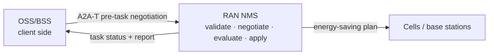
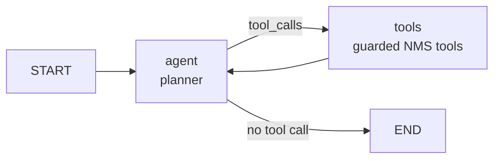

# RAN energy-saving sample: developer guide

> For developers who need to **integrate or change** this interaction. The customer-facing solution
> (business view, system interaction, scenarios, value) is in [README.md](README.md).

## 0. How to read this guide

Pick the path that matches your role. Every path starts by running the sample; none of them requires
reading the protocol first.

| You are | Read | When you finish you can |
| --- | --- | --- |
| just evaluating | 1 | run an offline negotiation and read the interaction in the UI |
| an OSS developer | 1 → 2 → 3 | connect the A2A-T client and plug in your own decision logic |
| an NMS developer | 1 → 2 → 4 | connect the negotiation gate, executor and tools to the real NMS |
| looking up a field or setting | 5 / 6 | find message fields, configuration keys and defaults |

Six terms you will meet immediately (the full glossary is [Appendix A](#appendix-a-glossary)):

| Term | In one line |
| --- | --- |
| A2A | protocol that carries messages and Tasks between agents |
| A2A-T | extension that adds pre-task negotiation and structured task prompts on top of A2A |
| OSS | client-side system: requests the energy-saving goal and decides the answer |
| NMS | execution-side system: validates, negotiates, evaluates, applies and reports |
| Task-T | structured task prompt |
| Negotiation-T | pre-task negotiation message |

## 1. Ten-minute walkthrough (tutorial)

**Goal:** run one offline negotiation without writing code and see what happens between the OSS and
the NMS.
**Before you start:** Python 3.12+, [`uv`](https://docs.astral.sh/uv/), and a checked-out repository.

### 1.1 Install

```bash
# 1. repository root: SDK and development dependencies
uv sync --dev

# 2. a2a-t-sample: sample dependencies (same .venv)
cd a2a-t-sample
uv pip install -r requirements.txt

# 3. activate (run from a2a-t-sample/)
source ../.venv/Scripts/activate        # Git Bash / Windows
# source ../.venv/bin/activate          # Linux / macOS
```

Every `python` below means this interpreter. Without activation, use
`../../.venv/Scripts/python.exe` on Windows or `../../.venv/bin/python` on Linux/macOS.

**Verify:** `python -c "import a2a_t; print(a2a_t.__name__)"` prints without error.

### 1.2 Run one offline negotiation

```bash
cd ran-energy-saving
python run_demo.py --scenario information --mode auto --model-mode offline
```

Offline mode needs no `.env` and no API key: `run_demo.py` falls back to `env.example`.

**Verify:** the run ends with:

```text
[client] final_state=task_completed task_id=<uuid>
[client] report={"ok": true, "summary": "Plan plan-cell-001-001 applied ..."}
[run_demo] stopped 2 background process(es)
```

**Common problems:**

| Symptom | Cause | Fix |
| --- | --- | --- |
| a port is already in use | a previous `--keep-alive` process is still running | `python run_demo.py --stop` |
| `ModuleNotFoundError: a2a_t` | the environment is not active | use the absolute venv Python, or run `uv sync --dev` again |
| startup rejects the language or model mode | an existing process runs with other settings | `--stop` first, then start with the new settings |

### 1.3 Read the interaction in the UI

```bash
python run_demo.py --ui --scenario information --mode auto --model-mode offline
# open http://127.0.0.1:8080
```

Press **Start run** in the left rail, then read the timeline:

- every row carries an **OSS** or **NMS** chip — that is who handled the step;
- the negotiation phase shows proposal → decision → accept;
- the execution phase shows the four tool calls;
- clicking a row opens the message or decision behind it.

**Verify:** the timeline shows both OSS and NMS chips and ends in the completed state.

## 2. Architecture at a glance (explanation)

**Goal:** after this section you can draw the two systems and one run, and you know which file to
open for each change.

### 2.1 Two systems, one negotiation chain



Keep the three layers apart:

| Layer | Owns | Does not own |
| --- | --- | --- |
| A2A (a2a-sdk) | AgentCard discovery, messages, Task events | the meaning of a negotiation |
| A2A-T (a2a_t) | Task-T / Negotiation-T generation, validation, metadata | HTTP connections or agents |
| business | OSS decisions; NMS evaluation and apply | hand-built protocol fields |

In one line: **A2A delivers it, A2A-T makes it meaningful, your business logic decides.**

### 2.2 Lifecycle of one run

| # | Phase | What happens | Main code |
| --- | --- | --- | --- |
| 1 | Dispatch | the client assembles its runtime and discovers the AgentCard | `protocol/client_runtime.py` |
| 2 | Task generation | the natural-language request becomes a Task-T | `protocol/client_flow.py` |
| 3 | Validation | the NMS validates Task-T; a failure opens a negotiation | `protocol/negotiation_gate.py` |
| 4 | Negotiation | propose, decide, counter (at most three rounds) | `negotiation_gate.py`, `decision_provider.py` |
| 5 | Resolution | accept/reject/abort; an accept refills Task-T | `client_flow.py`, `negotiation_gate.py` |
| 6 | NMS execution | evaluate and apply the plan | `server_executor.py`, `agents/server_agent/` |
| 7 | Report | publish the report artifact; the Task completes | `server_executor.py` |
| 8 | Done | write the transcript; the UI replays it | `client_service.py`, `web/` |

### 2.3 Code map: start from the change you need

| You want to change | Start here |
| --- | --- |
| OSS decision logic | `agents/client_agent/` + `protocol/decision_provider.py` |
| OSS protocol loop | `protocol/client_flow.py` |
| OSS conversations and run history | `protocol/client_service.py`, `protocol/client_store.py` |
| expose the OSS as an A2A backend | `protocol/client_gateway.py` |
| NMS negotiation rules | `protocol/negotiation_gate.py`, `protocol/negotiation_policy.py` |
| NMS execution flow | `protocol/server_executor.py`, `agents/server_agent/` |
| connect the real NMS interfaces | `agents/server_agent/tools.py` |
| Task persistence | `protocol/sqlite_task_store.py` |
| Web UI | `web/` |

### 2.4 What is sample code, what you replace

- **Reuse as is:** the A2A-T gate, the deterministic client flow, the client service and store, the
  NMS execution shell, and the TaskStore shape.
- **Replace:** the client decision agent and its tools, the four NMS tool bodies, the planner
  prompt/model, and the conversation/turn schema.
- **Demo only:** the mock registry, the Web UI, the in-process plan store, and the static webhook
  token.

## 3. OSS-side developer guide (how-to)

**Goal:** replace the sample client with your own OSS decision logic without breaking the protocol.
**Before you start:** sections 1 and 2; you know `protocol/client_flow.py` is the protocol loop.

### 3.1 What you implement

| Required | Notes |
| --- | --- |
| AgentCard discovery | registry or direct; see `protocol/discovery.py` |
| Task-T generation and send | generated by the A2A-T SDK, sent by the flow |
| a decision for every proposal | implement `respond(propose, session) -> NegotiationDecision` |
| refill Task-T on accept | fill the values the proposal asked for |
| terminal handling | after reject/abort, stop waiting for a Task |

Optional: conversation memory, manual decisions, an inbound A2A gateway, a UI.

### 3.2 Connect the A2A-T client

One run does three things: build the SDK environment, discover the NMS, assemble the runtime.

```python
# protocol/client_runtime.py (excerpt)
sdk_env = prepare_client_sdk_env(config, env_path)      # per-run SDK .env
discovered = await discover_agent(                       # registry or direct
    discovery=config.discovery,
    organization=AGENT_CARD_ORGANIZATION,
    name=AGENT_CARD_NAME,
    registry_center_url=config.registry_url,
)
runtime = await build_client_runtime(config, scenario, mode, transport)
```

**Why a per-run `.env`:** the A2A-T SDK reads model and endpoint settings from the environment; a
temporary file per run keeps runs from contaminating each other.

**Verify:** the client logs `agent-discovered: url=... discovery=...`.

### 3.3 Plug in your decision logic

A decision answers one question: **accept, reject, abort, or counter**. The flow renders the protocol
content.

```python
class NegotiationDecisionProvider(Protocol):
    async def respond(
        self, propose: NegotiationProposeView, session: NegotiationContext
    ) -> NegotiationDecision: ...
```

The sample ships three implementations:

| Provider | Used by | Behaviour |
| --- | --- | --- |
| `AdkDecisionProvider` | default `--mode auto` | Runs the client ADK agent; returns its structured `NegotiationDecision`. |
| `ManualDecisionProvider` | `--ui --mode manual` | Waits for the Web UI decision; 300 s timeout becomes `Abort`. |
| `ScriptedDecisionProvider` | tests (`MODE_SCRIPTED`; not exposed by `run_demo.py`) | Replays the scenario decisions in order. Offline `auto` mode instead keeps the ADK agent in the loop with the fake model. |

Every provider implements `respond(propose, session) -> NegotiationDecision`. Providers decide
**intent only**; the flow turns it into protocol content and never changes the round.

**Where the ADK session lives.** `AdkDecisionProvider` keeps one ADK session per negotiation, so the
agent still sees the earlier rounds. With `A2AT_SAMPLE_CLIENT_DB` set those sessions are stored in
that same SQLite file and survive a restart; unset (tests, ephemeral runs) keeps them in memory. A
durable session is the audit record of that negotiation — the prompts the agent received, its
answers and the tool results it saw — and is kept for
`A2AT_SAMPLE_ADK_SESSION_RETENTION_DAYS` (default 7). The sweep runs at client startup and, at most
hourly, before a run, so a long-lived process stays bounded. If the database cannot be opened the
provider logs a warning and falls back to memory: a decision never depends on the audit store.

The most common failure when connecting your own model is prose instead of JSON. The sample's
`AdkDecisionProvider` first extracts a JSON object from a fence or surrounding text, then sends one
corrective turn; only then does it raise. Your implementation should at least:

1. produce output that parses into `NegotiationDecision`;
2. include `counter_params` (`cellId`, `window`, `targetRate`) on a counter;
3. put the values the proposal asked for into `filled_params` on accept.

**Verify:** the client logs `decision-made action=... round=...`; the offline five-scenario
`final_state` matches [§5.3](#53-protocol-sequences-of-the-five-scenarios).

### 3.4 Optional: expose the OSS as an A2A backend

If the OSS side must also be callable by Gemini Enterprise or another A2A client, use
`protocol/client_gateway.py`:

```bash
python run_demo.py --ui --gateway --ui-port 8080 --gateway-port 8001 --model-mode offline
```

One inbound `message:send` starts one client run and returns the final report artifact; the inbound
`contextId` becomes the client conversation. The gateway does not replace the outbound A2A-T flow.

### 3.5 Self-check

- [ ] can discover the NMS AgentCard (registry or direct)
- [ ] can generate and send a Task-T
- [ ] produces a valid decision for every proposal
- [ ] refills Task-T parameters on accept
- [ ] reject/abort creates no Task
- [ ] the run record replays and the conversation can continue

**Common problems:**

| Symptom | Cause | Fix |
| --- | --- | --- |
| `DecisionProviderError: ... no parseable NegotiationDecision` | the model did not return JSON | tighten the prompt; keep one corrective retry; offline uses a fallback |
| the gate rejects an accept | Task-T was not refilled from the negotiation | pass `filled_params` through `generate_task_prompt_from_data_with_schema` |
| HTTP 409 `run_conflict` | the conversation already has an active run | wait for it, or use another conversation; the check is process-local |

## 4. NMS-side developer guide (how-to)

**Goal:** connect the negotiation gate, executor and tools to the real network management system.
**Before you start:** sections 1 and 2; you know `protocol/server_app.py` assembles the application.

### 4.1 What you implement

| Required | Notes |
| --- | --- |
| AgentCard | name, description, A2A-T extension declarations; see `shared/agent_card.py` |
| pre-task negotiation | validate Task-T; propose instead of rejecting outright |
| full Task lifecycle | SUBMITTED / WORKING / artifacts / COMPLETED |
| evaluation and apply | replace the sample tools with real NMS interfaces |
| report | final report artifact with A2A-T metadata |

### 4.2 Negotiation gate and policy

[`protocol/negotiation_gate.py`](protocol/negotiation_gate.py) is the server's single protocol
entry. It handles only **pre-task** requests (`context.current_task is None`; `context.task_id` is
not a reliable signal because `RequestContext` generates one in its constructor):

1. An initial Task-T request is validated with
   `validate_task_prompt_and_data_filling(prompt, TASK_PARAM_SCHEMA, TASK_TEMPLATE_URI)`.
2. A validation failure whose first error code maps to a negotiation type becomes the initial
   `Propose`; an unmappable failure becomes a terminal `REJECTED` Task with structured errors.
3. An `Accept` is validated with `validate_accept_prompt_and_data_filling`; the agreed Task-T
   prompt is then validated again and handed to the LangGraph NMS execution.
4. A `Reject` or `Abort` is terminal: the gate answers with a plain message and creates no Task.
5. A client counter-`Propose` is validated with `validate_propose_prompt_and_data_filling`, then
   answered by the policy.

Every SDK call is synchronous, so the gate runs it with `asyncio.to_thread` to keep the server
event loop responsive.

[`protocol/negotiation_policy.py`](protocol/negotiation_policy.py) is a pure function: state in,
`PolicyDecision` out. It never calls an LLM and never sends anything.

| Input | Decision |
| --- | --- |
| Initial validation failure | `propose` (round 1), or `abort` if already at the round budget. |
| Client `Accept` | `execute`. |
| Client `Reject` / `Abort` | `end`. |
| Client counter-`Propose` before `maxRounds` | `propose` at the next round, accepting the counter plan when feasible or revising it otherwise. |
| Client counter-`Propose` at `maxRounds` | `abort`, keeping the current round. |

The server never emits `Accept`: agreement is expressed by publishing a final acceptable
`Propose` that the client can accept. Without a `sampleProposal` (see below), the policy advances
through a preset revision sequence.

### 4.3 Executor and tools: connect the real NMS

NMS execution is a small LangGraph ReAct graph: the model picks a tool, the tool returns structured
output, and the loop continues until the report is generated.



| Tool | Precondition | Purpose |
| --- | --- | --- |
| `get_cell_energy_profile` | none | read the 24-hour load/energy, capacity and available windows |
| `evaluate_energy_saving_plan` | profile read for the same cell | validate window, saving rate and SLA; estimate impact |
| `apply_energy_saving_plan` | the same plan was evaluated successfully | apply the plan (the sample writes an in-process store) |
| `generate_energy_saving_report` | the plan was applied | produce the final report |

`PlanGuard` enforces the order; an out-of-order call returns `tool_order_violation`, and the planner
may correct itself within its step budget. Replacing `agents/server_agent/tools.py` with real NMS
calls keeps the graph shell and the order guard.

**Verify:** the server trace shows four tool spans; the Task ends `COMPLETED` with a report artifact.

### 4.4 Task store and state

`protocol/sqlite_task_store.py` is a minimal A2A `TaskStore`: `save/get/list/delete`, WAL plus a busy
timeout, and persistence errors are logged rather than breaking protocol execution. With
`A2AT_SAMPLE_TASK_DB` set, the Web UI opens the same file read-only to render the task table. Replace
it with your own database in production.

### 4.5 Self-check

- [ ] AgentCard is reachable and declares the A2A-T extensions
- [ ] a Task-T validation failure opens a negotiation instead of rejecting
- [ ] proposals and revisions respect `maxRounds`
- [ ] tools are order-guarded and return structured errors
- [ ] the Task lifecycle is complete and the report carries metadata
- [ ] Task state can be persisted and queried

**Common problems:**

| Symptom | Cause | Fix |
| --- | --- | --- |
| a tool returns `tool_order_violation` | profile/evaluate was skipped | call in order; let the planner retry |
| the planner exceeds its step budget | the model keeps retrying | raise `A2AT_SAMPLE_PLANNER_MAX_STEPS` or tighten the prompt |
| the UI task table is empty | `A2AT_SAMPLE_TASK_DB` is unset | set an absolute path and restart the server |

## 5. Protocol reference

### 5.1 Message shape

Every negotiation message carries:

- `A2A-Extensions: Task-T/v1,Negotiation-T/v1`;
- the rendered Negotiation-T text under the Negotiation-T extension URI;
- `templateUri` — the template the text was rendered from;
- `negotiationContext = {id, round, maxRounds, performative}`.

`protocol/messages.py` is the only place that builds or reads these keys. The negotiation session
id is forced to the A2A `contextId` (sample convention).

### 5.2 Four performatives and round ownership

| Performative | Generated with | Meaning |
| --- | --- | --- |
| `Propose` | `generate_negotiation_propose_prompt_from_text` | Missing information, an ambiguity, an alternative, or a revision. |
| `Accept` | `generate_negotiation_accept_prompt_from_text` | Client accepts; the flow refills the Task-T prompt with `generate_task_prompt_from_data_with_schema`. |
| `Reject` | `generate_negotiation_reject_prompt_from_text` | Client declines; terminal. |
| `Abort` | `generate_negotiation_abort_prompt_from_text` | Server (at `maxRounds`) or client ends the session; terminal. |

Round rules:

- The **server** initiates and is the only side that advances the round (`round = 1` for its first
  `Propose`, then `round + 1` for each revision).
- The **client** always uses `session.with_performative(...)`, keeping the inbound round; it never
  calls `next_round()`.
- `maxRounds = 3`. At round 3 a counter-proposal cannot be followed by a server confirmation, so
  the server aborts at round 3 instead of advancing past the budget.

Negotiation content uses **`fromText` only**. (`fromData` for Negotiation-T is out of scope for
this sample; the Task-T accept refill uses the separate `fromDataWithSchema` API.)

### 5.3 Protocol sequences of the five scenarios

All sequences are initiated by the server. `S` = server, `C` = client; parentheses show the round.
The expected sequences are asserted by `tests/test_scenarios.py` and `tests/test_client_flow.py`.

| Scenario | Business reading | Trigger | Negotiation sequence | Final state |
| --- | --- | --- | --- | --- |
| `information` | Missing value: the NMS asks, the OSS fills it | The Task-T request omits the time-segmented guaranteed throughput target (`content.param_missing`). | `S:Propose(1)` → `C:Accept(1)` | Task `COMPLETED` + report (`task_completed`) |
| `target` | Conflicting segments: correct the overlap before executing | The guaranteed-throughput target has overlapping time segments (`content.value_not_allowed`). | `S:Propose(1)` → `C:Propose(1)` (counter) → `S:Propose(2)` (revision) → `C:Accept(2)` | Task `COMPLETED` + report (`task_completed`) |
| `feasibility` | Infeasible conditions: the NMS proposes an alternative | A guaranteed rate conflicts with an 18-hour power outage (`content.rule_violation`). | `S:Propose(1)` (alternative plan) → `C:Accept(1)` | Task `COMPLETED` + report (`task_completed`) |
| `reject` | The OSS cannot provide the value: the negotiation ends | The client cannot provide the missing throughput target. | `S:Propose(1)` → `C:Reject(1)` → `S:Message("协商已结束")` | No Task (`no_task_negotiation_ended`) |
| `abort` | No convergence: the NMS aborts after the round budget | The client keeps counter-proposing a plan the policy cannot accept. | `S:Propose(1)` → `C:Propose(1)` → `S:Propose(2)` → `C:Propose(2)` → `S:Propose(3)` → `C:Propose(3)` → `S:Abort(3)` | No Task (`no_task_negotiation_aborted`) |

Notes:

- `target` keeps the client counter-proposal in round 1; only the server's revised plan advances
  to round 2, and the client's `Accept` stays in round 2.
- `reject` and `abort` never create a Task. `reject` ends with a plain A2A `Message` that carries
  no Negotiation-T metadata; `abort` is generated with the common abort template at
  `round = maxRounds = 3`.
- The mapping from the first Task-T validation error code to a negotiation type
  (`content.param_missing` → information, `content.value_not_allowed` → target,
  `content.rule_violation` → feasibility) is a **sample convention**, not an A2A-T contract. It is
  implemented in `NEGOTIATION_KIND_BY_ERROR_CODE` in
  [`protocol/negotiation_policy.py`](protocol/negotiation_policy.py).

### 5.4 `sampleProposal`: a sample-only convention

A client counter-proposal may carry:

```json
"metadata": {"sampleProposal": {"cellId": "cell-001", "window": "00:00~06:00", "targetRate": "30"}}
```

`sampleProposal` is **not an A2A-T protocol field**. It lets the deterministic policy evaluate the
counter-proposal with `shared.ran_data.evaluate_plan`, so the offline demo behaves reproducibly. If
it is absent, the protocol still works: the policy advances through its preset revision sequence.
The key is defined in [`protocol/messages.py`](protocol/messages.py) and parsed in
[`protocol/negotiation_policy.py`](protocol/negotiation_policy.py).

## 6. Configuration reference

All sample keys are read by [`shared/config.py`](shared/config.py), `run_demo.py`, or the A2A-T
SDK. `run_demo.py` reads `A2AT_SAMPLE_UI_PORT` only as the default of `--ui-port`; passing
`--ui-port` overrides it. Full template: [`env.example`](env.example) (also
[`../env.example`](../env.example)).

| Key | Values | Effect |
| --- | --- | --- |
| `A2AT_SAMPLE_MODEL_MODE` | `offline` (default), `live` | `offline` = scripted SDK provider + deterministic client ADK fake model + scripted LangGraph planner; `live` = SDK on both sides, client ADK model and server LangGraph planner use the OpenAI-compatible endpoint. |
| `A2AT_LANGUAGE` | `en-US`, `zh-CN` (default `zh-CN` when unset; `run_demo.py` defaults to `en-US`) | Process-level language for templates, canned responses, registry/server/client. Not switchable per run; the Web UI only displays it. |
| `A2AT_SAMPLE_HOST` / `A2AT_SAMPLE_PORT` | default `127.0.0.1` / `8000` | Server bind and advertised AgentCard interface. |
| `REGISTRY_CENTER_HOST` / `REGISTRY_CENTER_PORT` | default `127.0.0.1` / `5001` | Mock registry bind and lookup URL. |
| `A2AT_SAMPLE_DISCOVERY` | `registry` (default), `direct` | Discovery mode. |
| `A2AT_SAMPLE_DIRECT_SERVER_URL` | default `http://127.0.0.1:8000` | Base URL read by `direct` discovery. |
| `A2AT_SAMPLE_TRANSPORT` | `sse` (default), `webhook` | Client event transport. |
| `A2AT_SAMPLE_WEBHOOK_PORT` | default `9000` (`0` = ephemeral) | Embedded webhook receiver port. |
| `A2AT_SAMPLE_WEBHOOK_TOKEN` | default `demo-webhook-token` | Static push token checked against `X-A2A-Notification-Token`. |
| `A2AT_SAMPLE_WEBHOOK_IDLE_TIMEOUT` | default `300` (the HTTP budget) | Seconds without a push before a webhook phase ends; a phase must not end before the client gives up. |
| `A2AT_SAMPLE_HTTP_TIMEOUT_SECONDS` | default `300` (> 0) | Client HTTP budget of one A2A request: the `httpx` client timeout and `ClientCallContext.timeout` of every send. |
| `A2AT_SAMPLE_LLM_TIMEOUT_SECONDS` | default `120` (> 0) | Live LLM budget of one call (SDK structured call or ADK `LiteLlm` turn), written into the per-run SDK `.env`. |
| `A2AT_SAMPLE_LLM_MAX_ATTEMPTS` | default `1` (`1`..`10`) | Live SDK protocol retry limit per retryable step, written into the per-run SDK `.env`; OpenAI transport retries are disabled separately. |
| `A2AT_SAMPLE_UI_HOST` | default `127.0.0.1` | Default bind host of the Web UI; read by `run_demo.py` as the default of `--ui-host`. Use `0.0.0.0` to expose it on all interfaces (trusted networks only). |
| `A2AT_SAMPLE_UI_PORT` | default `8080` | Default bind port of the Web UI; read by `run_demo.py` as the default of `--ui-port`. |
| `A2AT_SAMPLE_TRACE_URL` | unset; `--ui` sets `http://127.0.0.1:<ui_port>` | Server trace endpoint (Web UI). Local demo only; the server POSTs spans there. |
| `A2AT_SAMPLE_TRACE_TOKEN` | unset; `--ui` mints a random token | Local token the server presents and the UI requires; unset disables ingestion (fails closed). |
| `A2AT_SAMPLE_TRACE_DIR` | unset; CLI sets `<sample>/runs` | Directory of the CLI server trace (`<dir>/<runId>/server-trace.jsonl`). |
| `A2AT_SAMPLE_TASK_DB` | unset = in-memory; `run_demo.py` writes `<sample>/runs/task-status.sqlite3` | Absolute SQLite path of the server's persisted A2A Task store, also read by `GET /api/tasks`. |
| `A2AT_SAMPLE_CLIENT_DB` | unset = in-memory; `run_demo.py` writes `<sample>/runs/client-state.sqlite3` | Absolute SQLite path of the client's conversation/run/negotiation store and of the ADK decision-agent sessions. |
| `A2AT_SAMPLE_CLIENT_MEMORY_TURNS` | default `6` (>= 0) | Number of recent conversation turns injected into the next decision prompt and Task-T generation. |
| `A2AT_SAMPLE_ADK_SESSION_RETENTION_DAYS` | default `7` (>= 1) | Days a decision-agent session is kept as audit data before the startup/periodic sweep removes it. |
| `A2AT_SAMPLE_GATEWAY_HOST` / `A2AT_SAMPLE_GATEWAY_PORT` | default `127.0.0.1` / `8001` | Optional inbound A2A gateway bind and advertised AgentCard interface. |
| `A2AT_SAMPLE_GATEWAY_REGISTER` | `0` (default), `1` | Register the gateway AgentCard with the registry center. |
| `A2AT_SAMPLE_GATEWAY_SCENARIO` | default `information` | Scenario used for an inbound gateway request. |
| `A2AT_SAMPLE_PLANNER_MODEL` | default: the ADK model without its `openai/` prefix | LangChain model id of the server planner. |
| `A2AT_SAMPLE_PLANNER_API_BASE` / `A2AT_SAMPLE_PLANNER_API_KEY` | default: the ADK endpoint/key | Server planner endpoint. |
| `A2AT_SAMPLE_PLANNER_TIMEOUT_SECONDS` | default `120` (> 0) | Per-call server planner budget. |
| `A2AT_SAMPLE_PLANNER_MAX_STEPS` | default `12` (> 0) | LangGraph recursion limit of one accepted Task. |
| `ADK_MODEL_PROVIDER` | `litellm` | Client ADK model provider (only LiteLlm is implemented by this sample). |
| `ADK_MODEL_NAME` | default `openai/mass/volcengine/deepseek-v4.1-flash` | LiteLlm model id (provider prefix required). |
| `ADK_MODEL_API_BASE` | default `http://127.0.0.1:31943/v1` | OpenAI-compatible endpoint. |
| `ADK_MODEL_API_KEY` | default `not-needed` | Endpoint key. |
| `A2AT_LLM_PROVIDER` | `openai_traced` in live mode; overridden to `scripted_traced` offline | SDK provider (traced wrappers of `openai` / `scripted`; the trace capture never changes behavior). |
| `A2AT_LLM_MODEL` | default `mass/volcengine/deepseek-v4.1-flash` | SDK model id (no LiteLlm prefix). |
| `A2AT_LLM_API_KEY` | default `not-needed`; overridden offline | SDK endpoint key. |
| `A2AT_LLM_BASE_URL` | default `http://127.0.0.1:31943/v1` | SDK endpoint base URL. |
| `A2AT_LLM_MAX_TOKENS`, `A2AT_LLM_TEMPERATURE`, `A2AT_LLM_TIMEOUT_SECONDS` | SDK defaults (`A2AT_LLM_TIMEOUT_SECONDS` is overridden per run) | Structured-call limits. The per-run SDK `.env` always uses `A2AT_SAMPLE_LLM_TIMEOUT_SECONDS` / `A2AT_SAMPLE_LLM_MAX_ATTEMPTS`. |
| `A2AT_LLM_DETAIL_LOG_ENABLED` | `false` (default) | Print full LLM payloads (debug; may expose sensitive content). |
| `A2AT_SAMPLE_LOG_LEVEL` | `INFO` (default) | Root log level: `DEBUG` / `INFO` / `WARNING` / `ERROR` / `CRITICAL`. |
| `A2AT_SAMPLE_LOG_FORMAT` | `text` (default) or `json` | One line per record; `json` carries `runId` / `conversationId` / `taskId` / `contextId` / `negotiationId` / `round` as top-level fields. |

**Offline mode.** Before constructing `A2ATClient` / `A2ATServer`, the runtimes register the traced
wrappers (`scripted_traced`, live `openai_traced`) and build a temporary SDK `.env` with
`A2AT_LLM_PROVIDER=scripted_traced`, `A2AT_LLM_MODEL=scripted`, `A2AT_LLM_API_KEY=not-needed`. The
source `.env` is never modified. The client ADK agent uses `shared/adk_fake_model.py`; the server
planner uses `ScriptedChatModel`, which emits the four sample tool calls in order. Logs and the Web
UI label the run `offline (scripted)`.

**Live mode.** The SDK on both sides, the client ADK agent and the server LangGraph planner use the
configured endpoint. The tools remain deterministic and guarded; only the planner's tool choice and
parameters are model-driven. On Windows, keep `PYTHONUTF8=1` (`run_demo.py` sets it for its
children). Live output depends on the model's extraction, semantic validation and planning; see §1.1.

**Timeout budgets.** The client sends every A2A request with `A2AT_SAMPLE_HTTP_TIMEOUT_SECONDS`
(300s default) in `ClientCallContext.timeout`, and the `httpx` client uses the same budget. In live
mode the server gate performs several LLM calls before it emits any event, so the client budget must
outlast that worst case; the old fixed 60s made the client give up while the server was still
working (`A2AClientTimeoutError`). Live LLM calls have a **120s per-call budget** (shared by SDK
structured calls and client ADK `LiteLlm` turns; raise it for slower endpoints). The per-run SDK `.env`
carries `A2AT_LLM_TIMEOUT_SECONDS=120` and `A2AT_LLM_MAX_ATTEMPTS=1`. The OpenAI SDK's own transport
retries are disabled by the traced provider, and LiteLLM is built with `num_retries=0`, so one call
cannot silently become three attempts; a stuck call fails within the configured budget and the gate
answers with a structured protocol error message the client can display. Offline mode is unaffected
(the scripted provider makes no network call). The webhook idle backstop follows the same rule and
defaults to the 300s HTTP budget, so it cannot end a phase while the client is still waiting.

Existing `.env` files that set `A2AT_SAMPLE_WEBHOOK_IDLE_TIMEOUT=30` or `A2AT_LLM_TIMEOUT_SECONDS=60`
should be updated or removed: the new sample keys are `A2AT_SAMPLE_HTTP_TIMEOUT_SECONDS=300`,
`A2AT_SAMPLE_LLM_TIMEOUT_SECONDS=120`, and `A2AT_SAMPLE_LLM_MAX_ATTEMPTS=1`.

**Ports.** Defaults are server `8000`, registry `5001`, webhook `9000`, Web UI `8080` and the
optional A2A gateway `8001`, all on `127.0.0.1`. `run_demo.py` writes these into the per-run `.env`
it hands to the child processes. The UI binds loopback by default; `--ui-host 0.0.0.0` (or
`A2AT_SAMPLE_UI_HOST=0.0.0.0`) exposes it on all interfaces. The server-to-UI trace POST still
targets `127.0.0.1`, which is correct when the UI and server run on the same host. The demo UI and
gateway have no authentication, so only expose them on a trusted network.

## 7. Testing and acceptance

Run from `a2a-t-sample/ran-energy-saving`, with the sample dependencies installed:

```bash
PYTHONPATH=. python -m pytest tests -q
python -m ruff check shared agents protocol web tests run_demo.py
```

(`python` must be the environment activated in §1.1; without activation use
`../../.venv/Scripts/python.exe` on Windows or `../../.venv/bin/python` on Linux/macOS.)

The suite is fully offline and deterministic (420 tests). What it covers:

| Test module | Coverage |
| --- | --- |
| `test_policy.py` | Every policy decision and round rule, including the abort at `maxRounds` and the error-code mapping. |
| `test_negotiation_gate.py` | Message classification, Task-T/Negotiation-T validation calls, round advance, terminal handling, and the real offline server. |
| `test_client_flow.py` | Five scenario flows, accept/counter/reject/abort message construction, the `sampleProposal` convention, and both transports. |
| `test_decision_provider.py` | Contract of the ADK, manual, and scripted providers, including manual timeout, durable session storage, the in-memory fallback and the retention sweep. |
| `test_scenarios.py` | End-to-end acceptance: a real server + real client + client ADK fake model, asserting the exact performative/round sequence and final state. |
| `test_transports.py` | SSE and webhook produce the same performative sequence. |
| `test_web_ui.py` | `/api/meta`, `/api/tasks`, `/api/client/runs`, `/api/client/conversations`, run lifecycle, SSE events, manual decisions, downloads, error statuses, plus a real offline information run (8 phases, monotonic `seq`, a decision before the task events it causes, client LLM spans, server planner/tool spans, `trace.json`) and a real manual decision flow. |
| `test_web_static.py` | Static contract: served assets and module graph, no `innerHTML`, inspector tabs and CSS tokens, every element id used by `main.js` exists in the shell; runs `node --check` on every JS module and the in-repo `tests/js` store, i18n and real-frame harnesses (skipped without Node). |
| `test_server_executor.py` | LangGraph Task lifecycle, report metadata, planner failure path, gate delegation, AgentCard extensions, registry payload. |
| `test_server_planner.py` | Scripted planner sequence, guarded tool order, offline/live model selection, prompt content. |
| `test_client_store.py` | Conversation/turn sequencing, run idempotency, negotiation audit, Task snapshots, stale-run sweep, read-only helpers. |
| `test_client_service.py` | Run persistence, conversation memory, one active run per conversation, failure/interrupt handling. |
| `test_client_gateway.py` | Inbound A2A message -> one run -> report artifact, conflict handling, cancellation, gateway card. |
| `test_sqlite_task_store.py` | Task save/get/delete, list filters/pagination, summaries/run ids, concurrent saves, read-only missing DB. |
| `test_server_tools.py`, `test_ran_data.py` | The four tools and the in-memory dataset. |
| `test_scripted_llm.py`, `test_adk_fake_model.py` | Schema routing and the deterministic client ADK model. |
| `test_config.py`, `test_scenario.py`, `test_transcript.py`, `test_client_runtime.py` | Configuration (including both databases, gateway and planner keys), scenario definitions, transcripts, runtime assembly, and the server import that must not load ADK. |
| `test_logging_setup.py` | Text/JSON format, context propagation into child tasks, credential redaction, and the environment-driven configuration. |
| `test_run_demo.py` | Launcher defaults and PID reuse: compatible metadata reuses, a model-mode/language/token mismatch restarts, a foreign listener is refused. |

The JS harnesses live in [`tests/js`](tests/js): `store.test.mjs` replays synthetic frames and
`frames.test.mjs` replays the real SSE frames of the offline integration run. Both run from
`pytest` and skip cleanly when `node` is not installed.

### Five-scenario offline smoke

```bash
for s in information target feasibility reject abort; do
  python run_demo.py --scenario "$s" --mode auto --model-mode offline
done
```

Expected `[client] final_state` values:

| Scenario | `final_state` |
| --- | --- |
| `information` | `task_completed` |
| `target` | `task_completed` |
| `feasibility` | `task_completed` |
| `reject` | `no_task_negotiation_ended` |
| `abort` | `no_task_negotiation_aborted` |

### Transport and UI smoke

```bash
python run_demo.py --scenario information --mode auto --model-mode offline --transport webhook
python run_demo.py --scenario target --mode auto --model-mode offline --transport webhook
```

Both reach `task_completed`; the client logs
`[client] webhook-mode: push_url=http://127.0.0.1:9000/webhook`.

```bash
python run_demo.py --ui --ui-port 8080 --scenario information --model-mode offline
curl http://127.0.0.1:8080/api/meta
```

The UI smoke is confirmed when `/api/meta` returns the language, model mode, scenarios, modes,
transports, and defaults shown in §1.1, and `/api/client/runs` returns the run with its turns.

### Gateway smoke

```bash
python run_demo.py --ui --gateway --ui-port 8080 --gateway-port 8001 --model-mode offline
curl -X POST http://127.0.0.1:8001/message:send \
  -H 'Content-Type: application/json' -H 'A2A-Version: 1.0' \
  -d '{"message":{"messageId":"m1","role":"ROLE_USER","contextId":"conv-gw",
       "parts":[{"text":"Maximize energy saving while keeping the throughput target."}]}}'
curl 'http://127.0.0.1:8080/api/client/runs?limit=5'
```

The gateway response is a `TASK_STATE_COMPLETED` Task with an `energy saving intent report`
artifact; `/api/client/runs` shows the corresponding client run and conversation. The sample was
verified end to end with this exact sequence in offline mode.

### Live smoke

```bash
python run_demo.py --scenario target --mode auto --model-mode live
```

Requires a reachable OpenAI-compatible endpoint. The command is exercised manually; it is not part
of the automated suite because output depends on the model. The client negotiation is model-driven
and the server planner chooses the NMS tool calls; the tools and their order guards are
deterministic. Offline mode remains the authoritative, reproducible demonstration.

Each run writes `runs/<timestamp>-<scenario>.json` and `.md` (gitignored). The Markdown file
contains the two-way timeline and the decisions table.

## 8. Production checklist

The sample is deliberately a prototype. Before production:

- **Persistence.** The two SQLite stores are the demo persistence layer: server Tasks
  (`protocol/sqlite_task_store.py`) and client conversations/runs/negotiations
  (`protocol/client_store.py`). Production should use your database and migrations. Plans still
  live in a process-local store (`shared/ran_data._PLANS`) and push configs use
  `InMemoryPushNotificationConfigStore`. Client ADK decision sessions are kept as audit data for
  `A2AT_SAMPLE_ADK_SESSION_RETENTION_DAYS` (default 7) and then swept; they contain prompts and tool
  results, so set the window from your audit and data-protection requirements, and size the client
  database for it. The LangGraph NMS execution uses no persistent checkpointer; add one only if you
  need resume-after-restart semantics. The server has no ADK session.
- **Logging.** One stdlib stream serves the client, the NMS and the gateway. Set
  `A2AT_SAMPLE_LOG_FORMAT=json` for a collector; each record carries `runId` / `conversationId` /
  `taskId` / `contextId` / `negotiationId` / `round`, so one negotiation can be followed across
  processes. Credentials are redacted, and prompts or tool results are summarized rather than
  dumped at `info`.
- **Registry.** `registry/` is a mock. Use the deployment's real registry center or configure
  `direct` discovery with a stable AgentCard endpoint.
- **Webhook security.** `A2AT_SAMPLE_WEBHOOK_TOKEN` is a static demo token. Use per-client secrets,
  rotation, replay protection, and TLS; treat the receiver as an exposed HTTP endpoint.
- **Authentication and TLS.** The A2A server, the inbound gateway and the registry have no
  authentication in this sample. Terminate TLS and add authentication/authorization at the gateway
  or in the A2A layer; the gateway's `A2A-Version: 1.0` and AgentCard are not security controls.
- **Model governance.** Live mode sends prompts and extracted parameters to the configured model
  endpoint, and the server LangGraph planner sends the accepted Task-T plus tool results. Apply data
  classification, redaction, rate limits, and provider agreements. Keep
  `A2AT_LLM_DETAIL_LOG_ENABLED=false` outside debugging.
- **Deterministic code owns protocol correctness.** Keep rounds, performatives, terminal states,
  and Task lifecycle in deterministic code; let the LLM produce intent, text, and tool calls only.
- **Offline machinery is test-only.** `shared/scripted_llm.py`, `shared/adk_fake_model.py`,
  `resources/mock_llm/`, and `shared/scenario.py` exist to make demos and tests reproducible; do
  not ship them as production paths.
- **Run concurrency.** The client service allows one active run per conversation and independent
  conversations concurrently; the Web UI is still a developer tool, not a multi-tenant console.
  Multi-process deployments also need a shared concurrency/locking mechanism beyond the per-process
  check.
- **SDK scope.** This sample does not modify `src/a2a_t/`. SDK defects should be handled as
  separate SDK changes, not patched inside the sample.
- **Gemini Enterprise.** Gemini Enterprise consumes an A2A AgentCard registered in Google Cloud
  Agent Registry; the card advertises the service URL and interfaces, while conversation continuity
  remains the agent's responsibility (`contextId`/`taskId` + a durable conversation/session store).
  This sample's optional gateway is that inbound surface; its client `conversations`/`turns` store is
  the memory seam. See the official registration guide:
  <https://docs.cloud.google.com/gemini/enterprise/docs/register-and-manage-an-adk-agent>.

## Appendix A. Glossary

| Term | Meaning |
| --- | --- |
| A2A | Agent2Agent protocol: transports messages and Tasks between agents. |
| A2A-T | The A2A-T SDK extension used here: `Task-T` (structured task prompts) and `Negotiation-T` (pre-task negotiation messages). |
| ADK | Google Agent Development Kit: builds the client `LlmAgent`, its tools, `Runner`, and sessions. The server does not use ADK. |
| RAN | Radio Access Network: the radio cells and their energy/load behaviour. |
| SLA | Service Level Agreement: the guaranteed throughput floor a cell must keep. |
| OSS / BSS | Operations / Business Support Systems: the **client side** of this sample — the operator system that requests energy saving and decides the negotiation answer. |
| NMS | Network Management System: the **execution side** of this sample — the RAN network management agent that validates and negotiates the task, then evaluates and applies the energy-saving plan on the cells. |
| OCS | Online Charging System: a production charging integration target, not part of this sample. |

## Appendix B. File map and replace checklist

### B.1 Directory

| Path | Responsibility |
| --- | --- |
| [`run_demo.py`](run_demo.py) | Multi-process launcher: starts registry, server and (with `--gateway`) the inbound A2A gateway in the background, runs the CLI client in the foreground (or serves the Web UI with `--ui`), and stops the children afterwards. |
| [`env.example`](env.example) | Unified offline-ready configuration template. |
| [`agents/server_agent/`](agents/server_agent) | Server-side LangGraph execution: `planner.py` (scripted/live model + prompt), `langgraph_tools.py` (guarded tools + `PlanGuard`), `graph.py` (ReAct state graph), `tools.py` (pure NMS tools). No ADK. |
| [`agents/client_agent/`](agents/client_agent) | Client ADK decision agent: `agent.py` exports `root_agent`; `tools.py` holds the SLA and impact tools; `prompts/request_instruction.md` is the instruction. |
| [`protocol/negotiation_gate.py`](protocol/negotiation_gate.py) | The server's only protocol entry: identifies pre-task requests, validates Task-T / Negotiation-T messages, and forwards accepted requests. |
| [`protocol/negotiation_policy.py`](protocol/negotiation_policy.py) | Pure deterministic server policy: `propose`, `abort`, `execute`, or `end`. Never calls an LLM. |
| [`protocol/server_executor.py`](protocol/server_executor.py) | Outer negotiation executor plus `LangGraphTaskExecutor`: runs the ReAct planner and publishes the A2A Task lifecycle. No ADK. |
| [`protocol/sqlite_task_store.py`](protocol/sqlite_task_store.py) | SQLite `TaskStore` for persisted A2A Task state and the UI task summaries. |
| [`protocol/server_app.py`](protocol/server_app.py) | Server assembly: AgentCard (declares `Task-T/v1` and `Negotiation-T/v1`), request handler, Starlette app, registry registration. |
| [`protocol/client_flow.py`](protocol/client_flow.py) | Client protocol flow: initial Task-T, multi-round negotiation, accept refill, and terminal handling over SSE or webhook. |
| [`protocol/client_runtime.py`](protocol/client_runtime.py) | Client per-run assembly: per-run SDK `.env`, discovery, SDK client, transport, and decision provider. |
| [`protocol/client_service.py`](protocol/client_service.py) | Client application service: conversations, run lifecycle, memory injection, per-conversation concurrency, persistence hooks. |
| [`protocol/client_store.py`](protocol/client_store.py) | Client SQLite store: conversations, turns, runs, negotiation audit, Task snapshots. |
| [`protocol/client_gateway.py`](protocol/client_gateway.py) | Optional inbound A2A gateway: one inbound message -> one client run -> final report artifact. |
| [`protocol/decision_provider.py`](protocol/decision_provider.py) | Decision-provider protocol and the ADK, manual, and scripted implementations. |
| [`protocol/discovery.py`](protocol/discovery.py) | AgentCard discovery through the registry center or `/.well-known/agent-card.json`. |
| [`protocol/messages.py`](protocol/messages.py) | A2A-T metadata helpers: extension URIs, `templateUri`, `negotiationContext`, end message, sample-only metadata. |
| [`protocol/transcript.py`](protocol/transcript.py) | Structured run transcript written to `runs/<timestamp>-<scenario>.json` and `.md`. |
| [`shared/config.py`](shared/config.py) | Reads `.env`, resolves both database paths, gateway and planner settings, and builds the client ADK model (fake model offline, `LiteLlm` live). |
| [`shared/agent_card.py`](shared/agent_card.py) | AgentCard identity constants shared by the client (discovery) and the server (card build). |
| [`shared/sdk_env.py`](shared/sdk_env.py) | Per-run SDK `.env` builder shared by both runtimes (no client↔server import). |
| [`shared/models.py`](shared/models.py) | `NegotiationDecision` (client `output_schema`) and the provider-facing proposal view. |
| [`shared/scenario.py`](shared/scenario.py) | Five scenario definitions: requests, expected performative/round sequence, terminal state, offline decisions. |
| [`shared/task_schema.py`](shared/task_schema.py) | Caller parameter schema used by server validation and client accept refill. |
| [`shared/ran_data.py`](shared/ran_data.py) + [`resources/ran_data/cells.json`](resources/ran_data/cells.json) | In-memory RAN dataset, plan evaluation, and process-local plan store. |
| [`shared/scripted_llm.py`](shared/scripted_llm.py) + [`resources/mock_llm/`](resources/mock_llm) | Scripted SDK `LLMClient` registered with the official factory; schema-routed canned responses. |
| [`shared/adk_fake_model.py`](shared/adk_fake_model.py) | Deterministic client ADK `BaseLlm` used offline and in tests. |
| [`shared/registry_client.py`](shared/registry_client.py) | Registry center register/query HTTP calls. |
| [`shared/webhook_receiver.py`](shared/webhook_receiver.py) | Embedded webhook push receiver with token validation. |
| [`shared/sse_event_consumer.py`](shared/sse_event_consumer.py) | Normalizes A2A stream events into one event shape. |
| [`registry/`](registry) | Mock registry center (AgentCard register/query, port 5001). |
| [`web/`](web) | Starlette Web UI (`app.py`) and the single-page front end (`static/index.html`). |
| [`tests/`](tests) | Unit, integration, transport, Web UI, and five-scenario offline acceptance tests; `tests/js/` holds the Node harnesses run by pytest. |

### B.2 Replace checklist

`KEEP` means the file is protocol/plumbing you can reuse as-is; `REPLACE` means it contains
sample business content or demo-only machinery.

#### Client side

| File / function | Verdict | Why |
| --- | --- | --- |
| `protocol/client_flow.py` (`run_client_flow`) | KEEP | Protocol correctness: message sequence, metadata, transports, terminal handling. |
| `protocol/decision_provider.py` (`NegotiationDecisionProvider`, `AdkDecisionProvider`) | KEEP | The ADK integration and decision contract. |
| `agents/client_agent/agent.py` (`build_client_agent`) | KEEP | ADK wiring; replace only if your agent graph differs. |
| `agents/client_agent/prompts/request_instruction.md` | **REPLACE** | Your client's policy and wording. |
| `agents/client_agent/tools.py` (`get_sla_policy`, `evaluate_proposal_impact`) | **REPLACE** | Read your SLA/catalog systems instead of the in-memory dataset. |
| `shared/scenario.py` (scripted decisions, user requests) | **REPLACE** | Demo inputs; keep only for offline demos/tests. |
| `protocol/client_runtime.py` | KEEP | Per-run assembly; adapt the SDK endpoint values via configuration. |
| `protocol/client_service.py` | KEEP | Conversation identity, run lifecycle, memory and per-conversation concurrency. |
| `protocol/client_store.py` | KEEP | Minimal durable client store; swap for your database in production. |
| `protocol/client_gateway.py` | KEEP (adapt the AgentCard/identity) | Optional inbound A2A surface; replace the demo agent card, auth and registration. |
| `shared/scripted_llm.py`, `shared/adk_fake_model.py`, `resources/mock_llm/` | KEEP (offline/test only) | Deterministic tests; never use them in production. |
| `web/app.py`, `web/static/index.html` | KEEP or REPLACE | Developer UI; replace with your own UI if needed. |
| `shared/models.py` (`NegotiationDecision`) | KEEP | Extend fields only if your decision needs more payload. |

#### Server side

| File / function | Verdict | Why |
| --- | --- | --- |
| `protocol/negotiation_gate.py` (`NegotiationGate`) | KEEP | Protocol entry and validation/short-circuit logic. |
| `protocol/server_executor.py` (`NegotiationAgentExecutor`, `LangGraphTaskExecutor`) | KEEP the shell | The A2A lifecycle, graph loop and gate wiring are reusable; the planner prompt/model and tools are business logic. |
| `agents/server_agent/planner.py` | **REPLACE** the prompt/model policy | Keep the `ScriptedChatModel` for offline tests; point the live model at your endpoint and prompt. |
| `agents/server_agent/langgraph_tools.py` (`PlanGuard`, tool wrappers) | **REPLACE** the order rules | Keep the wrapper shape; adapt the business preconditions. |
| `protocol/sqlite_task_store.py` (`SqliteTaskStore`) | KEEP | Minimal durable A2A TaskStore; swap for your database in production. |
| `protocol/server_app.py` (`build_agent_card`, `build_server_runtime`) | KEEP | Assembly; replace card metadata/provider URL and TaskStore. |
| `protocol/negotiation_policy.py` (`decide` and rule helpers) | REPLACE the rules, KEEP the shape | The state machine is reusable; the business rules and proposal texts are sample-specific. |
| `agents/server_agent/tools.py` (four tools) | **REPLACE** | Wire real RAN network-management operations. |
| `shared/ran_data.py`, `resources/ran_data/cells.json` | **REPLACE** | In-memory demo data and plan store. |

#### Both sides

| File / function | Verdict | Why |
| --- | --- | --- |
| `protocol/messages.py` | KEEP | A2A-T metadata assembly/parsing. |
| `protocol/discovery.py` | KEEP | Registry/direct discovery. |
| `shared/task_schema.py` + `TASK_TEMPLATE_URI` | **REPLACE** if the template differs | The caller schema and template are the contract both parties agree on. |
| `shared/config.py`, `env.example`, `.env` | **REPLACE values** | Endpoint, ports, language, discovery, transport. |
| `registry/` | **REPLACE** | This is a mock registry center; use your deployment's registry or bypass discovery. |
| `shared/webhook_receiver.py` + `A2AT_SAMPLE_WEBHOOK_TOKEN` | REPLACE auth, KEEP receiver | The static demo token is not production authentication. |
| `protocol/transcript.py` | KEEP | Run records; adapt the output directory if needed. |
| `run_demo.py` | KEEP (development only) | Three-process launcher, not a deployment tool. |
| `tests/` | KEEP / adapt | Replace scenario assertions with your own acceptance cases. |
